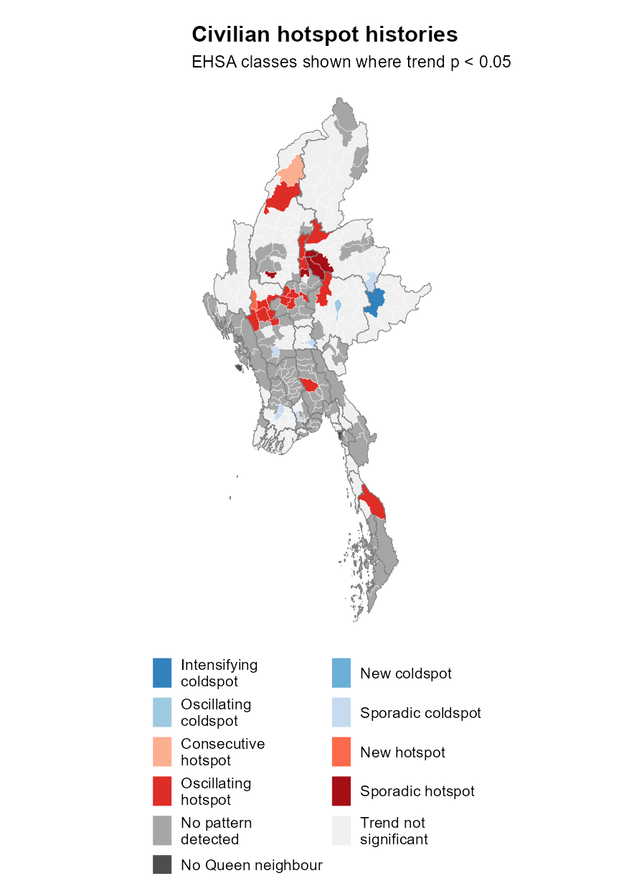
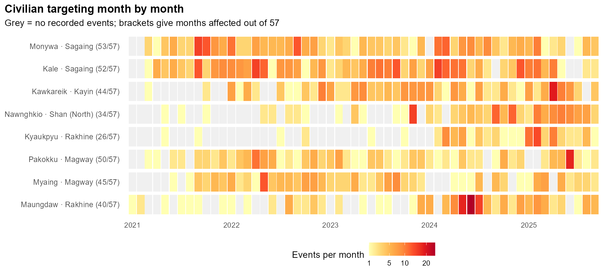

```{r}
#| include: false
if (.Platform$OS.type == "windows") invisible(Sys.setlocale("LC_CTYPE", "English_United States.utf8"))
library(tidyverse)
library(sf)
a <- readRDS("data/take-home-02/derived/analysis.rds")
fmt <- function(x) format(round(x), big.mark = ",", scientific = FALSE, trim = TRUE)
hot <- a$local$gi_cluster == "Hotspot"
civ_hot <- a$civilian$gi_cluster == "Hotspot"
air <- a$subtypes %>% filter(sub_event_type == "Air/drone strike")
abductions <- a$subtypes %>% filter(sub_event_type == "Abduction/forced disappearance")
monywa <- a$recurrence %>% filter(TS == "Monywa")
civilian_ehsa <- a$civilian_time$ehsa %>%
  left_join(st_drop_geometry(a$towns) %>% select(TS_PCODE, TS, ST), by = "TS_PCODE")
reference <- a$reference_comparison %>% filter(!is.na(trend_p_whole))
```

## Conflict and continuing needs {#conflict-across-330-townships}

After the February 2021 coup, fighting spread into central Myanmar alongside the long-running conflicts in border states. By September 2025, close to **3.6 million people were displaced**. Restrictions on movement and aid access disrupted daily life. [OCHA, September 2025](https://myanmar.un.org/en/302070-myanmar-humanitarian-update-no-49)

The report follows `r fmt(a$validation$retained)` recorded events across 330 townships over 57 months, from January 2021 to September 2025. It asks:

- Where did conflict cluster, and how did those concentrations change?
- Which forms of violence increased, especially those targeting civilians?
- Where did civilian targeting keep recurring?

Township maps locate clusters and outliers. Monthly hotspot histories follow changes in both total events and civilian targeting, with checks for different neighbours, comparison periods and related months.

::: {.small-note}
Includes battles, explosions/remote violence and violence against civilians. Data: [ACLED Myanmar](https://acleddata.com/country/myanmar), supplied through eLearn; [MIMU v9.4](https://geonode.themimu.info/layers/geonode:mmr_polbnda_adm3_250k_mimu_1). [Conflict background](https://acleddata.com/report/between-cooperation-and-competition-struggle-resistance-groups-myanmar).
:::

## The monthly total peaked in late 2023

{height=430 alt="Monthly conflict counts by event type."}

The monthly total peaked at 1,465 events in November 2023, shortly after [Operation 1027 began](https://acleddata.com/update/regional-overview-asia-pacific-october-2023).

January to September 2025 recorded 8,728 events, compared with 9,961 in the same months of 2024: a **12.4% decline**. The township comparisons show how unevenly that decline was shared.

## 127 townships recorded increases

{height=470 alt="Township changes between January to September 2024 and 2025."}

Kawkareik, Kyaukpyu and Nawnghkio had the largest rises. Kyaukpyu added **207 events**, while its neighbours averaged 53 fewer and Rakhine’s total fell by 734.

[]{#maungdaw-ranks-higher-for-reported-deaths}

Over the full study period, Maungdaw ranked **17th by incidents but third by reported deaths**: 599 events and 1,583 deaths. Kale had the highest reported death toll, at 1,877.

::: {.small-note}
Reported deaths include civilians and combatants. Zero can mean that fatality information was unavailable. [Full fatality comparison](take-home-exercise-02.qmd#events-and-reported-deaths)
:::

## Most hotspots are in central Myanmar

::: {.columns}
::: {.column width="64%"}
{height=540 alt="Local Moran’s I and Gi-star results."}
:::
::: {.column width="36%"}
Gi* identifies neighbourhoods with unusually high or low counts: **38 hotspots and 53 coldspots**. Sagaing, Mandalay and Magway contain 31 of the hotspots.

Local Moran’s I compares each township with its neighbours. It finds 38 high-count clusters, 52 low-count clusters and four low-count outliers beside higher-count neighbours.

The civilian map has 37 hotspots, including 34 from the overall map. Hakha, Tonzang and Nawnghkio appear only in the civilian map.

::: {.small-note #stricter-checks-narrow-the-hotspot-list}
Neighbours share an edge or corner; permutation p < 0.05. Adjustment for multiple tests reduces overall hotspots to 19. Six-nearest neighbours retains 87.2% of labels among the 327 townships with Queen neighbours; precise locations retain 91.7%. Tonzang has two civilian-targeting events, so its label mainly reflects neighbours.
:::
:::
:::

## How hotspot patterns changed {#hotspots-came-and-went}

::: {.columns}
::: {.column width="64%"}
{height=540 alt="Trends in space-time Gi-star and emerging hotspot patterns."}
:::
::: {.column width="36%"}
EHSA follows neighbourhood concentrations through time:

- 26 oscillating hotspots; `r sum(a$early_cold$last_cold <= as.Date('2021-04-01'))` had cold months only in early 2021.
- Eight sporadic hotspots: hot on and off, ended hot, and never cold.

The mapped **23 hotspots and 42 coldspots** also pass the trend test. With the original reference, the stricter checks retain rising trends in Kawkareik and Nawnghkio.

Monywa missed the September 2025 threshold, ending with “No pattern detected” after many hot months.

::: {.small-note}
Accounting for related months reduces significant trends from `r sum(a$ehsa$trend_p < .05, na.rm=TRUE)` to `r sum(a$ehsa$block_p < .05, na.rm=TRUE)`; `r sum(a$ehsa$block_q < .05, na.rm=TRUE)` survive multiple-test adjustment. Comparing against the same two months retains `r scales::percent(mean(reference$classification_whole[reference$measure == 'All events'] == reference$classification_window[reference$measure == 'All events']), accuracy=.1)` of EHSA classes. [Reference check](take-home-exercise-02.qmd#ehsa-reference-check)
:::
:::
:::

## New hotspots around Kawkareik

{height=440 alt="Gi-star hotspots in matched January to September periods of 2024 and 2025."}

The number of hotspots fell from 27 to 18. Yet **five of the seven appearing only in 2025 border Kawkareik**. Nearby Hlaingbwe rose from one to 41 events and still qualifies after adjustment for multiple tests. The increase extends across neighbouring townships.

::: {.small-note}
Both maps use January to September and the same neighbours. They compare hotspot labels, without directly testing whether the change between years is significant.
:::

## Civilian hotspots have different histories {#civilian-hotspot-histories}

::: {.columns}
::: {.column width="48%"}
{height=580 alt="Civilian EHSA classes shown where the trend test is significant."}
:::
::: {.column width="52%"}
The civilian map shows **`r sum(grepl('hotspot$', civilian_ehsa$map_class))` hotspot townships** with a significant trend. Mandalay and Magway contain `r sum(grepl('hotspot$', civilian_ehsa$map_class) & civilian_ehsa$ST %in% c('Mandalay', 'Magway'))` of them.

Nawnghkio is a sporadic hotspot in both the overall and civilian analyses.

Kawkareik’s civilian history ends with “No pattern detected”, despite its overall hotspot label. Its civilian trend also depends on the comparison period.

Kyaukpyu’s upward civilian trend survives both references and the stricter trend tests. Nawnghkio’s rise becomes less certain when those checks are applied together.

::: {.small-note}
The two-month reference retains `r scales::percent(mean(reference$classification_whole[reference$measure == 'Civilian targeting'] == reference$classification_window[reference$measure == 'Civilian targeting']), accuracy=.1)` of civilian EHSA classes. With the whole-period reference, allowing for related months reduces significant trends from `r sum(civilian_ehsa$trend_p < .05, na.rm=TRUE)` to `r sum(civilian_ehsa$block_p < .05, na.rm=TRUE)`; `r sum(civilian_ehsa$block_q < .05, na.rm=TRUE)` survive multiple-test adjustment. [Full comparison](take-home-exercise-02.qmd#civilian-hotspot-histories)
:::
:::
:::

## Air/drone events and abductions increased {#civilian-targeting-barely-fell}

The four largest changes in civilian-targeting events, January to September:

```{r}
a$subtypes %>%
  slice_max(abs(civilian_change), n = 4) %>%
  arrange(desc(civilian_change)) %>%
  transmute(`Sub-event type` = sub_event_type,
            `2024` = civilian_2024, `2025` = civilian_2025,
            Change = sprintf("%+d", civilian_change)) %>%
  knitr::kable()
```

Civilian targeting fell only **2%**, from 2,911 to 2,854 events. Air/drone events rose from `r fmt(air$civilian_2024)` to `r fmt(air$civilian_2025)`, and abductions from `r fmt(abductions$civilian_2024)` to `r fmt(abductions$civilian_2025)`. Declines in shelling and other categories offset these increases.

Kyaukpyu had the largest civilian-targeting air/drone increase, from 6 to 40. In 26 townships, including Myaing and Pakokku, civilian targeting rose while total events fell.

::: {.small-note}
Both years cover the same nine months. Counts describe recorded events; one event can involve several strikes or people abducted. All recorded actors are included.
:::

## Civilian targeting kept recurring {#repeated-civilian-targeting}

{height=430 alt="Monthly civilian-targeting counts for eight townships, including zero-event months."}

Monywa recorded civilian targeting in **`r monywa$months_affected` of 57 months**. Its January to September count fell from `r monywa$civilian_2024` to `r monywa$civilian_2025`, yet events still covered `r monywa$months_affected_2025` of nine months in both years. Maungdaw also had eight affected months in each year. In Myaing, reports spread from `r a$recurrence$months_affected_2024[a$recurrence$TS == 'Myaing']` months to `r a$recurrence$months_affected_2025[a$recurrence$TS == 'Myaing']`.

::: {.small-note}
Grey cells mean no civilian-targeting event was recorded. Monywa had `r civilian_ehsa$hot_months[civilian_ehsa$TS == 'Monywa']` civilian hotspot months but ended with “No pattern detected”. Recurrence counts any recorded incident; EHSA tests whether neighbourhood counts are unusually high or low.
:::

## Recommended actions

- Compare food, shelter and medical coverage with hotspots in Sagaing, Mandalay and Magway to identify communities with little support.
- Check whether assistance in Kawkareik, its neighbours and Nawnghkio has kept pace with rising conflict.
- Review routes to emergency care after aerial attacks in Kyaukpyu, Thabeikkyin and Wetlet. Arrange confidential support and referrals with local protection organisations in Wundwin and Minhla (Bago West).
- Maintain contact with communities in Monywa and Maungdaw facing recurring civilian targeting. Assess household needs following the high reported death tolls in Kale and Maungdaw.
- Check whether assistance reaches affected communities in Myaing and Pakokku, where civilian targeting rose despite lower total counts.

Local partners’ coverage and priorities should guide follow-up. Update records beyond September 2025 and confirm current conditions before operational use. Further study could examine event accounts and access to clinics and aid.

::: {.small-note}
Reporting coverage and location accuracy affect the maps. [Full report, sources and code](take-home-exercise-02.qmd) · [Coursework repository](https://github.com/chinh02/isss626-chinh-le)
:::
