```{r}
#| label: th02-results
#| include: false
knitr::read_chunk("scripts/analyse-take-home-02.R")
knitr::read_chunk("scripts/visualise-take-home-02.R")
if (.Platform$OS.type == "windows") invisible(Sys.setlocale("LC_CTYPE", "English_United States.utf8"))
result_path <- "data/take-home-02/derived/analysis.rds"
inputs <- c("scripts/analyse-take-home-02.R",
            "data/take-home-02/raw/aspatial/ACLED_Data_Myanmar_Jan2021-Sep2025.csv",
            "data/take-home-02/raw/geospatial/mmr_polbnda_adm3_250k_mimu_1.shp")
if (!file.exists(result_path) || any(file.info(inputs)$mtime > file.info(result_path)$mtime)) {
  source("scripts/analyse-take-home-02.R", local = new.env(), encoding = "UTF-8")
}
source("scripts/visualise-take-home-02.R", local = new.env(), encoding = "UTF-8")
library(tidyverse)
library(sf)
results <- readRDS(result_path)
town_results <- results$towns %>%
  st_drop_geometry() %>%
  left_join(results$local, by = "TS_PCODE") %>%
  left_join(results$ehsa, by = "TS_PCODE")
cases <- read_csv("data/take-home-02/derived/case-townships.csv", show_col_types = FALSE)
fmt <- function(x) format(round(x), big.mark = ",", scientific = FALSE, trim = TRUE)
pct <- function(x) paste0(round(100*x, 1), "%")
hot <- results$local$gi_cluster == "Hotspot"
civ_hot <- results$civilian$gi_cluster == "Hotspot"
valid <- !is.na(results$local$gi_p)
air <- results$subtypes %>% filter(sub_event_type == "Air/drone strike")
abductions <- results$subtypes %>% filter(sub_event_type == "Abduction/forced disappearance")
shelling <- results$subtypes %>% filter(sub_event_type == "Shelling/artillery/missile attack")
monywa <- results$recurrence %>% filter(TS == "Monywa")
civilian_ehsa <- results$civilian_time$ehsa %>%
  left_join(st_drop_geometry(results$towns) %>% select(TS_PCODE, TS, ST), by = "TS_PCODE")
kyaukpyu_air <- results$subtype_townships %>%
  filter(TS == "Kyaukpyu", sub_event_type == "Air/drone strike")
aerial_places <- results$subtype_townships %>% filter(sub_event_type == "Air/drone strike")
abduction_places <- results$subtype_townships %>% filter(sub_event_type == "Abduction/forced disappearance")
```

::: {.exercise-lead}
This study follows recorded armed conflict across Myanmar’s 330 townships from January 2021 to September 2025, with a closer look at events targeting civilians.
:::

[View the executive summary](take-home-exercise-02-summary.qmd)

## Introduction {#study-questions}

[]{#conflict-in-myanmar}

By September 2025, close to 3.6 million people were displaced in Myanmar. Continued fighting had disrupted schooling and made it difficult for families to reach healthcare and humanitarian assistance. These conditions varied across the country: some communities faced new attacks, while others had lived with repeated violence for years. [OCHA, September 2025](https://myanmar.un.org/en/302070-myanmar-humanitarian-update-no-49)

This report examines recorded conflict across Myanmar’s townships from January 2021 to September 2025. It follows where events were concentrated, how those concentrations changed, and how often civilians were targeted.

### Study focus {#what-this-study-examines}

For the [Geospatial Analytics for Peace assignment](https://isss626-ay2026-27aug.netlify.app/take-home_ex02), I use ACLED event records and MIMU township boundaries to examine three questions:

- Where does recorded conflict cluster, and how did those concentrations change?
- Which forms of violence rose or fell, particularly when civilians were targeted?
- Which townships experienced civilian targeting repeatedly, even when their recent counts were lower?

[]{#national-trends-and-local-differences}

January–September 2025 had fewer recorded events than the same months of 2024. The township comparisons examine how widely that decline was shared and whether events targeting civilians also fell.

## Background to the conflict {#background-and-related-research}

### The coup and the groups involved {#a-conflict-with-different-regional-histories}

Myanmar entered 2021 with a long history of armed conflict. Ethnic armed organisations had fought the military over autonomy and political power, particularly in border regions. These conflicts continued alongside the new resistance that emerged after the military seized power on 1 February 2021. [Brenner and Han, 2022](https://academic.oup.com/jogss/article/7/1/ogab022/6369076); [ACLED](https://acleddata.com/report/four-years-after-2021-coup-myanmar-violence-against-civilians-still-increasing)

Protests against the coup met violent repression. Some protesters sought military training from established armed groups, while communities formed local defence forces. Fighting spread into central areas that had previously experienced relative peace.

| Group | Who they are |
|---|---|
| Myanmar military | The armed forces that seized power in 2021 and fought resistance groups across the country. |
| Ethnic armed organisations | Established armed groups seeking greater control over their regions and a say in national politics. The Arakan Army in Rakhine is one example. |
| People’s Defence Forces | Resistance groups formed after the coup. Some trained and fought alongside ethnic armed organisations. |

Cooperation varied from place to place. Groups opposing military rule could still disagree over territory, resources and who should govern. This helps explain why the conflict involved different combinations of armed groups across regions. [ACLED’s account of resistance groups](https://acleddata.com/report/between-cooperation-and-competition-struggle-resistance-groups-myanmar)

### Changes in the fighting {#changes-in-how-violence-is-carried-out}

Fighting spread to new areas, and the weapons and tactics also changed. Three developments help explain the period covered by the maps:

[]{#coordinated-offensives-and-divided-control}

| Period | Development |
|---|---|
| October 2023 | The Brotherhood Alliance, a coalition of three ethnic armed organisations, launched Operation 1027 in northern Shan. Attacks extended across several townships, including Lashio and Nawnghkio. [ACLED](https://acleddata.com/update/regional-overview-asia-pacific-october-2023) |
| 2024 | The military increasingly used airstrikes against civilians. In February, it began enforcing a law requiring compulsory military service, and abductions for forced recruitment increased. Other armed groups also carried out forced recruitment. [ACLED](https://acleddata.com/report/four-years-after-2021-coup-myanmar-violence-against-civilians-still-increasing) |
| By May 2025 | Both military and resistance forces used drones. The military expanded its drone operations alongside aircraft and helicopters, including in fighting around Nawnghkio and Kawkareik. [ACLED’s July 2025 report](https://acleddata.com/report/war-sky-how-drone-warfare-shaping-conflict-myanmar) |

These developments give a reason to look beyond the total number of events. Fewer battles can occur alongside more air attacks or abductions. The later comparisons follow each recorded form of violence separately.

### Civilian life during the conflict {#living-with-repeated-violence}

For civilians, control over an area could be confusing and changeable. In parts of Rakhine, people dealt with both the military administration and the Arakan Army. One authority might provide justice while another funded schools and healthcare. Interviews conducted in 2023, published in 2025, describe how money, personal connections and ethnic identity affected people’s ability to negotiate demands or avoid contact. [Weigand and colleagues, 2025](https://academic.oup.com/jogss/article/10/3/ogaf009/8108008)

By late 2024, families across Myanmar faced food shortages, lost livelihoods and severely disrupted public services. In September 2025, checkpoint delays and transport blockades still restricted access to assistance, while funding gaps left many people without sustained support. [OCHA, December 2024](https://myanmar.un.org/en/286727-myanmar-humanitarian-needs-and-response-plan-2025-december-2024); [OCHA, September 2025](https://myanmar.un.org/en/302070-myanmar-humanitarian-update-no-49)

A lower event count therefore leaves questions about people’s daily circumstances. Alongside the hotspot maps, this report follows how often civilian targeting was recorded in each township, including places where recent totals fell.

## Data and coverage {#data-and-study-area}

### Sources and study period

| Source | Information used |
|---|---|
| [ACLED Myanmar data](https://acleddata.com/country/myanmar), supplied through the course’s eLearn page | Event dates, types, named townships, locations, civilian-targeting flags and reported fatalities. |
| [MIMU township boundaries v9.4](https://geonode.themimu.info/layers/geonode:mmr_polbnda_adm3_250k_mimu_1) | The 330 township boundaries and their township codes. |

The supplied file contains 87,109 records from January 2021 to September 2025. The analysis follows the same 330 townships throughout these 57 months.

```{r}
#| label: th02-place-map
#| eval: false
#| code-fold: true
#| code-summary: "Label the states, regions and case townships"
```

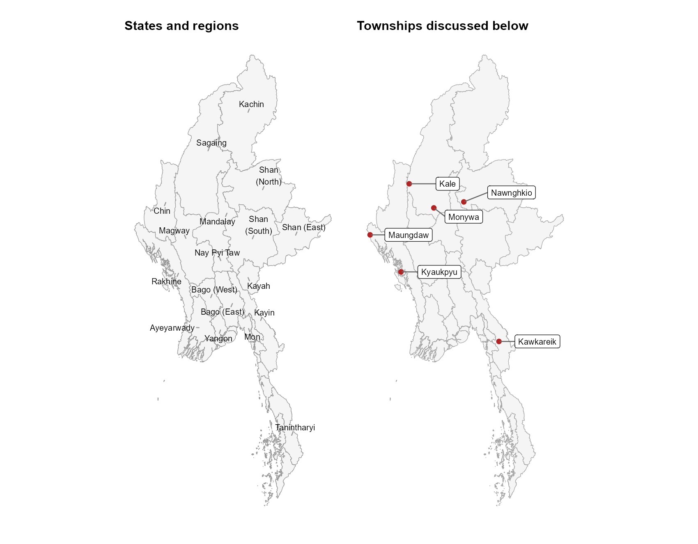

Sagaing, Mandalay and Magway cover much of the central area discussed in the report. Kawkareik is in Kayin near the Thai border; Nawnghkio is in northern Shan. Kyaukpyu and Maungdaw lie in Rakhine on the western side of the country.

The packages below handle the data, maps and spatial tests.

```{r}
#| label: th02-packages
#| eval: false
```

The initial checks cover dates, event IDs and township boundaries.

```{r}
#| label: th02-settings
#| eval: false
#| code-fold: true
#| code-summary: "Folders and analysis settings"
```

```{r}
#| label: th02-import
#| eval: false
```

Read the township boundaries and check that each township code is unique.

```{r}
#| label: th02-boundaries
#| eval: false
```


### Which events are included?


First, keep the three conflict event types within the study period.

```{r}
#| label: th02-filter
#| eval: false
```

Township names are matched within their state or region. Removing spaces and punctuation allows minor spelling differences to match.

```{r}
#| label: th02-township-key
#| eval: false
```

```{r}
#| label: th02-match-townships
#| eval: false
```

```{r}
#| label: th02-location-audit
#| eval: false
#| code-fold: true
#| code-summary: "Save the list of retained and excluded records"
```

Keep the matched records, then add a month and a civilian-targeting flag to each event.

```{r}
#| label: th02-retain-events
#| eval: false
```

The study follows battles, explosions/remote violence, and violence against civilians. It excludes protests, riots and strategic developments to keep the comparison focused on these three forms of conflict. This also leaves out violence coded under protests or riots, including excessive force against protesters. The totals therefore cover a narrower set of events than ACLED’s full definition of political violence. Six records assigned to “Indian Ocean” are outside the study area.

Of the 54,000 qualifying records, 107 have no named township and 88 have only a broad location. The latter can be placed at a regional centre rather than where the event occurred, so assigning them to a township would be misleading. Removing these leaves `r fmt(results$validation$retained)` events, with no duplicate IDs.


```{r}
#| label: th02-coordinates
#| eval: false
#| code-fold: true
#| code-summary: "Check coordinates against the named townships"
```

Events are assigned using the recorded township and state or region. Spelling and punctuation differences, such as “Pangsang (Panghkam)”, are resolved before matching. This keeps a report covering a city in its named township, even when its coordinates point to the city centre.

The coordinates agree with the named township for `r round(100 * (1 - results$validation$coordinate_disagreements / results$validation$retained), 2)`% of retained records. For the remaining `r results$validation$coordinate_disagreements`, the analysis keeps the named township and records the disagreement for review.

Location precision is still uneven: `r fmt(results$validation$geo_precision_2)` records (`r pct(results$validation$geo_precision_2 / results$validation$retained)`) refer to an area near a place rather than that place itself. The precise-location check later in the report tests how much this affects the overall hotspot map.

### How precise are the dates?

```{r}
#| label: th02-date-precision
#| eval: false
```

```{r}
results$date_precision %>%
  select(`Date known to` = precision, Events = events) %>%
  knitr::kable()
```

Most events have an exact date. Month-level dates are retained because the analysis groups events by month. Week-level dates need more care: `r results$validation$week_dates_near_boundary` lie close enough to a month boundary that a three-day shift would change their month. A small monthly peak or a final-month hotspot label can be sensitive to this uncertainty. The three-day screen flags possible boundary crossings; it does not reconstruct the dates from the original reports. [ACLED’s date definitions](https://acleddata.com/methodology/acled-codebook)

::: {.callout-note title="What the counts mean"}
The counts describe reported events. Reporting coverage varies, and these totals do not measure risk per person. ACLED’s civilian-targeting flag identifies events where civilians were the main or only target; civilians can also be harmed in other events. [ACLED codebook](https://acleddata.com/methodology/acled-codebook)
:::

### Keeping months with no recorded events {#preparing-the-monthly-data}


Count events, civilian-targeting events and reported deaths for each township and month.

```{r}
#| label: th02-cube
#| eval: false
```

`expand_grid()` creates every township–month combination. Missing counts are filled with zero.

```{r}
#| label: th02-fill-months
#| eval: false
```

```{r}
#| label: th02-cube-checks
#| eval: false
#| code-fold: true
#| code-summary: "Build and check the complete space-time cube"
```

Add up the monthly counts to get each township’s study-period total.

```{r}
#| label: th02-township-totals
#| eval: false
```

Each township has one record per month: 330 × 57 = 18,810 township-months. A zero means no qualifying event was recorded. These months make up `r pct(results$validation$zero_event_bins/results$validation$bins)` of the records and remain in every monthly comparison.

Recent changes compare January to September in both 2024 and 2025, giving each year the same nine-month observation period.

## Where and when conflict was recorded

The national totals show when recorded conflict rose or fell. Township comparisons then show where those changes occurred, followed by a separate look at reported deaths.

### The monthly total peaked in late 2023 {#changes-over-time}


Group the records by month and event type for the national timeline.

```{r}
#| label: th02-descriptive-counts
#| eval: false
```

```{r}
#| label: th02-other-totals
#| eval: false
#| code-fold: true
#| code-summary: "Annual and state totals"
```

```{r}
#| label: th02-plot-style
#| eval: false
#| code-fold: true
#| code-summary: "Chart setup and shared theme"
```

```{r}
#| label: th02-monthly-plot
#| eval: false
```

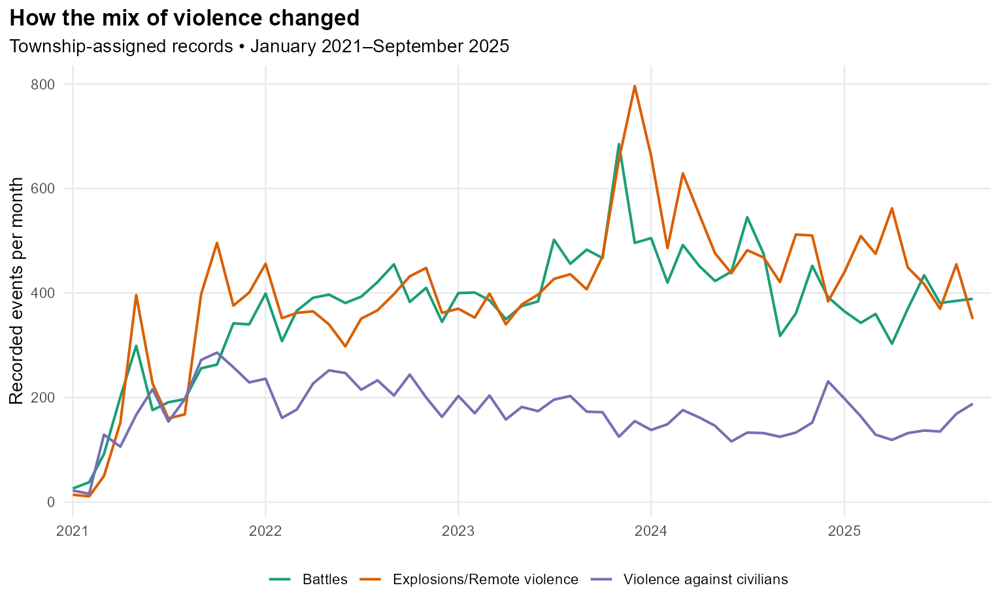

Recorded conflict peaked at 1,465 events in November 2023, followed by 1,447 in December. Counts stayed high into early 2024. Explosions and remote violence were the largest category in both 2024 and the available months of 2025.

The peak came shortly after Operation 1027 began in northern Shan on 27 October 2023. [ACLED’s account of that month](https://acleddata.com/update/regional-overview-asia-pacific-october-2023) describes a sharp escalation in fighting following the Brotherhood Alliance’s offensive.

By January to September 2025, the total had fallen to 8,728 events, compared with 9,961 in the same months of 2024. This 12.4% decline is the starting point for the local comparisons.

### Where the national decline came from {#recent-township-changes}

Each township’s change is its January to September 2025 count minus its count for the same months of 2024. Red areas recorded more events; blue areas recorded fewer.

```{r}
#| label: th02-recent-counts
recent_counts <- results$cube %>%
  filter(lubridate::year(month) %in% 2024:2025,
         lubridate::month(month) <= 9) %>%
  mutate(year = lubridate::year(month)) %>%
  group_by(TS_PCODE, year) %>%
  summarise(events = sum(events), civilian = sum(civilian), .groups = "drop") %>%
  pivot_wider(names_from = year, values_from = c(events, civilian))
```

Join the year totals to the township names and subtract 2024 from 2025.

```{r}
#| label: th02-recent-differences
recent <- results$towns %>%
  st_drop_geometry() %>%
  as_tibble() %>%
  select(TS_PCODE, TS, ST) %>%
  left_join(recent_counts, by = "TS_PCODE") %>%
  mutate(change = events_2025 - events_2024,
         civilian_change = civilian_2025 - civilian_2024)
```

```{r}
#| label: th02-recent-map
change_map <- results$towns %>%
  select(TS_PCODE) %>%
  left_join(recent, by = "TS_PCODE")
change_limit <- ceiling(max(abs(recent$change)) / 50) * 50
```

Use a colour scale centred on zero to show increases and decreases.

```{r}
#| label: th02-recent-map-plot
p_change_map <- ggplot(change_map) +
  geom_sf(aes(fill = change), colour = "white", linewidth = .08) +
  scale_fill_distiller(palette = "RdBu", direction = -1,
                       limits = c(-change_limit, change_limit),
                       breaks = c(-change_limit, 0, change_limit), name = "Change in events") +
  coord_sf(datum = NA) +
  theme_void() +
  theme(legend.position = "bottom") +
  labs(title = "Where counts rose and fell")
```

For the bar chart, select the five largest increases and five largest decreases.

```{r}
#| label: th02-largest-changes
largest_changes <- bind_rows(
  slice_max(recent, change, n = 5, with_ties = FALSE),
  slice_min(recent, change, n = 5, with_ties = FALSE)) %>%
  mutate(label = paste(TS, ST, sep = " · "))
```

Plot those changes on the same colour scale as the map.

```{r}
#| label: th02-recent-bar
p_change_bar <- ggplot(largest_changes, aes(change, reorder(label, change))) +
  geom_col(aes(fill = change), width = .65, show.legend = FALSE) +
  scale_fill_distiller(palette = "RdBu", direction = -1,
                       limits = c(-change_limit, change_limit)) +
  geom_vline(xintercept = 0, colour = "grey55", linewidth = .3) +
  geom_text(aes(label = sprintf("%+d", change), hjust = if_else(change > 0, -.12, 1.12)),
            size = 3.3) +
  scale_x_continuous(expand = expansion(mult = .2)) +
  labs(x = "2025 count minus 2024 count", y = NULL, title = "Five largest rises and falls") +
  theme(panel.grid.major.y = element_blank(), axis.text.y = element_text(size = 9))
```

Place the two panels side by side.

```{r}
#| label: th02-recent-save
#| code-fold: true
#| code-summary: "Arrange and save the two panels"
change_figure <- p_change_map + p_change_bar + patchwork::plot_layout(widths = c(1, 1.35)) +
  patchwork::plot_annotation(subtitle = "January to September in both years")
ggsave("take-home-02/figures/recent-changes.png", change_figure,
       width = 11, height = 7, dpi = 170, bg = "white")
```

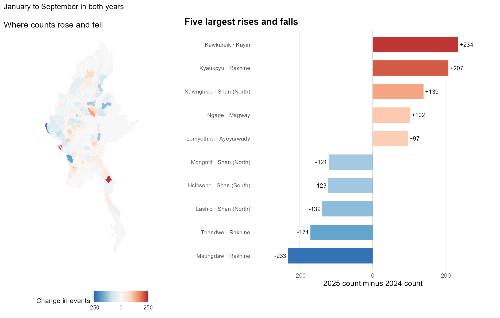

Counts rose in `r sum(recent$change > 0)` townships, fell in `r sum(recent$change < 0)`, and stayed the same in `r sum(recent$change == 0)`. Increases added `r fmt(sum(pmax(recent$change, 0)))` events, while decreases removed `r fmt(-sum(pmin(recent$change, 0)))`. Together, these changes produced the national fall of `r fmt(-sum(recent$change))`.

The largest increases were in Kawkareik (122 to 356), Kyaukpyu (56 to 263) and Nawnghkio (202 to 341). Kyaukpyu is especially striking: it had the second-largest township increase while the total for Rakhine, its state, fell by 734. The decline across Rakhine was uneven.

### Sagaing accounts for nearly a quarter of events {#where-conflict-is-concentrated}


Map the full-period counts, then select the ten townships with the largest totals for the bar chart.

```{r}
#| label: th02-distribution-plot
#| eval: false
```

```{r}
#| label: th02-distribution-top
#| eval: false
```

```{r}
#| label: th02-distribution-save
#| eval: false
#| code-fold: true
#| code-summary: "Arrange and save the two panels"
```

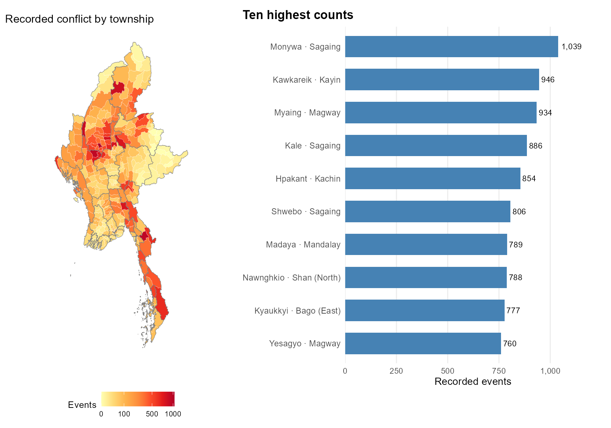

Across the full study period, Sagaing recorded 12,612 events, or `r pct(12612/results$validation$retained)` of the total. Magway followed with 5,384 and Mandalay with 4,911. Much of the recorded conflict was concentrated in central Myanmar.

`r town_results$TS[which.max(town_results$events)]` had the highest township count, with `r fmt(max(town_results$events))` events. The clustering analysis later checks whether high-count townships also had high-count neighbours.

### Maungdaw ranks much higher for reported deaths {#events-and-reported-deaths}

An event count gives equal weight to every incident, regardless of the reported deaths. Comparing both measures helps identify places where fewer incidents still involved a high loss of life. [Christover Manafe’s study](https://isss626-camanafe.netlify.app/take_home_ex/take_home_ex02/take_home_ex02#feature-engineering) also uses several measures to compare conflict.

```{r}
#| label: th02-fatality-counts
fatality_counts <- results$towns %>%
  st_drop_geometry() %>%
  as_tibble() %>%
  select(TS_PCODE, TS, ST, events, fatalities) %>%
  mutate(event_rank = min_rank(desc(events)),
         fatality_rank = min_rank(desc(fatalities)))
fatality_examples <- fatality_counts %>%
  filter(TS %in% c("Monywa", "Kale", "Maungdaw"))
```

```{r}
#| label: th02-fatality-plot
p_death_map <- ggplot(results$towns) +
  geom_sf(aes(fill = fatalities), colour = "white", linewidth = .06) +
  scale_fill_distiller(palette = "YlOrRd", direction = 1,
                       trans = "sqrt", breaks = c(0, 500, 1800), labels = scales::comma,
                       name = "Reported deaths") +
  guides(fill = guide_colourbar(title.position = "top", barwidth = grid::unit(4.5, "cm"))) +
  coord_sf(datum = NA) +
  theme_void() +
  theme(legend.position = "bottom") +
  labs(title = "Where deaths were reported")
```

Compare deaths with event counts. Label Monywa, Kale and Maungdaw so they can be followed in both measures.

```{r}
#| label: th02-fatality-scatter
p_death_comparison <- ggplot(fatality_counts, aes(events, fatalities)) +
  geom_point(colour = "grey65", size = 1.8, alpha = .6) +
  geom_point(data = fatality_examples, colour = "firebrick", size = 3) +
  geom_text(data = fatality_examples, aes(label = TS), hjust = 1.1, vjust = -.7, size = 3.5) +
  scale_x_continuous(labels = scales::comma, expand = expansion(mult = c(.03, .12))) +
  scale_y_continuous(labels = scales::comma, expand = expansion(mult = c(.03, .12))) +
  labs(x = "Recorded events", y = "Reported deaths",
       title = "Incidents and reported deaths", subtitle = "Each dot is one township")
```

Combine the map and scatter plot.

```{r}
#| label: th02-fatality-save
#| code-fold: true
#| code-summary: "Arrange and save the two panels"
fatality_figure <- p_death_map + p_death_comparison +
  patchwork::plot_layout(widths = c(1, 1.2)) +
  patchwork::plot_annotation(subtitle = "January 2021 to September 2025")
ggsave("take-home-02/figures/events-and-deaths.png", fatality_figure,
       width = 11, height = 7, dpi = 170, bg = "white")
```

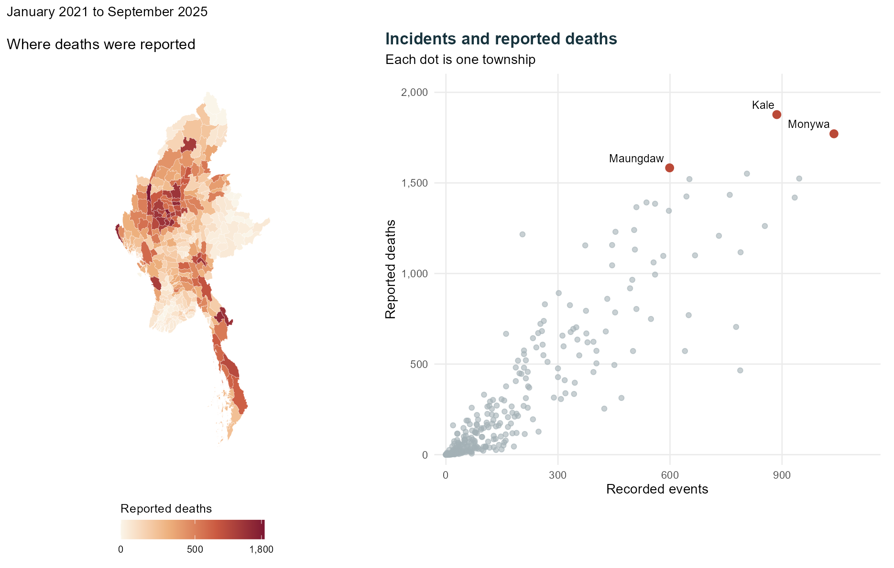

| Township | Recorded events | Reported deaths |
|---|---|---|
| Maungdaw | 599, ranked 17th | 1,583, ranked third |
| Kale | 886, ranked fourth | 1,877, ranked first |
| Monywa | 1,039, ranked first | 1,771, ranked second |

Maungdaw moves furthest up this list when deaths are considered. An assessment based only on incident counts would give it much less attention. Kale and Monywa appear near the top on both measures.

Reported deaths include civilians and combatants. ACLED also uses zero when no fatality information is available, so a zero can mean that deaths were unreported. [ACLED codebook](https://acleddata.com/methodology/acled-codebook)

### Follow a township through the months {#explore-the-months}


```{r}
#| label: th02-explorer-code
#| eval: false
#| code-fold: true
#| code-summary: "Build the interactive monthly map"
```

Try Kawkareik or Nawnghkio, then compare their later rise with Monywa’s longer history of high counts. The colour scale stays fixed as the month changes, so the same colour always represents the same range of counts.

```{=html}
<iframe src="take-home-02/conflict-explorer.html" title="Explore Myanmar conflict counts by month and township" style="width:100%;height:850px;border:1px solid #dce3df;border-radius:8px" loading="lazy"></iframe>
```

[Open the explorer in its own tab](take-home-02/conflict-explorer.html)

## Where conflict forms clusters {#clusters-outliers-and-hotspots}

High counts in one township and high counts across several neighbouring townships describe different patterns. Two tests help separate them:

| Test | What it examines |
|---|---|
| Local Moran’s I | Whether a township has similar counts to its neighbours, or stands out from them. |
| Getis–Ord Gi* | Whether a township and its neighbours form a concentration of unusually high counts (a hotspot) or low counts (a coldspot). |

### What counts as a neighbour?


```{r}
#| label: th02-neighbours
#| eval: false
```

Townships are neighbours when their boundaries touch at an edge or corner. This is called Queen contiguity. Each township’s neighbour weights sum to one. Local Moran’s I compares a township with its neighbours; Gi* includes the township itself in the neighbourhood count.

Chaungzon, Munaung and Cocokyun have no shared-boundary neighbours in this boundary file. Their event counts remain in the study, but the Queen-based tests leave them unclassified. Maps and distance checks use an Albers projection centred on Myanmar, with a one-metre tolerance for identifying shared boundaries.


The helper below runs Gi* and returns its score, permutation p-value and hotspot label. `q` is the p-value after the multiple-test adjustment.

```{r}
#| label: th02-gi-test
#| eval: false
```

```{r}
#| label: th02-lisa-labels
#| eval: false
#| code-fold: true
#| code-summary: "Assign the Local Moran cluster and outlier labels"
```

This second helper runs Local Moran’s I, calculates the neighbour average with `lag.listw()`, and adds the Gi* results.

```{r}
#| label: th02-local-tests
#| eval: false
```

Both tests compare the observed pattern with 999 shuffled arrangements of the other townships’ counts, keeping the township being tested fixed. Coloured areas pass the two-sided permutation threshold of p < 0.05; grey areas do not.

### Most hotspots are in central Myanmar


```{r}
#| label: th02-local-run
#| eval: false
```

```{r}
#| label: th02-map-style
#| eval: false
#| code-fold: true
#| code-summary: "Shared map theme and legend order"
```

Join the test results to the township boundaries using `TS_PCODE`.

```{r}
#| label: th02-local-plot
#| eval: false
```

The first panel shows Local Moran clusters and outliers.

```{r}
#| label: th02-lisa-map
#| eval: false
```

The second panel shows Gi* hotspots and coldspots.

```{r}
#| label: th02-hotspot-map
#| eval: false
```

```{r}
#| label: th02-local-save
#| eval: false
#| code-fold: true
#| code-summary: "Save the paired maps"
```

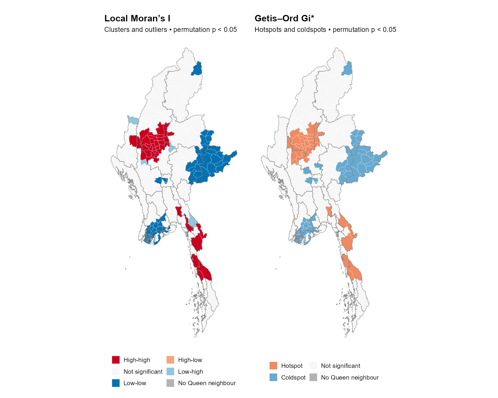

Local Moran’s I identifies 38 townships with high counts beside high-count neighbours, and 52 with low counts beside low-count neighbours. These are the high–high and low–low clusters in the legend.

Four townships stand out as low–high outliers: Hlaingbwe, Tonzang, Seikphyu and Pyinoolwin. Their own counts are below the township average, while their neighbours’ weighted counts are above it. No high–low outlier passes the test.

Gi* identifies 38 hotspots and 53 coldspots. Sagaing has 18 hotspots, Mandalay seven and Magway six. Both tests place most high-count clusters in central Myanmar.

Among the coldspots, 13 are in Ayeyarwady, 11 in Yangon and ten in Shan (East). Local Moran’s I places most low–low clusters in the same areas, though some individual classifications differ.

Kawkareik has the second-highest total, at 946 events, but does not qualify as a whole-period hotspot. Much of its increase came late in the study, which the later monthly analysis examines.

```{r}
#| label: th02-local-counts
lisa_counts <- results$local %>%
  count(lisa, name = "Townships") %>%
  rename(Result = lisa) %>%
  mutate(Method = "Local Moran’s I")

hotspot_counts <- results$local %>%
  count(gi_cluster, name = "Townships") %>%
  rename(Result = gi_cluster) %>%
  mutate(Method = "Gi*")

bind_rows(lisa_counts, hotspot_counts) %>%
  select(Method, Result, Townships) %>%
  knitr::kable()
```

### Which hotspots survive stricter checks? {#how-much-do-the-choices-matter}


First, repeat Gi* using the six nearest township centres.

```{r}
#| label: th02-neighbour-checks
#| eval: false
```

Then repeat it using only records with the most precise location code.

```{r}
#| label: th02-precise-check
#| eval: false
```

Three checks test how sensitive the labels are to the settings:

- Use the six nearest township centres as neighbours, making the relationship mutual.
- Keep only the more precisely located records.
- Apply the Benjamini–Hochberg adjustment to reduce chance findings from testing many townships.

```{r}
#| label: th02-sensitivity
valid <- !is.na(results$local$gi_p)
check_labels <- c(
  queen = "Queen neighbours",
  queen_fdr = "Queen neighbours, multiple-test adjustment",
  knn6 = "Six nearest neighbours",
  precise_only = "Queen neighbours, precise locations only"
)
check_counts <- results$comparison %>%
  filter(valid) %>%
  select(all_of(names(check_labels))) %>%
  pivot_longer(everything(), names_to = "Check", values_to = "Result") %>%
  count(Check, Result)
```

Count hotspots and coldspots under each setting, using the same 327 townships with Queen neighbours.

```{r}
#| label: th02-sensitivity-table
check_counts %>%
  filter(Result %in% c("Hotspot", "Coldspot")) %>%
  mutate(Check = factor(Check, levels = names(check_labels), labels = check_labels)) %>%
  pivot_wider(names_from = Result, values_from = n, values_fill = 0) %>%
  arrange(Check) %>%
  select(Check, Hotspots = Hotspot, Coldspots = Coldspot) %>%
  knitr::kable()
```

The multiple-test adjustment reduces the hotspot count from 38 to 19. The wider map is useful for identifying places to examine; the adjusted list has stronger statistical support.

Across the 327 townships with Queen neighbours, 87.2% keep the same hotspot, coldspot or non-significant label with six-nearest neighbours. Using only more precise locations retains 91.7% of the labels.

The main concentrations remain similar, but some township labels change and six-nearest neighbours produces more coldspots. Shared boundaries remain the main definition used below.

### Some increases sit among declining neighbours {#changes-and-neighbours}

Kyaukpyu’s increase raises a local question: did nearby townships also record more conflict? Each dot compares a township’s change with the average change among its Queen neighbours, excluding itself. The three island townships have no such neighbours and are left out.

```{r}
#| label: th02-change-lag
library(spdep)
change_weights <- nb2listw(results$nb, style = "W", zero.policy = TRUE)
recent$neighbour_change <- lag.listw(change_weights, recent$change, zero.policy = TRUE)
has_neighbours <- card(results$nb) > 0
recent$neighbour_change[!has_neighbours] <- NA_real_

set.seed(62603)
change_moran <- moran.mc(recent$change[has_neighbours],
                         nb2listw(subset(results$nb, has_neighbours), style = "W"),
                         nsim = 999, alternative = "greater")
```

```{r}
#| label: th02-change-lag-plot
neighbour_changes <- recent %>%
  filter(!is.na(neighbour_change)) %>%
  mutate(direction = case_when(
    change > 0 & neighbour_change > 0 ~ "Both increased",
    change > 0 & neighbour_change < 0 ~ "Township up, neighbours down",
    change < 0 & neighbour_change > 0 ~ "Township down, neighbours up",
    change < 0 & neighbour_change < 0 ~ "Both decreased",
    TRUE ~ "One or both unchanged"))
```

Plot each township’s change against its neighbours’ average change.

```{r}
#| label: th02-change-scatter
p_change_lag <- ggplot(neighbour_changes, aes(change, neighbour_change)) +
  geom_hline(yintercept = 0, colour = "grey65", linewidth = .4) +
  geom_vline(xintercept = 0, colour = "grey65", linewidth = .4) +
  geom_point(aes(colour = direction), size = 2.1, alpha = .7) +
  geom_text(data = filter(neighbour_changes, TS %in% c("Kyaukpyu", "Kawkareik", "Nawnghkio")),
            aes(label = TS), hjust = 1.08, vjust = -.6, size = 3.4) +
  scale_colour_brewer(palette = "Dark2", name = NULL) +
  labs(x = "Change in the township’s count", y = "Average change among its neighbours",
       title = "Township changes and their surroundings",
       subtitle = "January to September 2025 compared with the same months of 2024") +
  guides(colour = guide_legend(ncol = 2))
ggsave("take-home-02/figures/neighbour-changes.png", p_change_lag,
       width = 9, height = 6, dpi = 170, bg = "white")
```

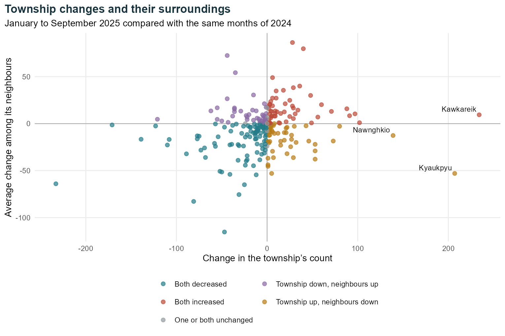

Nearby townships tend to change in the same direction overall: Moran’s I is `r round(as.numeric(change_moran$statistic), 3)`, with permutation p = `r formatC(change_moran$p.value, format = 'f', digits = 3)`. There are also local exceptions. Of the `r sum(recent$change > 0 & has_neighbours)` rising townships with neighbours, `r sum(recent$change > 0 & recent$neighbour_change < 0, na.rm = TRUE)` sit beside an average decline.

Kyaukpyu added 207 events while its neighbours averaged 53 fewer. Nawnghkio also rose while its neighbours’ average fell. These increases were more localised than the regional totals suggest. The civilian analysis below examines which forms of violence increased in these places.

The dot colours show the direction of change between years. The earlier Local Moran’s I and Gi* maps test clustering across the full study period.

### New hotspots appear around Kawkareik {#hotspots-in-two-periods}

Recent concentrations can be hidden when several years are combined. I repeat Gi* for January to September 2024 and the same months of 2025, following the comparison of time windows in [Matthew Ho’s study](https://is415-gaa-matthew-ho.netlify.app/takehomeex/takehomeex2/the2#choosing-time-horizons).

Both maps use the same Queen neighbours and a two-sided threshold of p < 0.05. Using 9,999 permutations gives finer p-values for this comparison.

```{r}
#| label: th02-period-hotspots
#| code-fold: true
#| code-summary: "Gi* helper for the two nine-month periods"
period_weights <- spdep::nb2listw(spdep::include.self(results$nb), style = "W", zero.policy = TRUE)
period_gi <- function(counts, year) {
  g <- spdep::localG_perm(counts, period_weights, nsim = 9999,
                        alternative = "two.sided", iseed = 62604,
                        zero.policy = TRUE, no_repeat_in_row = TRUE)
  p <- attr(g, "internals")[, "Pr(z != E(Gi)) Sim"]
  p[spdep::card(results$nb) == 0] <- NA_real_
  tibble(TS_PCODE = recent$TS_PCODE, year = year, events = counts,
         gi = as.numeric(g), p = p, q = p.adjust(p, "BH")) %>%
    mutate(hot = if_else(is.na(p), NA, gi > 0 & p < .05),
           hot_adjusted = if_else(is.na(q), NA, gi > 0 & q < .05),
           status = case_when(is.na(p) ~ "No Queen neighbour",
                              hot ~ "Hotspot", TRUE ~ "Not a hotspot"))
}
```

Apply the helper to each year’s counts. Both calls use the same test settings.

```{r}
#| label: th02-period-run
period_hotspots <- bind_rows(
  period_gi(recent$events_2024, 2024L),
  period_gi(recent$events_2025, 2025L)
)
```

Put the two years beside each other and identify which hotspot labels changed.

```{r}
#| label: th02-period-changes
hotspot_changes <- period_hotspots %>%
  select(TS_PCODE, year, hot, hot_adjusted) %>%
  pivot_wider(names_from = year, values_from = c(hot, hot_adjusted)) %>%
  left_join(select(recent, TS_PCODE, TS, ST), by = "TS_PCODE") %>%
  mutate(change = case_when(
    is.na(hot_2024) ~ "No Queen neighbour",
    hot_2024 & hot_2025 ~ "Hotspot in both periods",
    hot_2025 ~ "Hotspot in 2025 only",
    hot_2024 ~ "Hotspot in 2024 only",
    TRUE ~ "Not a hotspot in either period"))
```

```{r}
#| label: th02-period-hotspot-maps
period_map <- results$towns %>%
  select(TS_PCODE) %>%
  left_join(period_hotspots, by = "TS_PCODE") %>%
  group_by(year) %>%
  mutate(period = paste0(year, ": ", sum(hot, na.rm = TRUE), " hotspots"),
         status = factor(status, levels = c("Hotspot", "Not a hotspot", "No Queen neighbour")))
period_map <- ungroup(period_map)
kawkareik_point <- results$towns %>%
  filter(TS == "Kawkareik") %>%
  st_point_on_surface()
```

Draw one panel per year, keeping the same legend in both.

```{r}
#| label: th02-period-map-plot
p_periods <- ggplot(period_map) +
  geom_sf(aes(fill = status), colour = "white", linewidth = .08) +
  geom_sf(data = kawkareik_point, shape = 21, fill = "white", colour = "grey20", size = 2) +
  geom_sf_text(data = kawkareik_point, aes(label = TS), nudge_x = -45000,
               hjust = 1, size = 3.2, colour = "grey20") +
  facet_wrap(~period, nrow = 1) +
  scale_fill_manual(values = c(RColorBrewer::brewer.pal(3, "Reds")[3], "grey90", "grey70"),
                    drop = FALSE, name = NULL) +
  coord_sf(datum = NA) + theme_void(base_size = 12) +
  theme(legend.position = "bottom", strip.text = element_text(face = "bold", size = 12)) +
  labs(title = "Hotspots around Kawkareik become clearer in 2025",
       subtitle = "January to September in each year · the circle marks Kawkareik")
ggsave("take-home-02/figures/hotspots-two-periods.png", p_periods,
       width = 10, height = 7.5, dpi = 170, bg = "white")
```

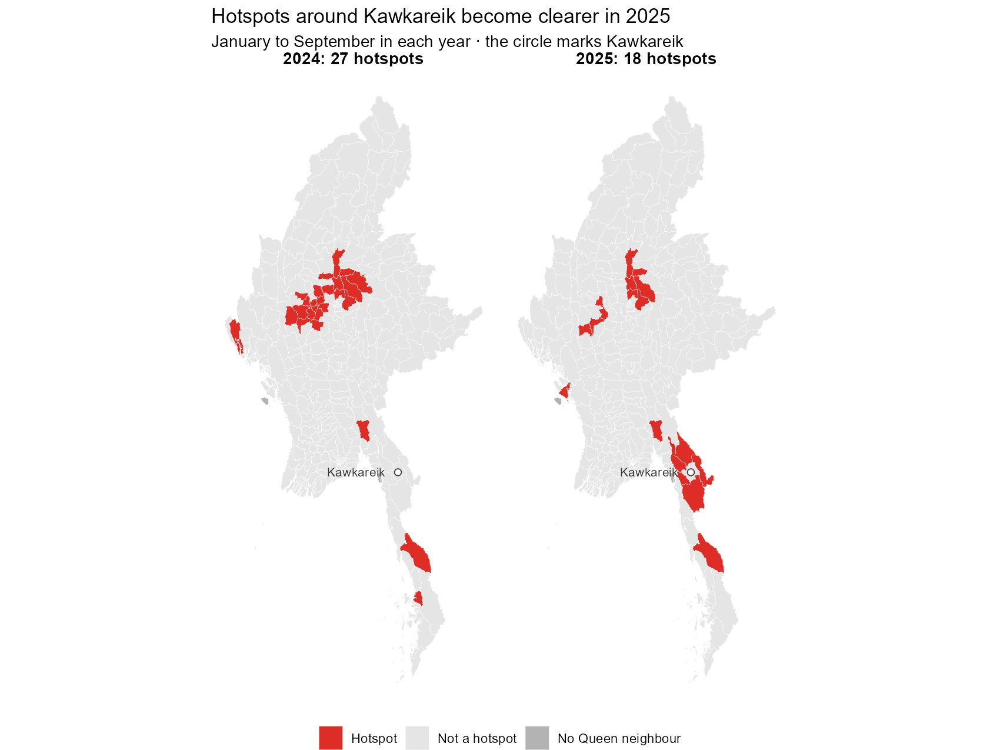

The number of hotspots falls from 27 to 18. Eleven townships qualify in both years, 16 only in 2024, and seven only in 2025.

Five of the seven appearing only in 2025 border Kawkareik, where events rose from 122 to 356. Hlaingbwe, one of its neighbours, rose from one event to 41. All four of Hlaingbwe’s neighbours also recorded increases.

This increase extends across several neighbouring townships. Gi* evaluates a different neighbourhood around each township, so Kawkareik can sit beside hotspots without receiving the same label.

After adjustment for multiple tests, four hotspots remain in 2024 and three in 2025. Hlaingbwe qualifies only in 2025 under both versions. These maps compare hotspot labels; they do not directly test whether the change between years is statistically significant.

## How local patterns changed {#how-the-hotspots-changed}

Kawkareik’s later increase and Monywa’s longer history raise another question: when did each neighbourhood become a concentration of conflict? The monthly analysis follows these changes from January 2021 to September 2025.

### Following hotspots through time


```{r}
#| label: th02-time-neighbours
#| eval: false
#| code-fold: true
#| code-summary: "Define neighbours in the current and previous month"
```

Build the monthly neighbourhoods, then run the same Gi* test on the complete series.

```{r}
#| label: th02-time-weights
#| eval: false
```

```{r}
#| label: th02-time-weight-checks
#| eval: false
#| code-fold: true
#| code-summary: "Check that neighbourhoods include no future months"
```

```{r}
#| label: th02-time-gi
#| eval: false
```

Emerging Hot Spot Analysis (EHSA) follows each township’s neighbourhood month by month. Its Gi* score uses the township and its Queen neighbours in the current and previous month; January 2021 uses January alone. These counts are compared with the distribution across all townships and months.


Attach the Gi* scores to the township-month counts. Adjust monthly p-values across townships.

```{r}
#| label: th02-mann-kendall
#| eval: false
```

Run one Mann–Kendall test per township. `tau` gives the trend direction; `lag1` measures how similar successive months are.

```{r}
#| label: th02-mk-test
#| eval: false
#| code-fold: true
#| code-summary: "Define the township trend test"
```

```{r}
#| label: th02-mk-run
#| eval: false
```

The Mann–Kendall test checks whether Gi* scores tend to rise or fall over time. A rising score means the neighbourhood is becoming a stronger concentration of recorded conflict. The event timelines separately show each township’s own count.


```{r}
#| label: th02-classification-rules
#| eval: false
#| code-fold: true
#| code-summary: "Apply the EHSA classification rules"
```

EHSA combines the trend with the sequence of hot and cold months. The main labels used here are:

| Label | How to read it |
|---|---|
| Oscillating hotspot | Ends hot and had at least one earlier cold month. “Oscillating” does not imply a regular cycle. |
| Sporadic hotspot | Hot on and off, ends hot, and has no earlier cold month. |
| New or consecutive hotspot | Becomes hot for the first time in the final month, or has its first uninterrupted hot run at the end. |
| Persistent, intensifying or diminishing hotspot | Hot in at least 90% of months; the trend distinguishes a steady, strengthening or weakening concentration. |

Coldspot labels use the same rules with high and low reversed. The final month is September 2025. Earlier hot months can therefore lead to “No pattern detected” if the ending does not fit a class. [Classification definitions](https://doc.esri.com/en/arcgis-pro/latest/tool-reference/space-time-pattern-mining/learnmoreemerging.html)

### How hotspot patterns changed {#hotspots-came-and-went}


```{r}
#| label: th02-classify
#| eval: false
#| code-fold: true
#| code-summary: "Summarise each township’s hotspot history"
```

For the map, keep the EHSA class where the trend passes the 0.05 threshold.

```{r}
#| label: th02-classify-map
#| eval: false
```

Join each township’s trend result to its boundary and label the trend direction.

```{r}
#| label: th02-ehsa-plot
#| eval: false
```

Map the trend on the left.

```{r}
#| label: th02-trend-map
#| eval: false
```

```{r}
#| label: th02-ehsa-labels
#| eval: false
#| code-fold: true
#| code-summary: "Order the EHSA classes in the legend"
```

Map the EHSA history on the right. Reds represent hotspot classes and blues represent coldspot classes.

```{r}
#| label: th02-pattern-map
#| eval: false
```

```{r}
#| label: th02-ehsa-save
#| eval: false
#| code-fold: true
#| code-summary: "Save the paired maps"
```

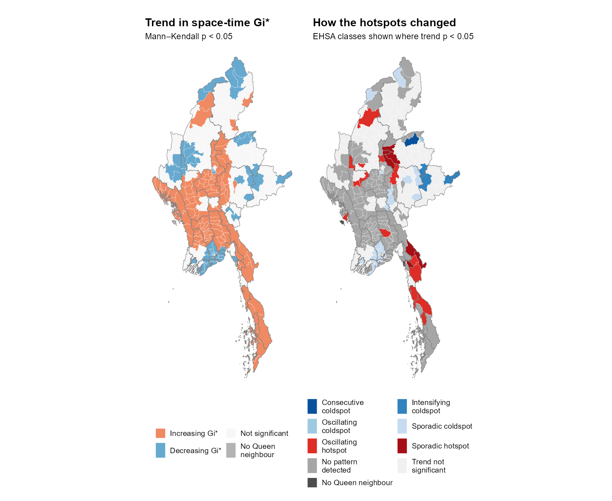

Across all townships, EHSA identifies 26 oscillating and eight sporadic hotspots. The map shows the 16 oscillating and seven sporadic hotspots whose trends also pass the Mann–Kendall test, giving 23 mapped hotspots.

For `r sum(results$early_cold$last_cold <= as.Date('2021-04-01'))` of the `r nrow(results$early_cold)` oscillating hotspots, all cold months fall in January to April 2021. Here, the label usually describes low early counts followed by later hotspots. It need not mean repeated swings between high and low conflict. The mapped oscillating hotspots include `r sum(town_results$map_class == 'Oscillating hotspot' & town_results$ST == 'Magway')` in Magway and `r sum(town_results$map_class == 'Oscillating hotspot' & town_results$ST == 'Tanintharyi')` in Tanintharyi; `r sum(town_results$map_class == 'Sporadic hotspot' & town_results$ST == 'Shan (North)')` sporadic hotspots are in northern Shan.

Monywa illustrates how the ending affects the label: it had many hot months but ends with “No pattern detected”. Its timeline below explains the result.

Following the handout, the map includes only trends with Mann–Kendall p < 0.05. It also includes 42 coldspots.

### Coldspots also changed through time

The table includes all classifications, including those without a significant trend.

```{r}
#| label: th02-ehsa-counts
results$ehsa %>%
  group_by(classification) %>%
  summarise(`All townships` = n(), `Trend p < 0.05` = sum(trend_p < .05, na.rm = TRUE), .groups = "drop") %>%
  rename(Pattern = classification) %>%
  knitr::kable()
```

The largest group is the 53 sporadic coldspots, including 20 in Yangon and 11 in Ayeyarwady. They were cold on and off, ended cold, and had no significant hot months.

Several smaller groups have different histories:

- The 12 persistent coldspots, including 11 in Shan, were cold in at least 90% of months without a significant trend. They are absent from the map because it requires a significant trend.
- Matman, Mongping and Mongyawng are intensifying coldspots. As their Gi* scores fell, their low neighbourhood counts became more unusual relative to the full study period.
- Kutkai’s only two cold months were August and September 2025, giving it a consecutive coldspot label.
- Lashio, Tangyan and Laukkaing ended cold after earlier hot months, giving them oscillating coldspot labels. Only Laukkaing has a significant trend and appears on the map.

### Three townships, three different histories {#a-closer-look-at-contrasting-townships}

Kawkareik and Nawnghkio have the highest event counts in their respective hotspot classes with significant trends. Monywa has the highest count overall. Their timelines show how those totals built up differently.


```{r}
#| label: th02-stories-plot
#| eval: false
#| code-fold: true
#| code-summary: "Select the three contrasting township histories"
```

Extract their monthly counts and Gi* scores.

```{r}
#| label: th02-case-series
#| eval: false
```

Plot the event counts and neighbourhood scores separately so their timing can be compared.

```{r}
#| label: th02-case-count-plot
#| eval: false
```

```{r}
#| label: th02-case-gi-plot
#| eval: false
```

```{r}
#| label: th02-stories-save
#| eval: false
#| code-fold: true
#| code-summary: "Save the timelines and case table"
```

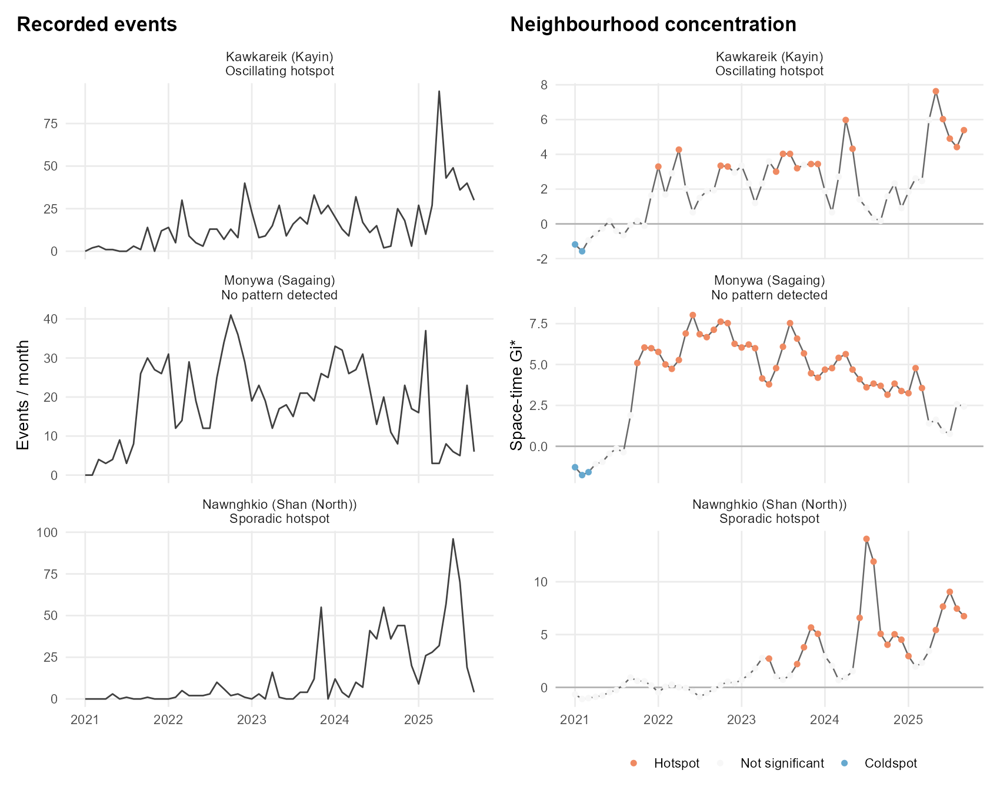

#### Kawkareik: a later rise

Kawkareik, Kayin, recorded `r fmt(town_results$events[town_results$TS == 'Kawkareik'])` events. Two early cold months followed by later hot periods give it an oscillating hotspot label. January to September counts rose from 122 in 2024 to 356 in 2025, including an air/drone increase from `r results$subtype_townships$events_2024[results$subtype_townships$TS == 'Kawkareik' & results$subtype_townships$sub_event_type == 'Air/drone strike']` to `r results$subtype_townships$events_2025[results$subtype_townships$TS == 'Kawkareik' & results$subtype_townships$sub_event_type == 'Air/drone strike']`. Neighbouring townships also rose, and its upward Gi* trend survives the stronger check below.

#### Nawnghkio: repeated hotspot periods

Nawnghkio, Shan (North), was hot in 18 months and has a sporadic hotspot label. Its 341 events by September 2025 exceeded the 310 in all of 2024. Matched-period air/drone events rose from `r aerial_places$events_2024[aerial_places$TS == 'Nawnghkio']` to `r aerial_places$events_2025[aerial_places$TS == 'Nawnghkio']`. [ACLED’s July 2025 study](https://acleddata.com/report/war-sky-how-drone-warfare-shaping-conflict-myanmar) describes military drone operations here and in Kawkareik. September’s four events still coincided with a hotspot label because Gi* also includes neighbours and the preceding month.

#### Monywa: fewer recent events after years of high counts

Monywa, Sagaing, was hot throughout 2022 to 2024 and in three months of 2025. It recorded 1,039 events overall. September’s p-value of 0.066 misses the hotspot threshold, and its trend is not significant. Yet civilian targeting continued in `r monywa$months_affected_2025` of the nine months of 2025, as the recurrence analysis later shows.

### Do the trends hold up? {#checking-the-trend-results}

```{r}
#| label: th02-block-function
#| eval: false
#| code-fold: true
#| code-summary: "Resample six-month blocks for the trend check"
```

```{r}
#| label: th02-block-run
#| eval: false
#| code-fold: true
#| code-summary: "Apply the same block check to each township"
```

```{r}
#| label: th02-block-apply
#| eval: false
```

Successive months often resemble each other, especially because Gi* includes the preceding month. To account for this, the check resamples six-month blocks 999 times after removing the estimated trend. A further adjustment accounts for testing many townships.

| Check | Townships with a significant trend |
|---|---:|
| Ordinary Mann–Kendall test | `r sum(results$ehsa$trend_p < .05, na.rm = TRUE)` |
| Allow for related months using six-month blocks | `r sum(results$ehsa$block_p < .05, na.rm = TRUE)` |
| Also adjust for testing many townships | `r sum(results$ehsa$block_q < .05, na.rm = TRUE)` |

The median correlation between successive Gi* scores is `r round(median(results$ehsa$lag1, na.rm = TRUE), 2)`. Treating these months as independent gives too much weight to repeated similar observations.

Kawkareik and Nawnghkio retain upward trends under the stronger checks. Yesagyo’s p-value rises from about 0.006 to `r round(town_results$block_p[town_results$TS == 'Yesagyo'], 3)` in the block check, so its apparent rise has weaker support.

Adjusting both the monthly hotspot tests and the township trend tests changes `r sum(results$ehsa$classification != results$ehsa$classification_fdr)` EHSA labels. Individual classifications depend on the thresholds, neighbours and final month used. The block check accounts approximately for related months; seasonal patterns and changes in reporting remain possible influences.

### Does the comparison period change the result? {#ehsa-reference-check}

The main analysis compares each neighbourhood with one fixed baseline covering all 57 months. That makes early 2021 look quiet against the much higher counts later on. A second calculation asks how unusual each neighbourhood was compared with Myanmar at the time, using the current and previous month as its reference.

```{r}
#| label: th02-window-gi
#| eval: false
#| code-fold: true
#| code-summary: "Compare each neighbourhood with its two-month window"
```

```{r}
#| label: th02-reference-run
#| eval: false
```

Both versions use the same events, Queen neighbours, 999 permutations, seeds, trend tests and EHSA rules. The reference changes together with the pool of counts used in the permutations: 18,810 township-months in the main analysis, 660 in each two-month window, and 330 for January 2021.

```{r}
#| label: th02-reference-comparison
#| eval: false
#| code-fold: true
#| code-summary: "Match the two sets of township results"
```

```{r}
reference_summary <- results$reference_comparison %>%
  filter(!is.na(trend_p_whole)) %>%
  group_by(measure) %>%
  summarise(`Same EHSA class` = scales::percent(mean(classification_whole == classification_window), accuracy = .1),
            `Rising: whole period` = sum(tau_whole > 0 & trend_p_whole < .05),
            `Rising: two-month window` = sum(tau_window > 0 & trend_p_window < .05),
            .groups = "drop")
knitr::kable(reference_summary, col.names = c("Records", names(reference_summary)[-1]))
```

The agreement is calculated across the 327 townships with Queen neighbours. The civilian comparison uses the same procedure and is discussed in the next section.

```{r}
trend_label <- function(tau, p) {
  case_when(p >= .05 ~ "No clear trend", tau > 0 ~ "Rising", TRUE ~ "Falling")
}
reference_cases <- results$reference_comparison %>%
  filter(measure == "All events",
         TS %in% c("Kawkareik", "Nawnghkio", "Kyaukpyu", "Monywa", "Hlaingbwe", "Yesagyo", "Matman")) %>%
  transmute(Township = TS,
            `Whole-period trend` = trend_label(tau_whole, trend_p_whole),
            `Two-month trend` = trend_label(tau_window, trend_p_window))
knitr::kable(reference_cases)
```

Kawkareik, Nawnghkio and Kyaukpyu retain rising Gi* trends with the two-month reference. Kawkareik’s class changes from oscillating to sporadic: its early cold months no longer qualify under this comparison. The later concentration remains, while the description of its history changes.

Hlaingbwe and Yesagyo lose their significant upward trends. Their recent increases still appear in the counts, but evidence for a rise across the full 57 months depends on the reference used. Matman and Mongping become persistent coldspots instead of intensifying coldspots. Their neighbourhood counts remain low compared with other places at the time, without a significant trend towards a stronger coldspot.

Using the two-month reference and allowing for related months and multiple tests still leaves rising trends in Nawnghkio and Kyaukpyu. Kawkareik’s adjusted p-value reaches `r round(results$reference_comparison$block_q_window[results$reference_comparison$measure == 'All events' & results$reference_comparison$TS == 'Kawkareik'], 3)`, so support for its rising trend weakens. Monywa’s falling trend in the table also loses significance once related months are taken into account.

## Where civilians were targeted {#events-targeting-civilians}

The national decline includes battles and other conflict events. The next comparisons focus on events where civilians were the main or only target: where they clustered, which forms increased, and how often they recurred.

### What the civilian records include


```{r}
#| label: th02-civilian-run
#| eval: false
```

ACLED’s civilian-targeting flag selects `r fmt(results$validation$civilian_records)` events, or `r pct(results$validation$civilian_records/results$validation$retained)` of the retained records. It includes bombings aimed at civilians as well as the category “Violence against civilians”. Events involving incidental civilian harm fall outside this subset. The measure counts events, not deaths.

### Three hotspots appear only in the civilian map


Use the same boundaries, legend and test settings for the civilian-targeting results.

```{r}
#| label: th02-civilian-plot
#| eval: false
```

```{r}
#| label: th02-civilian-map
#| eval: false
```

```{r}
#| label: th02-civilian-save
#| eval: false
#| code-fold: true
#| code-summary: "Place the overall and civilian maps side by side"
```

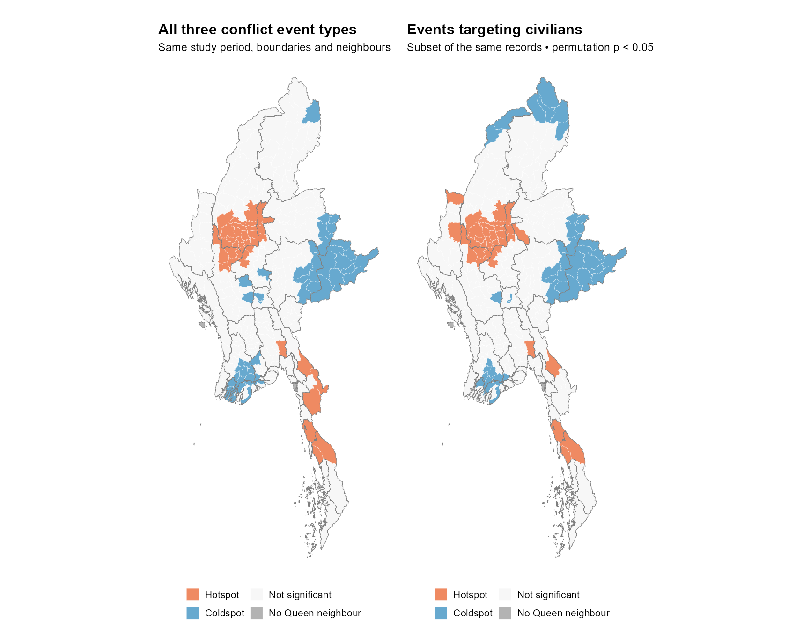

The civilian-targeting map has 37 hotspots, with 34 also appearing in the overall map. The differences are:

| Hotspot only in… | Townships |
|---|---|
| The civilian-targeting map | Hakha, Tonzang, Nawnghkio |
| The overall map | Myawaddy, Kyainseikgyi, Seikphyu, Mogoke |

Tonzang itself has only two retained civilian-targeting events. Its hotspot label mainly reflects neighbouring townships. Following up this result means locating the incidents across that neighbourhood.

### How civilian hotspots changed {#civilian-hotspot-histories}

The whole-period civilian map combines nearly five years of events. EHSA adds the monthly history, using civilian-targeting counts in the same 330-township, 57-month cube.

```{r}
#| label: th02-followup-trends
#| eval: false
#| code-fold: true
#| code-summary: "Apply the same trend and classification steps"
```

```{r}
#| label: th02-civilian-ehsa
#| eval: false
```

```{r}
#| label: th02-civilian-time-map
#| eval: false
#| code-fold: true
#| code-summary: "Join the civilian histories to township boundaries"
```

```{r}
#| label: th02-civilian-time-plot
#| eval: false
```

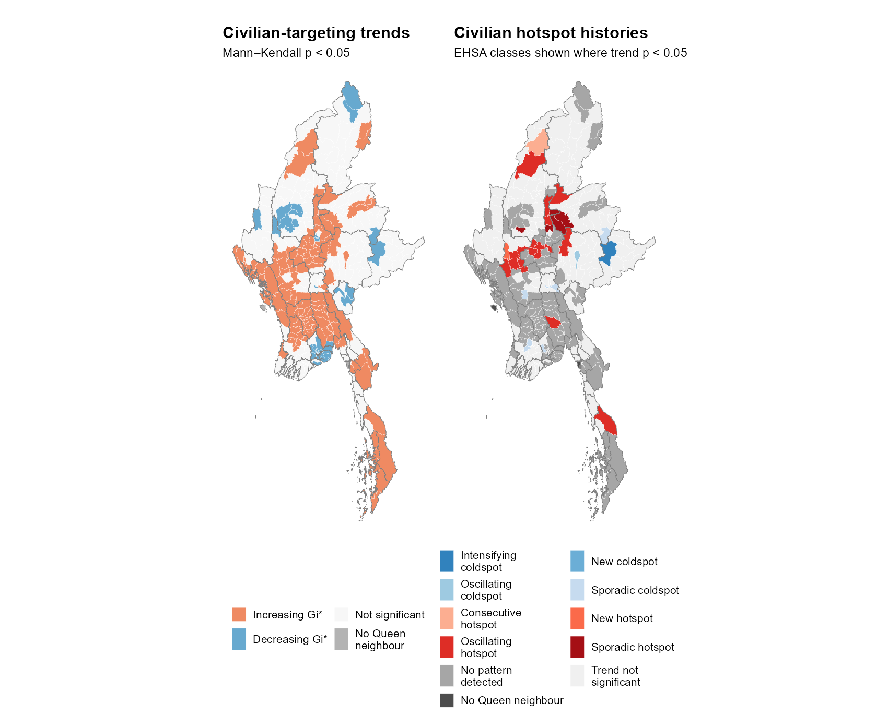

The civilian map shows `r sum(grepl('hotspot$', civilian_ehsa$map_class))` hotspot townships with a significant trend, including `r sum(grepl('hotspot$', civilian_ehsa$map_class) & civilian_ehsa$ST == 'Mandalay')` in Mandalay and `r sum(grepl('hotspot$', civilian_ehsa$map_class) & civilian_ehsa$ST == 'Magway')` in Magway. Saw is a new hotspot; Hkamti ends with its first run of `r civilian_ehsa$hot_months[civilian_ehsa$TS == 'Hkamti']` hot months. These labels describe neighbourhood concentrations in the final months of the dataset.

Nawnghkio is a sporadic hotspot in both the overall and civilian analyses. Kawkareik differs: its civilian series has only `r civilian_ehsa$hot_months[civilian_ehsa$TS == 'Kawkareik']` hot months and ends with “No pattern detected”, even though its Gi* trend rises. Its overall hotspot history therefore gives an incomplete picture of events targeting civilians.

```{r}
results$civilian_time$ehsa %>%
  group_by(classification) %>%
  summarise(`All townships` = n(), `Trend p < 0.05` = sum(trend_p < .05, na.rm = TRUE),
            .groups = "drop") %>%
  rename(Pattern = classification) %>%
  knitr::kable()
```

The table keeps classes without a significant trend, including any persistent concentrations. The map follows the handout’s requirement to show trend-significant results.

```{r}
civilian_checks <- tibble(
  Check = c("Ordinary trend test", "Allow for related months", "Also adjust for multiple tests"),
  `Townships with a significant trend` = c(
    sum(civilian_ehsa$trend_p < .05, na.rm = TRUE),
    sum(civilian_ehsa$block_p < .05, na.rm = TRUE),
    sum(civilian_ehsa$block_q < .05, na.rm = TRUE)))
knitr::kable(civilian_checks)
```

With the two-month reference, `r pct(mean(results$reference_comparison$classification_whole[results$reference_comparison$measure == 'Civilian targeting' & !is.na(results$reference_comparison$trend_p_whole)] == results$reference_comparison$classification_window[results$reference_comparison$measure == 'Civilian targeting' & !is.na(results$reference_comparison$trend_p_whole)]))` of civilian EHSA classes stay the same. Nawnghkio and Kyaukpyu retain significant upward trends. Kawkareik’s civilian trend no longer passes the 0.05 threshold; Saw and Hkamti keep their new and consecutive labels, but their trends also stop qualifying for the filtered map.

The combined checks narrow the civilian findings further. Nawnghkio’s upward trend weakens when the two-month reference, related months and multiple tests are all considered (adjusted p = `r round(results$reference_comparison$block_q_window[results$reference_comparison$measure == 'Civilian targeting' & results$reference_comparison$TS == 'Nawnghkio'], 3)`). Kyaukpyu remains significant (`r round(results$reference_comparison$block_q_window[results$reference_comparison$measure == 'Civilian targeting' & results$reference_comparison$TS == 'Kyaukpyu'], 3)`), despite having no final EHSA pattern. Its rising trajectory is worth following alongside the increase in civilian-targeting air/drone events below.

### Little change in civilian targeting {#recent-civilian-targeting}

```{r}
#| label: th02-recent-civilian
recent_totals <- tibble(
  Measure = c("All retained conflict events", "Events targeting civilians"),
  `Jan–Sep 2024` = c(sum(recent$events_2024), sum(recent$civilian_2024)),
  `Jan–Sep 2025` = c(sum(recent$events_2025), sum(recent$civilian_2025))) %>%
  mutate(Change = scales::percent(`Jan–Sep 2025` / `Jan–Sep 2024` - 1, accuracy = .1))
knitr::kable(recent_totals, format.args = list(big.mark = ","))
```

Civilian-targeting events fell from 2,911 to 2,854, a decline of 2%. Their share of all retained events rose from `r pct(sum(recent$civilian_2024)/sum(recent$events_2024))` to `r pct(sum(recent$civilian_2025)/sum(recent$events_2025))`. Most of the national reduction came from other conflict events.

In `r sum(recent$change < 0 & recent$civilian_change > 0)` townships, total events fell while civilian targeting rose. Two examples show the difference clearly:

| Township | All events, 2024 to 2025 | Civilian-targeting events, 2024 to 2025 |
|---|---|---|
| Pakokku | 171 to 116 | 15 to 35 |
| Myaing | 180 to 103 | 13 to 30 |

Both townships had less recorded conflict overall, alongside more events aimed at civilians. The next comparison separates the forms of violence behind these totals.

### Air/drone strikes and abductions increased {#changes-in-forms-of-violence}

The background accounts describe growing use of aerial attacks and abductions. The paired chart compares every recorded sub-event type for January to September in both years, first across all events and then within civilian targeting. Categories with zero events remain visible through `complete()`.

Keep January to September in each year, then count every sub-event type.

```{r}
#| label: th02-subtype-counts
#| eval: false
```

```{r}
#| label: th02-subtype-totals
#| eval: false
```

Put the 2024 and 2025 counts into separate rows so each can be drawn as a point.

```{r}
#| label: th02-subtype-plot
#| eval: false
```

```{r}
#| label: th02-subtype-labels
#| eval: false
#| code-fold: true
#| code-summary: "Create the count and change labels"
```

Join each pair of points with a line. The two panels compare all events and civilian targeting.

```{r}
#| label: th02-subtype-chart
#| eval: false
```

```{r}
#| label: th02-subtype-save
#| eval: false
#| code-fold: true
#| code-summary: "Save the paired comparison"
```

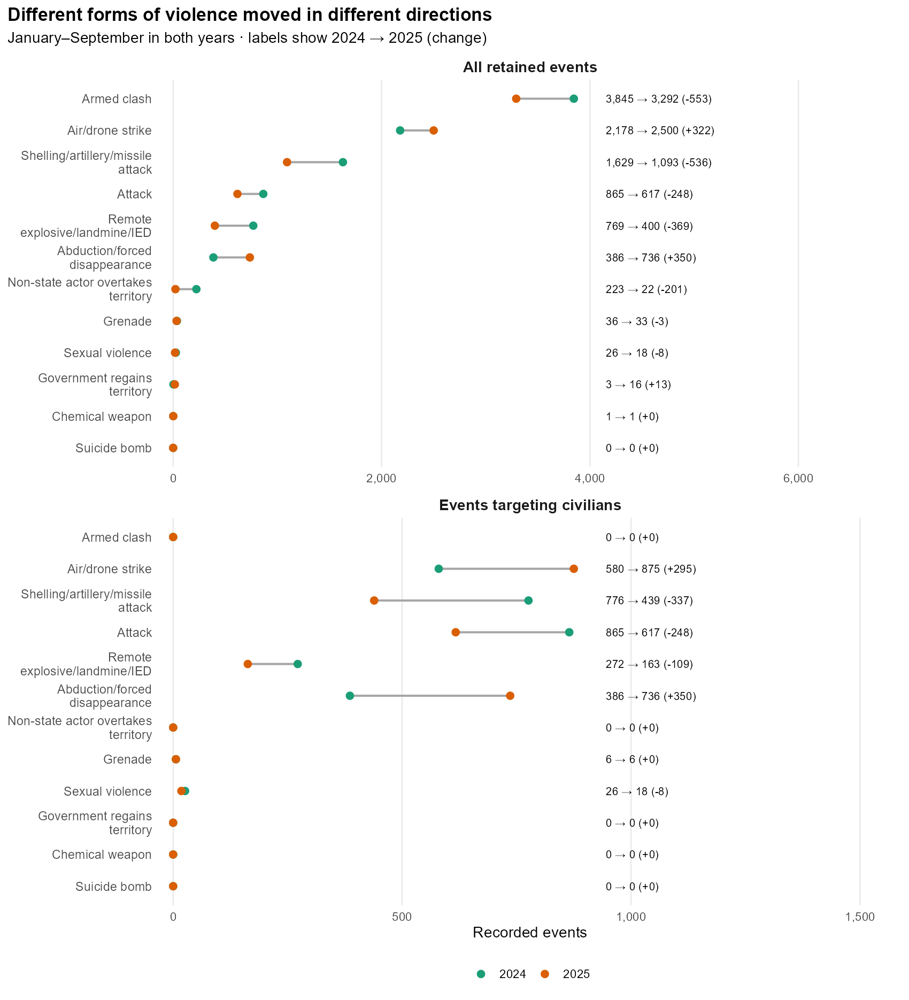

Two forms of civilian targeting rose sharply:

- Air/drone events increased from `r fmt(air$civilian_2024)` to `r fmt(air$civilian_2025)`, a rise of `r pct(air$civilian_2025/air$civilian_2024 - 1)`.
- Abduction/forced disappearance events increased from `r fmt(abductions$civilian_2024)` to `r fmt(abductions$civilian_2025)`, a rise of `r pct(abductions$civilian_2025/abductions$civilian_2024 - 1)`.

Together they added `r fmt(air$civilian_change + abductions$civilian_change)` events. Declines in shelling, attacks and other categories offset that increase.

Shelling targeting civilians fell from `r fmt(shelling$civilian_2024)` to `r fmt(shelling$civilian_2025)`. The small overall decline therefore combines substantial changes in the forms of violence. The aerial and abduction increases follow the direction described in [ACLED’s four-year review](https://acleddata.com/report/four-years-after-2021-coup-myanmar-violence-against-civilians-still-increasing), whose actor-specific figures and full-year periods differ from this comparison.

Each count represents a recorded event, which can involve several strikes or people abducted. [ACLED’s aerial-warfare methodology](https://acleddata.com/report/war-sky-how-drone-warfare-shaping-conflict-myanmar) also includes aerial attacks during active fighting within battle events, so the air/drone category covers separately recorded incidents.

### The increases appeared in different townships {#where-civilian-violence-changed}

For each township, the maps subtract the January to September 2024 count from the same-period 2025 count. Both use the same colour scale centred on zero: equal shades show equal changes in recorded events.

```{r}
#| label: th02-subtype-townships
#| eval: false
```

Join the two categories to the boundaries and use the largest absolute change to set a shared colour scale.

```{r}
#| label: th02-subtype-map
#| eval: false
```

```{r}
#| label: th02-subtype-map-plot
#| eval: false
```

```{r}
#| label: th02-subtype-map-save
#| eval: false
#| code-fold: true
#| code-summary: "Save the township comparison"
```

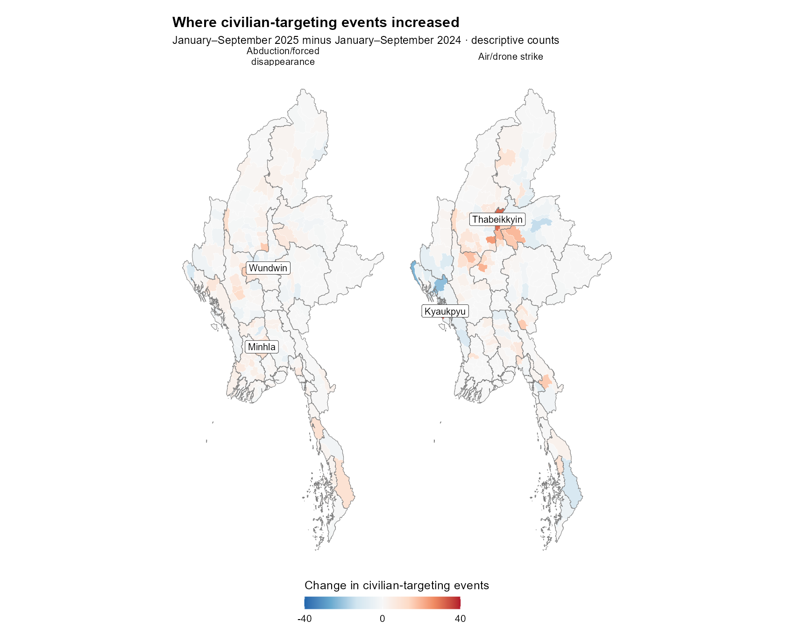

Kyaukpyu has the largest civilian-targeting air/drone increase, from `r kyaukpyu_air$civilian_2024` to `r kyaukpyu_air$civilian_2025`. Its total civilian-targeting count rose from `r results$recurrence$civilian_2024[results$recurrence$TS == 'Kyaukpyu']` to `r results$recurrence$civilian_2025[results$recurrence$TS == 'Kyaukpyu']`, a smaller rise because other categories fell. Large aerial increases also occurred in Thabeikkyin (`r aerial_places$civilian_2024[aerial_places$TS == 'Thabeikkyin']` to `r aerial_places$civilian_2025[aerial_places$TS == 'Thabeikkyin']`) and Wetlet (`r aerial_places$civilian_2024[aerial_places$TS == 'Wetlet']` to `r aerial_places$civilian_2025[aerial_places$TS == 'Wetlet']`).

Abductions increased most in Wundwin, from `r abduction_places$civilian_2024[abduction_places$TS == 'Wundwin']` to `r abduction_places$civilian_2025[abduction_places$TS == 'Wundwin']`, followed by Minhla in Bago (West), from `r abduction_places$civilian_2024[abduction_places$TS == 'Minhla' & abduction_places$ST == 'Bago (West)']` to `r abduction_places$civilian_2025[abduction_places$TS == 'Minhla' & abduction_places$ST == 'Bago (West)']`. These are different places from the largest aerial increases, pointing to different local protection needs.

Kyaukpyu’s rise also runs against Rakhine’s overall decline. [Fieldwork in Rakhine](https://academic.oup.com/jogss/article/10/3/ogaf009/8108008) describes daily life under competing authorities. It provides regional context; the timing, actors and sources in Kyaukpyu’s event accounts would help explain this particular increase.

### Civilian targeting recurred over many months {#repeated-civilian-targeting}

A large total can build up over years or during a short, intense period. To distinguish these histories, each month counts once if it contains at least one civilian-targeting event. The national map covers all 57 months; the heatmap follows eight townships discussed earlier.

`sum(civilian > 0)` counts months with at least one recorded civilian-targeting event.

```{r}
#| label: th02-recurrence-counts
#| eval: false
```

Repeat that count for the matched nine-month periods.

```{r}
#| label: th02-recent-recurrence
#| eval: false
```

Join the full-period and recent counts to the township names.

```{r}
#| label: th02-join-recurrence
#| eval: false
```

Map the number of affected months, from zero to 57.

```{r}
#| label: th02-recurrence-plot
#| eval: false
```

Select the eight townships for the monthly comparison.

```{r}
#| label: th02-recurrence-cases
#| eval: false
```

```{r}
#| label: th02-recurrence-series
#| eval: false
#| code-fold: true
#| code-summary: "Prepare the monthly rows and township labels"
```

Draw every month in grey first, then colour the months with recorded events.

```{r}
#| label: th02-recurrence-heatmap
#| eval: false
```

```{r}
#| label: th02-recurrence-save
#| eval: false
#| code-fold: true
#| code-summary: "Arrange and save the recurrence figures"
```

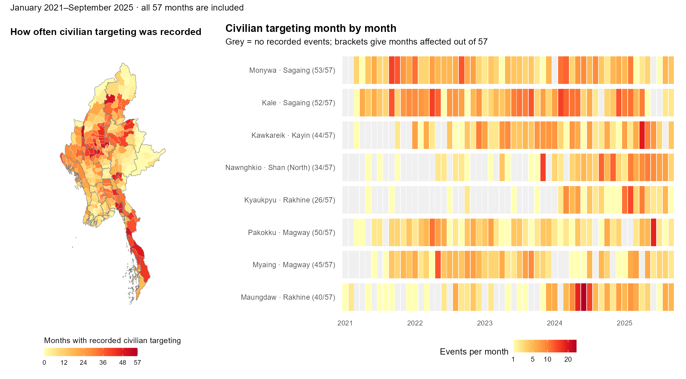

Monywa recorded civilian targeting in `r monywa$months_affected` of the 57 months, Kale in `r results$recurrence$months_affected[results$recurrence$TS == 'Kale']`, and Pakokku in `r results$recurrence$months_affected[results$recurrence$TS == 'Pakokku']`. These histories extend across most of the study period. Kyaukpyu had `r results$recurrence$months_affected[results$recurrence$TS == 'Kyaukpyu']` affected months overall, including all nine months of 2025.

Monywa’s civilian series had `r civilian_ehsa$hot_months[civilian_ehsa$TS == 'Monywa']` hot months, compared with `r monywa$months_affected` months containing a recorded event. It ended with “No pattern detected” in both the overall and civilian analyses.

| Measure | What it tells us about Monywa |
|---|---|
| Months with civilian targeting | Any recorded incident makes a month count, giving `r monywa$months_affected` affected months. |
| Civilian hotspot months | The neighbourhood had unusually high counts in `r civilian_ehsa$hot_months[civilian_ehsa$TS == 'Monywa']` months under the whole-period reference. |
| Final EHSA class | September 2025 was not a hotspot month, and the preceding sequence did not meet another class. |

A grey heatmap cell means no civilian-targeting event was recorded that month. [OCHA’s September update](https://myanmar.un.org/en/302070-myanmar-humanitarian-update-no-49) describes continuing restrictions on movement and aid access, hardships that can persist between recorded incidents.

### Fewer incidents can still leave most months affected {#recent-civilian-recurrence}

For January to September in each year, the table pairs the number of events with the number of months containing at least one event.

```{r}
#| label: th02-recurrence-table
recurrence_table <- results$recurrence %>%
  filter(TS %in% c("Monywa", "Kale", "Kawkareik", "Nawnghkio", "Kyaukpyu",
                   "Pakokku", "Myaing", "Maungdaw")) %>%
  arrange(TS) %>%
  transmute(Township = paste(TS, ST, sep = " · "),
            `Events 2024` = civilian_2024, `Events 2025` = civilian_2025,
            `Months 2024` = months_affected_2024, `Months 2025` = months_affected_2025)
knitr::kable(recurrence_table, caption = "Civilian targeting, January–September in both years; months are out of nine.")
```

Monywa’s count fell from `r monywa$civilian_2024` to `r monywa$civilian_2025`, but events still covered `r monywa$months_affected_2024` months in 2024 and `r monywa$months_affected_2025` in 2025. Maungdaw also had `r results$recurrence$months_affected_2024[results$recurrence$TS == 'Maungdaw']` affected months in each year despite a lower total. Both places continued to record incidents through most of the year.

Myaing’s count rose from `r results$recurrence$civilian_2024[results$recurrence$TS == 'Myaing']` to `r results$recurrence$civilian_2025[results$recurrence$TS == 'Myaing']`, spread across `r results$recurrence$months_affected_2024[results$recurrence$TS == 'Myaing']` months in 2024 and `r results$recurrence$months_affected_2025[results$recurrence$TS == 'Myaing']` in 2025. Pakokku’s higher count covered fewer months: `r results$recurrence$months_affected_2025[results$recurrence$TS == 'Pakokku']` compared with `r results$recurrence$months_affected_2024[results$recurrence$TS == 'Pakokku']`. An increase in events can therefore be spread more widely through the year or concentrated into fewer months.

For Monywa, the lower total still leaves a need to follow households facing recurring incidents. In Myaing, both the rising total and the wider spread through the year deserve attention.

## Reading the findings together {#integrated-findings}

The three study questions lead to the following findings:

| Study question | Main finding |
|---|---|
| Where did conflict cluster and change? | Most whole-period hotspots were in central Myanmar. Recent increases extended across Kawkareik’s neighbours, while Kyaukpyu and Nawnghkio rose beside an average decline. |
| Which forms of violence increased? | Civilian-targeting air/drone and abduction events rose sharply. Declines in shelling and other categories left the civilian total only 2% lower. |
| Where did civilian targeting keep recurring? | Monywa, Kale and Pakokku recorded incidents through most of the 57 months. Monywa and Maungdaw still had incidents in eight of nine months in both recent years, despite lower counts. |

The national decline was uneven in both place and form. Fewer total events could coexist with rising civilian targeting, as in Myaing and Pakokku. A falling count could also leave incidents recurring through most months, as in Monywa.

The monthly civilian analysis adds another distinction. Nawnghkio is a hotspot in both histories, while Kawkareik’s overall and civilian histories end differently. The reference check also changes some labels, including Kawkareik’s, even where the rising trend remains. Reading these labels alongside the counts gives a clearer account of what changed locally.

The published accounts help place these findings in context. ACLED describes changing tactics and armed-group relationships; the Rakhine fieldwork and OCHA reports describe daily restrictions and interrupted services. Together, they give a reason to consider the type and timing of violence when following up local needs. The event maps locate recorded changes, while local accounts are needed to understand their consequences for households.

## Priorities for civilian assistance {#recommendations-and-limitations}

### Recommendations

Humanitarian organisations and local partners could use these findings to review the following gaps in support:

- Compare food, shelter and medical coverage with the hotspot townships in Sagaing, Mandalay and Magway. Include nearby communities when identifying areas with little support.
- Review whether assistance in Kawkareik and Nawnghkio has kept pace with rising conflict. Include Hlaingbwe and the other townships around Kawkareik where counts increased.
- Check routes to emergency care and arrangements for reaching households after aerial attacks in Kyaukpyu, Thabeikkyin and Wetlet. In Wundwin and Minhla (Bago West), work with local protection organisations on confidential support and referrals for families affected by abduction.
- Maintain contact with communities in Monywa and Maungdaw, where civilian targeting continued in eight of nine months in both years. Assess household needs following the high reported death tolls in Kale and Maungdaw.
- Check whether assistance reaches affected communities in Myaing and Pakokku, where civilian targeting increased despite lower overall counts. For the civilian hotspots in Hakha, Tonzang and Nawnghkio, locate the incidents across neighbouring townships before deciding where follow-up is needed.

[OCHA reports access and funding constraints](https://myanmar.un.org/en/302070-myanmar-humanitarian-update-no-49). Local partners’ coverage and priorities should guide which gaps can be addressed. Before using the shortlist operationally, update the records beyond September 2025 and confirm conditions on the ground.

### Further study {#further-study}

The event accounts offer a useful next step. For abductions, they could help distinguish forced recruitment from other forms of coercion, identify the actors involved and check for changes in reporting. In Kyaukpyu, the monthly accounts could show whether the aerial increase was concentrated around particular episodes.

A further study could compare these histories with displacement, functioning clinics and travel restrictions. Local testimony would help explain what happened between recorded incidents, whether people could reach support, and the difficulties they faced when trying to return home.

### Limits of these maps

Reporting coverage, approximate locations and township size affect the counts. Fixed boundaries also leave out population movements and differences in exposure. These maps identify concentrations of recorded events. Explaining their causes or assessing present-day safety requires current local evidence.

Some hotspot histories change with the comparison period, the final month and the treatment of related months. The report keeps these checks beside the results so that a changing label can be read alongside the event history. Week-level dates near month boundaries add uncertainty to individual monthly classifications.

## Sources {#references-and-approach}

- [Exercise 2 handout](https://isss626-ay2026-27aug.netlify.app/take-home_ex02)
- [ACLED Myanmar data](https://acleddata.com/country/myanmar)
- [ACLED codebook](https://acleddata.com/methodology/acled-codebook)
- [ACLED: Between cooperation and competition: The struggle of resistance groups in Myanmar](https://acleddata.com/report/between-cooperation-and-competition-struggle-resistance-groups-myanmar)
- [ACLED’s October 2023 regional overview](https://acleddata.com/update/regional-overview-asia-pacific-october-2023)
- [OCHA’s 2025 humanitarian response plan](https://myanmar.un.org/en/286727-myanmar-humanitarian-needs-and-response-plan-2025-december-2024)
- [Brenner and Han (2022): Forgotten Conflicts: Producing Knowledge and Ignorance in Security Studies](https://academic.oup.com/jogss/article/7/1/ogab022/6369076)
- [Weigand et al. (2025): Agency during Armed Conflict: Everyday Life under Competing Authorities in Myanmar’s Rakhine State](https://academic.oup.com/jogss/article/10/3/ogaf009/8108008)
- [ACLED: The war from the sky: How drone warfare is shaping the conflict in Myanmar](https://acleddata.com/report/war-sky-how-drone-warfare-shaping-conflict-myanmar)
- [ACLED: Four years after the 2021 coup in Myanmar, violence against civilians is still increasing](https://acleddata.com/report/four-years-after-2021-coup-myanmar-violence-against-civilians-still-increasing)
- [OCHA: Myanmar Humanitarian Update No. 49, 23 September 2025](https://myanmar.un.org/en/302070-myanmar-humanitarian-update-no-49)
- [MIMU township boundaries v9.4](https://geonode.themimu.info/layers/geonode:mmr_polbnda_adm3_250k_mimu_1)
- R for Geospatial Data Science and Analytics: [Chapter 8](https://r4gdsa.netlify.app/chap08.html), [Chapter 9](https://r4gdsa.netlify.app/chap09.html), [Chapter 10](https://r4gdsa.netlify.app/chap10.html) and [Chapter 11](https://r4gdsa.netlify.app/chap11)
- [ArcGIS EHSA definitions](https://doc.esri.com/en/arcgis-pro/latest/tool-reference/space-time-pattern-mining/learnmoreemerging.html)
- [spdep: Getis–Ord G and Gi* statistics](https://r-spatial.github.io/spdep/reference/localG.html)
- [Christover Manafe’s Take-home Exercise 2](https://isss626-camanafe.netlify.app/take_home_ex/take_home_ex02/take_home_ex02#feature-engineering)
- [Matthew Ho’s Take-home Exercise 2](https://is415-gaa-matthew-ho.netlify.app/takehomeex/takehomeex2/the2)
- [Khant Min Naing’s Take-home Exercise 2](https://is415-geospatial-with-khant.netlify.app/take-home_ex/take-home_ex02/take-home_ex02)
