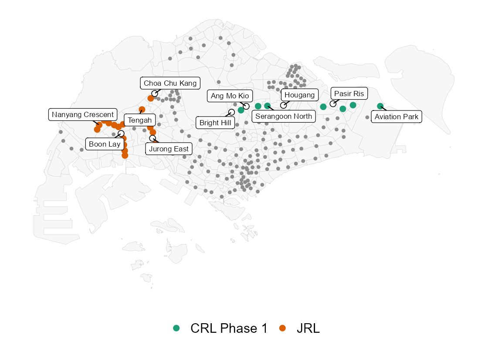
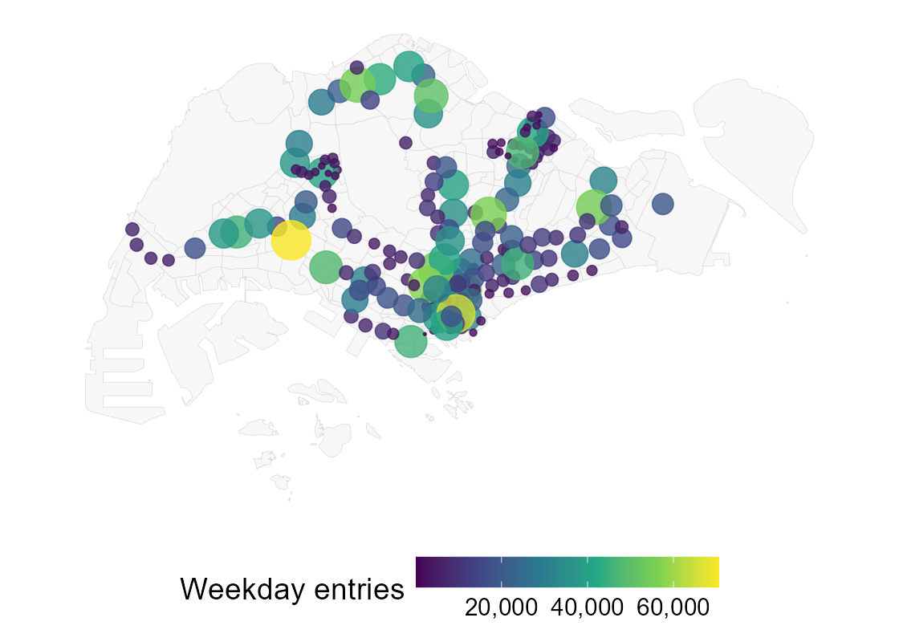
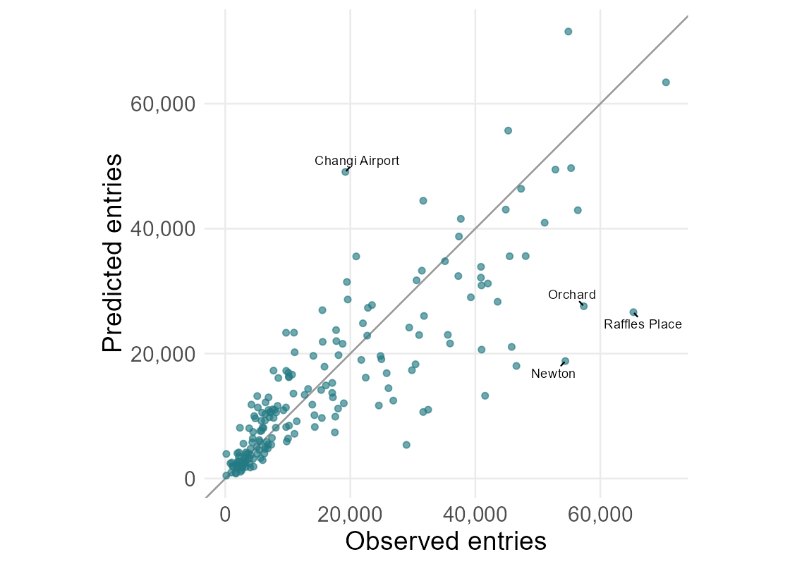
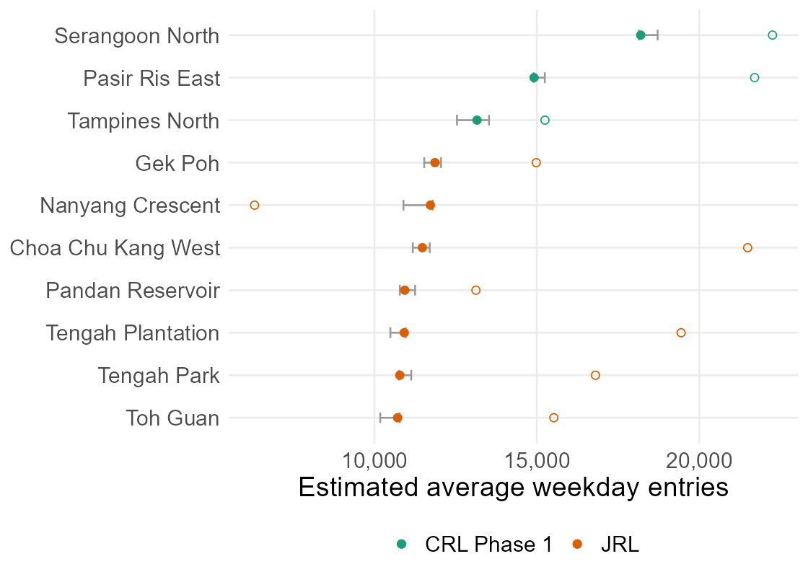
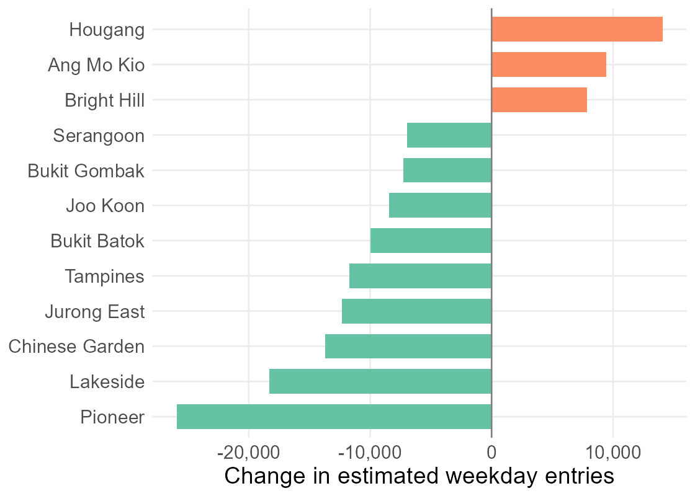
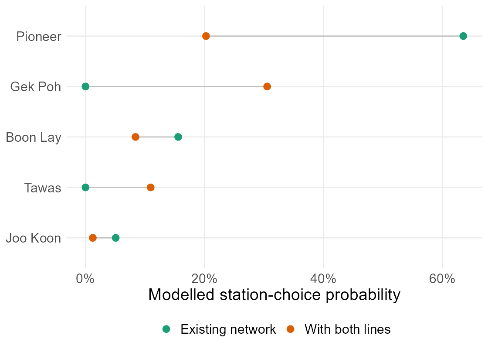
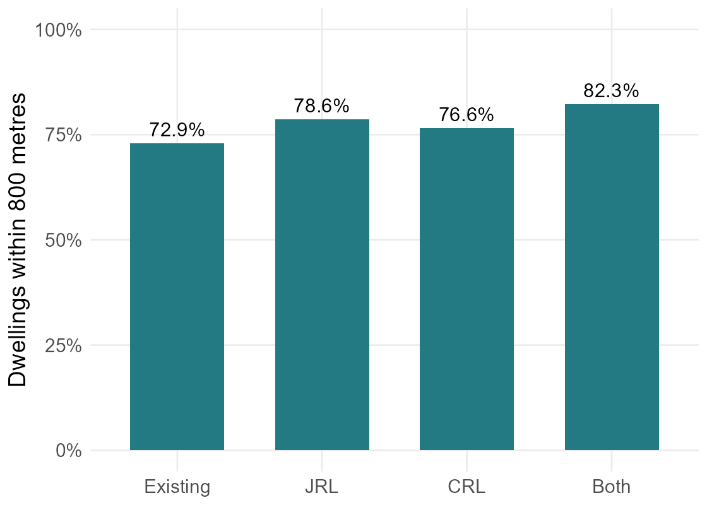
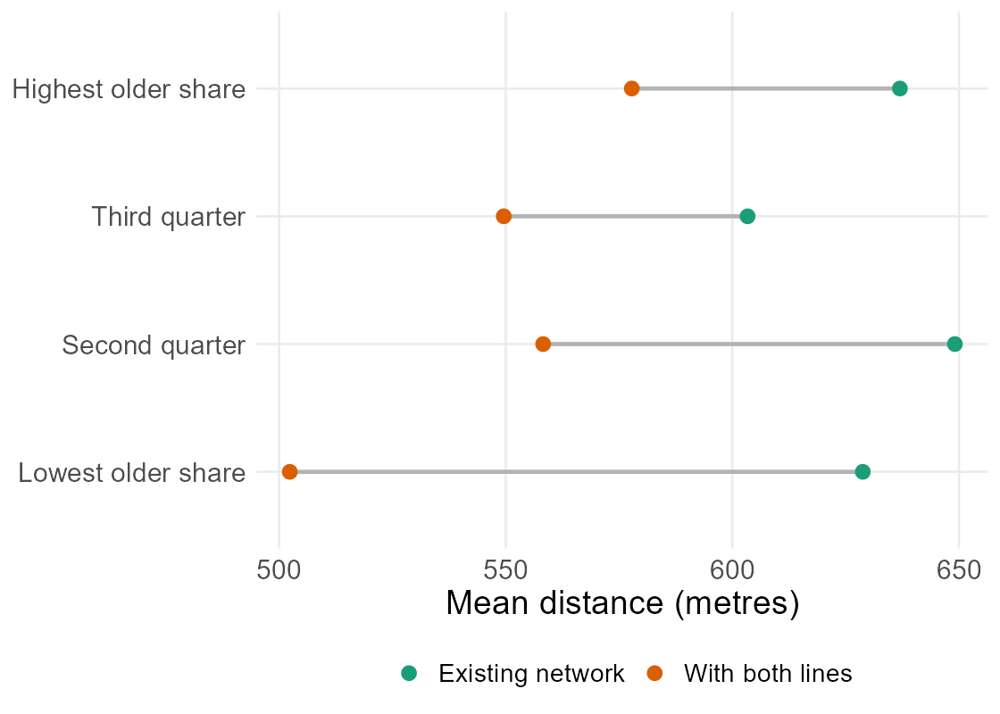

```{r}
#| include: false
library(tidyverse)
# The report QMD creates these shared results and the summary figures.
analysis <- readRDS("data/take-home-03/derived/analysis.rds")
prepared <- analysis$prepared
ridership <- analysis$ridership
details <- analysis$details
review <- readRDS("data/take-home-03/derived/review.rds")
stopifnot(identical(review$baseline_sha256,
  digest::digest(file = "data/take-home-03/derived/analysis.rds", algo = "sha256")))
diagnostics <- readRDS("data/take-home-03/derived/station-diagnostics.rds")
office_check <- ridership$fold_sensitivity %>% group_by(model) %>%
  summarise(WAPE = sum(abs(predicted - observed)) / sum(observed), .groups = "drop")
fmt <- function(x) scales::comma(round(x))
estimate <- function(x) scales::comma(round(x, -2))
pct <- function(x) scales::percent(x, accuracy = 0.1)
coverage <- prepared$coverage %>% filter(threshold == 800)
before <- coverage$share[coverage$scenario == "Existing"]
after <- coverage$share[coverage$scenario == "Both"]
top <- details$top_access
older <- prepared$equity %>% filter(scenario == "Both", age_group == "Highest older share")
younger <- prepared$equity %>% filter(scenario == "Both", age_group == "Lowest older share")
selected <- ridership$performance %>% filter(model == ridership$fit$model)
distance_expansion <- details$distance_summary %>% filter(scenario == "Both")
combined <- details$scenarios %>% filter(scenario == "Both")
new_top <- ridership$predictions %>% filter(scenario == "Both", !existing) %>%
  slice_max(predicted, n = 1, with_ties = FALSE)
largest_change <- details$change_station
largest_gain <- ridership$predictions %>% filter(scenario == "Both", existing) %>%
  slice_max(change, n = 1, with_ties = FALSE)
pioneer <- details$local_choices %>% filter(station_id == largest_change$station_id)
local_leader <- details$local_choices %>% filter(scenario == "Both") %>%
  slice_max(probability, n = 1, with_ties = FALSE)
residential_sensitivity <- details$sensitivity %>% filter(check == "Residential demand only")
hougang_check <- review$interchanges %>% filter(station_id == "HOUGANG")
recent_tel <- review$recent_groups %>% filter(startsWith(recent_group, "TEL4"))
age_coverage <- review$age_coverage %>%
  select(age_group, scenario, share) %>% pivot_wider(names_from = scenario, values_from = share)
age_gap_before <- age_coverage$Existing[age_coverage$age_group == "Lowest older share"] -
  age_coverage$Existing[age_coverage$age_group == "Highest older share"]
age_gap_after <- age_coverage$Both[age_coverage$age_group == "Lowest older share"] -
  age_coverage$Both[age_coverage$age_group == "Highest older share"]
```

## What changes when a new station opens? {#study-question}

::: {.columns}
::: {.column width="42%"}
A closer station may change where people enter the railway, even if they make the same number of journeys.

- What explains weekday boardings?
- Which neighbourhoods might switch stations?
- Which neighbourhoods gain closer access?

The scenario adds the handout's 24 JRL and 12 CRL Phase 1 stations.

Ridership figures count entries on an average weekday. Transfers inside the railway are excluded.
:::
::: {.column width="58%"}

:::
:::

## September 2026 journeys and station surroundings {#data}

- `r nrow(prepared$stations$Existing)` existing stations, counting each interchange once.
- `r nrow(prepared$stations$Both) - nrow(prepared$stations$Existing)` new locations with both lines; seven existing stations gain connections.
- `r nrow(prepared$origins)` subzones, with June 2026 residents, mapped facilities and 2025 worker counts.
- `r fmt(prepared$hdb_match$matched_dwellings)` HDB homes located on the map: `r pct(prepared$hdb_match$matched_dwellings / prepared$hdb_match$total_dwellings)` of the property-table total.

September 2026 weekday entries are the starting point; August provides another check. Every network comparison uses the same population, activities and total journeys.

::: {.smaller}
Subzone names match between the 2026 population data and the older 2019 map. Some homes could not be located: the mapped sample covers `r pct(review$housing_quality$share[review$housing_quality$bldg_contract_town == "TG"])` of Tengah homes and `r pct(review$housing_quality$share[review$housing_quality$bldg_contract_town == "BM"])` of Bukit Merah homes. [Data sources](take-home-exercise-03.qmd#sec-data)
:::

## Busy stations serve homes and workplaces {#current-boardings}

::: {.columns}
::: {.column width="40%"}
September averages **`r fmt(sum(ridership$observed$entries))` weekday entries**.

Jurong East leads, followed by Raffles Place. Yishun is also among the busiest despite having one line.

Counting the whole day captures people leaving homes, workplaces and other activities. Each journey is counted once, where it enters the railway. This is why the model needs more than residential population.
:::
::: {.column width="60%"}

:::
:::

## Estimate the choice between nearby stations {#model}

The Huff model gives each station a share of journeys from nearby places. Closer stations usually receive a larger share; transport connections can increase their appeal.

| Improvement | What changes |
|---|---|
| Use more detailed starting locations | Place HDB residents at mapped blocks and activities at facility locations |
| Distinguish MRT and LRT-only stops | Let the model learn how their appeal differs, alongside rail and bus connections |
| Use worker counts | Use totals by workplace area to weight activity locations |

To test it, I divide stations into five geographical groups. The model learns from four groups and predicts the fifth without using its entry counts. Every model uses the same tests.

::: {.smaller}
Worker counts describe where employed residents work, across 44 planning areas. Facility locations help place them within each area; nearby starting points are grouped in 500-metre cells. [Model and validation](take-home-exercise-03.qmd#sec-model)
:::

## Predictions improve, but recent stations are overestimated {#validation}

::: {.columns}
::: {.column width="44%"}
For the stations left out of fitting, the combined size of the errors is **`r pct(selected$WAPE)`** of recorded entries (WAPE). Separate MRT/LRT averages give `r pct(review$benchmarks$WAPE[review$benchmarks$model == "Training mean within MRT / LRT"])`.

When all eleven recently opened stations are left out of fitting, the model predicts `r round(recent_tel$group_holdout / recent_tel$observed, 1)` times TEL4's recorded entries. It also overestimates Hume and CCL6. [Recent-station check](take-home-exercise-03.qmd#sec-validation)

The model helps compare locations. Capacity planning needs better evidence on likely passenger numbers.

:::
::: {.column width="56%"}

:::
:::

::: {.smaller}
Limiting choices to nearby stations gives `r pct(min(ridership$distance_performance$WAPE[is.finite(ridership$distance_performance$max_distance)]))` to `r pct(max(ridership$distance_performance$WAPE[is.finite(ridership$distance_performance$max_distance)]))` error; the exponential curve gives `r pct(ridership$distance_performance$WAPE[ridership$distance_performance$distance_form == "exponential"])`. I keep the power curve. Another geographical grouping gives `r pct(office_check$WAPE[office_check$model == ridership$fit$model])`; August gives `r pct(ridership$temporal$WAPE)` at the same stations. Both geographical groupings helped choose the model.
:::

## `r new_top$station` leads the new locations {#new-stations}

::: {.columns}
::: {.column width="39%"}
With both lines added, new stations receive **`r pct(combined$new_share)`** of the same total journeys.

`r new_top$station` receives about `r estimate(new_top$predicted)` weekday entries. Pasir Ris East follows.

Changing the distance rule puts the new-station share between `r pct(min(distance_expansion$new_share))` and `r pct(max(distance_expansion$new_share))`. Learning from different station groups gives `r pct(min(review$fold_scenarios$new_share))` to `r pct(max(review$fold_scenarios$new_share))`; placing journeys by residents alone gives `r pct(residential_sensitivity$new_share)`.
:::
::: {.column width="61%"}

:::
:::

::: {.smaller}
Filled dots show the selected model; hollow dots use residents alone. Bars show the bus-stop radius and minimum-distance checks. Aviation Park and Tengah have low estimates. [All new stations](take-home-exercise-03.qmd#sec-quiet-stations)
:::

## Pioneer faces alternatives; Hougang gains a line {#existing-stations}

::: {.columns}
::: {.column width="40%"}
`r largest_change$station`: about **`r estimate(abs(largest_change$change))` fewer** daily entries (`r pct(abs(largest_change$percent_change))`).

`r largest_gain$station`: about **`r estimate(largest_gain$change)` more** (`r pct(largest_gain$percent_change)`).

Give Hougang no extra attraction for gaining a line, and its predicted gain becomes a **loss of `r estimate(abs(hougang_check$fixed_change))`**. Much of its forecast depends on this assumption.

::: {.smaller}
Total journeys stay fixed; entries exclude transfers inside stations. Small losses far from new stations vary strongly with the distance rule. [Interchange check](take-home-exercise-03.qmd#sec-interchanges) · [Distance check](take-home-exercise-03-workflow.qmd#distance-expansion)
:::
:::
::: {.column width="60%"}

:::
:::

## Yunnan's journeys could spread across several stations {#catchments}

::: {.columns}
::: {.column width="40%"}
Across Singapore, the leading station choice changes in **`r combined$changed_origins` of `r combined$active_origins`** subzones with estimated journeys.

In Yunnan, Pioneer's share falls from `r pct(pioneer$probability[pioneer$scenario == "Existing"])` to `r pct(pioneer$probability[pioneer$scenario == "Both"])`. `r local_leader$station` becomes the leading choice.

The model leaves out final destinations and transfers. Someone needing the EWL may still prefer Pioneer to a closer JRL station. Actual journeys need checking before feeder routes change.
:::
::: {.column width="60%"}

:::
:::

## More homes are closer, with uneven gains {#access}

The share of mapped homes within 800 metres of a station rises from **`r pct(before)` to `r pct(after)`** with both lines.

::: {.columns}
::: {.column width="52%"}

:::
::: {.column width="48%"}

:::
:::

Homes in neighbourhoods with the largest older-resident share gain `r fmt(older$mean_gain)` metres on average; those with the smallest share gain `r fmt(younger$mean_gain)`. The gap in homes within 800 metres widens from **`r format(round(100 * age_gap_before, 1), nsmall = 1)` to `r format(round(100 * age_gap_after, 1), nsmall = 1)` percentage points**.

::: {.smaller}
Distances are straight lines to MRT/LRT stations. More homes are within reach at 400 and 1,200 metres too. These results come from mapped distances, independently of the ridership model.
:::

## Limitations and planning priorities {#recommendations}

**Limitations.** The model moves today's journeys between stations; it does not add riders from new housing or from buses and cars. Distances are straight lines, population and worker counts cover residents only, and recently opened stations are over-predicted.

- Check walks from Garden's mapped homes to **Hong Kah and Tengah Plantation**. Stations become an average of `r fmt(top$gain_m)` metres closer on the map.
- Check bus travel times and access to stops in **Clementi West and Telok Blangah Way**, two areas with a high share of older residents where all matched homes remain beyond 800 metres.
- Study connections between Yunnan, Pioneer, Gek Poh and Tawas before changing feeder routes.
- Find out where trips start around Serangoon North and Pasir Ris East, and near the quietest new stations, before planning capacity from these estimates.

[Read the report and sources](take-home-exercise-03.qmd#sec-references)
