```{r}
#| label: report-format
#| include: false
library(tidyverse)
library(sf)
library(readxl)
library(jsonlite)
library(MCI)
library(spdep)
library(leaflet)
library(htmlwidgets)
library(ggrepel)

base <- "data/take-home-03"
raw_dir <- file.path(base, "raw")
out <- file.path(base, "derived")
dir.create(out, recursive = TRUE, showWarnings = FALSE)
dir.create("take-home-03", showWarnings = FALSE)
fmt <- function(x) scales::comma(round(x))
estimate <- function(x) scales::comma(round(x, -2))
pct <- function(x) scales::percent(x, accuracy = 0.1)
normalise <- function(x) gsub("[^A-Z0-9]", "", toupper(x))
theme_set(theme_minimal(base_size = 12) +
  theme(panel.grid.minor = element_blank(), plot.title.position = "plot",
    plot.title = element_text(face = "bold"), legend.position = "bottom"))
save_plot <- function(plot, name, width = 10, height = 6) {
  ggsave(file.path("take-home-03", paste0(name, ".png")), plot,
    width = width, height = height, dpi = 160, bg = "white")
}
review <- list()
details <- list()
```

::: {.callout-note}
## This page is the complete workflow

It holds every line of R used in Take-home Exercise 3, from raw downloads to the saved results, including the model-development trials. It runs from top to bottom and saves the tables and figures that the other two pages read.

For the findings, read the [technical report](take-home-exercise-03.qmd) or the [executive summary](take-home-exercise-03-summary.qmd).
:::

## Introduction {#study-questions}

When a new station opens closer to home or work, some passengers may change where they board. The Jurong Region Line (JRL) will bring new stations to western Singapore, while Phase 1 of the Cross Island Line (CRL) will run from Aviation Park to Bright Hill. [LTA's rail development update](https://www.lta.gov.sg/content/ltagov/en/newsroom/2026/3/news-releases/next-phase-of-rail-development.html)

This report asks where passengers might board after the new lines open, and which neighbourhoods would be closer to a station. A station could have modest boarding numbers and still save nearby residents a long trip to reach the railway. I therefore compare both ridership and access from homes.

An entry is the start of a rail journey at a station; a transfer between lines inside the railway is not another entry. Unless stated otherwise, the counts below are entries on an average weekday. A station's catchment is the area it draws passengers from. Catchments can overlap because people in the same neighbourhood may choose different stations.

### Study questions

- What helps explain the differences in weekday boardings between existing stations?
- Where could JRL and CRL Phase 1 draw passengers, and how would nearby catchments change?
- Which neighbourhoods gain closer access, including those with more older residents?

I compare today's network with the handout's 24 JRL stations and 12 CRL Phase 1 stations, CR2 to CR13, added. In each comparison, the population, workplaces and total number of rail journeys stay the same. This shows how existing journeys might shift between stations under current conditions. Future housing growth and extra journeys encouraged by the new lines would need a separate forecast.

Hume opened in February 2025, years after its station shell was built. Its history raises a useful question for this study: how well can current conditions tell us about demand at a new station? I check the model against recently opened stations and look at the proposed stations with low estimates as well as the busiest ones. [LTA: Hume station](https://www.lta.gov.sg/content/ltagov/en/newsroom/2025/1/news-releases/hume_station_to_open.html)

| Handout objective | Where it is addressed |
|---|---|
| Fit a model of station choice | [Station choice and validation](#estimating-station-choice) |
| Predict proposed stations' entries | [JRL and CRL estimates](#expanded-network) |
| Examine effects on existing stations | [Station changes and catchments](#existing-stations-gain-connections-and-competition) |

The [neighbourhood access comparison](#neighbourhood-access) then looks at the homes served by these changes, including areas with more older residents.

## Data and study area {#data-and-study-area}

### A common date for the comparison

September 2026 provides the starting picture of station use. I count entries across the whole weekday, so the data include journeys starting near homes, workplaces and shops. Each journey is counted once, where the passenger enters the railway. August provides a check on whether the model also works in another month.

The passenger data tell us how busy each station is. To understand those differences and estimate use at future stations, I also need to know where people live, where activities are located and which transport connections are nearby.

| Source | Use in this study |
|---|---|
| [LTA passenger volumes](https://datamall.lta.gov.sg/content/datamall/en/dynamic-data.html) | Journeys between stations, added up to give weekday entries at each station |
| [LTA geospatial data and station codes](https://datamall.lta.gov.sg/content/datamall/en/static-data.html) | September 2026 station locations, operating bus stops and station names |
| [Future station coordinates](https://github.com/elliotwutingfeng/singapore_train_station_coordinates) | Proposed locations, checked against LTA's line descriptions |
| [SingStat geographic distribution](https://www.singstat.gov.sg/find-data/explore-data-themes/population/geographic-distribution/latest-news-data) | June 2026 residents by age and dwelling type |
| [SingStat workplace locations, GHS 2025](https://tablebuilder.singstat.gov.sg/table/CT/C020150) | How many employed residents work in each planning area |
| [LTA bus routes and services](https://datamall.lta.gov.sg/content/datamall/en/dynamic-data.html) | Direct bus alternatives and daytime service frequencies, retrieved 4 November 2026 |
| [URA subzone boundaries](https://data.gov.sg/datasets/d_8594ae9ff96d0c708bc2af633048edfb/view) | Subzone locations and boundaries |
| [HDB buildings](https://data.gov.sg/datasets/d_16b157c52ed637edd6ba1232e026258d/view) and [Property Information](https://data.gov.sg/datasets/d_17f5382f26140b1fdae0ba2ef6239d2f/view) | Completed residential blocks and dwelling counts |
| [OpenStreetMap, distributed by Geofabrik](https://download.geofabrik.de/asia/malaysia-singapore-brunei.html) | Shops, workplaces and other facilities, plus addresses for matching housing records |

### Boundaries and population

I match the population table to subzones by planning area and subzone name, then measure distances in Singapore’s SVY21 coordinate system.

```{r}
#| label: th03-population
subzones <- st_read("data/geospatial/MasterPlan2019SubzoneBoundaryNoSea.geojson", quiet = TRUE) %>%
  st_make_valid() %>% st_transform(3414) %>%
  transmute(origin_id = SUBZONE_C, subzone = SUBZONE_N, planning_area = PLN_AREA_N,
            region = REGION_N, key = normalise(paste(PLN_AREA_N, SUBZONE_N)))
population <- read_csv(file.path(raw_dir, "population-2026/respopagesextod2026.csv"),
                       show_col_types = FALSE)
stopifnot(!anyNA(population$Pop), all(population$Time == 2026),
          !anyDuplicated(population[c("PA", "SZ", "AG", "Sex", "TOD", "Time")]))
population <- population %>%
  mutate(key = normalise(paste(PA, SZ)), age = parse_number(AG), hdb = startsWith(TOD, "HDB")) %>%
  group_by(key) %>%
  summarise(residents = sum(Pop), hdb_residents = sum(Pop[hdb]),
            older_hdb = sum(Pop[hdb & age >= 65]), .groups = "drop")
stopifnot(setequal(population$key, subzones$key), !anyDuplicated(subzones$key))
subzones <- left_join(subzones, population, by = "key") %>%
  mutate(older_share = if_else(hdb_residents > 0, older_hdb / hdb_residents, NA_real_))
origins <- st_point_on_surface(subzones) %>% arrange(origin_id)
```

The population table uses Master Plan 2025, while the available map has 2019 boundaries. All `r nrow(subzones)` subzone names match. I use those boundaries as an approximate map of the population; the population counts are rounded to the nearest ten.

### Station locations and connections

I match station codes before combining lines at the same interchange. Circle Line 6 belongs in the September network because it opened in July 2026.

```{r}
#| label: th03-station-codes
codebook <- read_excel(file.path(raw_dir, "station-codes/Train Station Codes and Chinese Names.xls")) %>%
  transmute(code = stn_code, station = mrt_station_english, line = mrt_line_english)
coordinates <- read_csv(file.path(raw_dir, "all-stations.csv"), show_col_types = FALSE)
future <- read_csv(file.path(raw_dir, "future-stations.csv"), show_col_types = FALSE)
# CCL6 opened on 12 July 2026; the downloaded codebook omits these three stations.
ccl6 <- coordinates %>% filter(station_code %in% c("CC30", "CC31", "CC32")) %>%
  transmute(code = station_code, station = station_name, line = "Circle Line")
codebook <- bind_rows(codebook, anti_join(ccl6, codebook, by = "code")) %>%
  mutate(station_id = normalise(station), network = "Existing")
additions <- future %>%
  filter((grepl("^J[SEW][0-9]+$", station_code)) |
           station_code %in% paste0("CR", 2:13)) %>%
  transmute(code = station_code, station = station_name,
            line = if_else(startsWith(code, "J"), "Jurong Region Line", "Cross Island Line"),
            station_id = normalise(station),
            network = if_else(startsWith(code, "J"), "JRL", "CRL Phase 1"))
stopifnot(sum(additions$network == "JRL") == 24, sum(additions$network == "CRL Phase 1") == 12)
code_crosswalk <- bind_rows(codebook, additions)
stopifnot(!anyDuplicated(code_crosswalk$code))
```

```{r}
#| label: th03-station-locations
station_file <- list.files(file.path(raw_dir, "stations"), "\\.shp$", recursive = TRUE, full.names = TRUE)
footprints <- st_read(station_file, quiet = TRUE) %>% st_make_valid() %>% st_transform(3414) %>%
  group_by(STN_NAM) %>% summarise() %>% st_point_on_surface()
xy <- st_coordinates(footprints)
official_xy <- tibble(code = footprints$STN_NAM, x = xy[, 1], y = xy[, 2])
points <- st_as_sf(coordinates, coords = c("lon", "lat"), crs = 4326) %>% st_transform(3414)
xy <- st_coordinates(points)
registry_xy <- tibble(code = coordinates$station_code, registry_x = xy[, 1], registry_y = xy[, 2])
station_rows <- code_crosswalk %>% left_join(official_xy, by = "code") %>%
  left_join(registry_xy, by = "code") %>%
  mutate(x = if_else(network == "Existing", coalesce(x, registry_x), registry_x),
         y = if_else(network == "Existing", coalesce(y, registry_y), registry_y))
stopifnot(!anyNA(station_rows[c("x", "y")]))
# Keep the same representative location for an existing interchange in every scenario.
station_points <- station_rows %>% arrange(network != "Existing", code) %>%
  group_by(station_id) %>% summarise(station = first(station), x = first(x), y = first(y),
                                    existing = any(network == "Existing"), .groups = "drop") %>%
  st_as_sf(coords = c("x", "y"), crs = 3414)
```

```{r}
#| label: th03-bus-connections
bus_file <- list.files(file.path(raw_dir, "bus-stops"), "\\.shp$", recursive = TRUE, full.names = TRUE)
bus_stops <- st_read(bus_file, quiet = TRUE) %>%
  filter(STATUS == "OP") %>% distinct(BUS_STOP_N, .keep_all = TRUE) %>% st_transform(3414)
for (radius in c(400, 500, 800)) {
  station_points[[paste0("bus_", radius)]] <- lengths(st_is_within_distance(station_points, bus_stops, dist = radius))
}
networks <- list(Existing = "Existing", JRL = c("Existing", "JRL"),
                 CRL = c("Existing", "CRL Phase 1"), Both = c("Existing", "JRL", "CRL Phase 1"))
stations <- lapply(networks, function(included) {
  attributes <- code_crosswalk %>% filter(network %in% included) %>% group_by(station_id) %>%
    summarise(lines = n_distinct(line), codes = paste(code, collapse = "/"), .groups = "drop")
  inner_join(station_points, attributes, by = "station_id") %>% arrange(station_id)
})
stopifnot(nrow(stations$Both) - nrow(stations$Existing) == 29)
write_csv(code_crosswalk, file.path(out, "station-code-crosswalk.csv"))
```

### Shops, workplaces and other facilities {#places-where-activities-take-place}

The OSM extract contains points and building outlines. I keep shops, offices, education, healthcare, food and leisure facilities, and represent each outline by a point inside it.

```{r}
#| label: th03-osm-extract
#| code-fold: true
#| code-summary: "Show the R calculation"
# GDAL's streaming conversion consumes every OSM layer, avoiding truncated reads.
osm_gpkg <- file.path(raw_dir, "osm-singapore.gpkg")
if (!file.exists(osm_gpkg)) {
  message("Converting Singapore OSM points and polygons")
  Sys.setenv(OSM_MAX_TMPFILE_SIZE = "512")
  gdal_utils("vectortranslate", file.path(raw_dir, "osm.osm.pbf"), osm_gpkg,
    options = c("-f", "GPKG", "-spat", "103.5", "1.1", "104.15", "1.5", "points", "multipolygons"))
}
tag <- function(x, name) {
  direct <- if (name %in% names(x)) x[[name]] else rep(NA_character_, nrow(x))
  coalesce(direct, str_match(x$other_tags, paste0('"', name, '"=>"([^"]+)"'))[, 2])
}
```

I use the same categories for OSM points and building outlines.

```{r}
#| label: th03-osm-extract-2
#| code-fold: true
#| code-summary: "Show the R calculation"
extract_activity <- function(layer) {
  x <- st_read(osm_gpkg, layer = layer, quiet = TRUE)
  x$amenity_tag <- tag(x, "amenity")
  x$shop_tag <- tag(x, "shop")
  x$office_tag <- tag(x, "office")
  x$leisure_tag <- tag(x, "leisure")
  x <- x %>% mutate(category = case_when(
    !is.na(shop_tag) & !shop_tag %in% c("no", "vacant") ~ "Shops",
    !is.na(office_tag) & office_tag != "no" ~ "Offices",
    amenity_tag %in% c("school", "college", "university", "kindergarten") ~ "Education",
    amenity_tag %in% c("hospital", "clinic", "doctors", "dentist") ~ "Healthcare",
    amenity_tag %in% c("restaurant", "cafe", "fast_food", "food_court", "marketplace", "library", "cinema", "theatre") |
      leisure_tag %in% c("sports_centre", "stadium", "fitness_centre", "swimming_pool") ~ "Food and leisure",
    TRUE ~ NA_character_)) %>% filter(!is.na(category)) %>%
    st_make_valid() %>% st_transform(3414) %>% st_point_on_surface() %>%
    select(name, category)
  x$source_layer <- layer
  x
}
```

I keep facilities inside Singapore’s subzones, then remove nearby duplicates with the same name and category.

```{r}
#| label: th03-osm-extract-3
#| cache: true
#| cache.extra: !expr digest::digest(list(body(extract_activity), subzones, origins, file.info(osm_gpkg)[, c("size", "mtime")]))
#| code-fold: true
#| code-summary: "Show the R calculation"
pois <- bind_rows(extract_activity("multipolygons"), extract_activity("points"))
hits <- st_intersects(pois, subzones)
pois <- pois[lengths(hits) > 0, ]
hits <- hits[lengths(hits) > 0]
pois$origin_id <- subzones$origin_id[vapply(hits, `[`, integer(1), 1)]
# Drop repeated named facilities in the same category within 50 metres.
keys <- paste(normalise(pois$name), pois$category)
duplicate <- rep(FALSE, nrow(pois))
named <- which(!is.na(pois$name) & nzchar(pois$name))
for (group in split(named, keys[named])) {
  if (length(group) < 2) next
  nearby <- st_is_within_distance(pois[group, ], dist = 50)
  for (i in seq_along(group)) {
    earlier <- group[nearby[[i]]]
    duplicate[group[i]] <- any(earlier < group[i] & !duplicate[earlier])
  }
}
pois <- pois[!duplicate, ]
origin_activity <- st_drop_geometry(pois) %>% count(origin_id, name = "activity")
origins <- origins %>% left_join(origin_activity, by = "origin_id") %>% mutate(activity = replace_na(activity, 0L))
stopifnot(sum(origins$activity) == nrow(pois), sum(origins$residents) == sum(population$residents))
```

Records with the same name and category within 50 metres are counted once. The remaining facilities give a measure of activity in each subzone.

```{r}
#| label: th03-interactions
interactions <- lapply(stations, function(destinations) {
  distances <- st_distance(origins, destinations)
  expand_grid(origin_id = origins$origin_id, station_id = destinations$station_id) %>%
    mutate(distance_km = as.vector(t(as.matrix(distances))) / 1000) %>%
    left_join(st_drop_geometry(destinations) %>% select(station_id, lines, starts_with("bus_")), by = "station_id")
})
for (name in names(stations)) {
  stopifnot(nrow(interactions[[name]]) == nrow(origins) * nrow(stations[[name]]),
            !anyDuplicated(interactions[[name]][c("origin_id", "station_id")]),
            !anyNA(interactions[[name]]))
}
```

### Existing and proposed stations {#matching-stations-and-homes}

Before comparing the networks, I need to count interchanges consistently. An interchange is one station, even when several lines serve it. The 36 stations listed for the new lines therefore add `r nrow(stations$Both) - nrow(stations$Existing)` new locations, while seven existing stations gain a connection. Circle Line 6 already belongs in the September network because it opened in July 2026. The later JRL station JS2A is outside the handout's list. [LTA: Circle Line 6](https://www.lta.gov.sg/content/ltagov/en/upcoming_projects/rail_expansion/circle_line_6.html)

```{r}
#| label: th03-network-map
prepared <- list(stations = stations, subzones = subzones)
new_stations <- prepared$stations$Both %>% filter(!existing) %>%
  mutate(line = if_else(startsWith(codes, "J"), "JRL", "CRL Phase 1"))
upgrades <- prepared$stations$Both %>% filter(existing) %>%
  filter(lines > prepared$stations$Existing$lines[match(station_id, prepared$stations$Existing$station_id)])
network_labels <- bind_rows(upgrades, new_stations %>%
  filter(station_id %in% c("AVIATIONPARK", "SERANGOONNORTH", "NANYANGCRESCENT", "TENGAH")))
network_map <- ggplot() +
  geom_sf(data = subzones, fill = "grey97", colour = "grey83", linewidth = 0.15) +
  geom_sf(data = prepared$stations$Existing, colour = "grey55", size = 1.2) +
  geom_sf(data = new_stations, aes(colour = line), size = 2.5) +
  geom_sf(data = upgrades, shape = 21, fill = "white", size = 2.6) +
  geom_label_repel(data = network_labels, aes(label = station, geometry = geometry),
    stat = "sf_coordinates", size = 2.7, seed = 626, min.segment.length = 0, max.overlaps = Inf) +
  scale_colour_brewer(palette = "Dark2") +
  coord_sf(datum = NA) + labs(colour = NULL, x = NULL, y = NULL,
    title = "Where the proposed stations would extend the network",
    subtitle = "New locations in colour; outlined stations gain a connecting line")
save_plot(network_map, "network", height = 6)
```

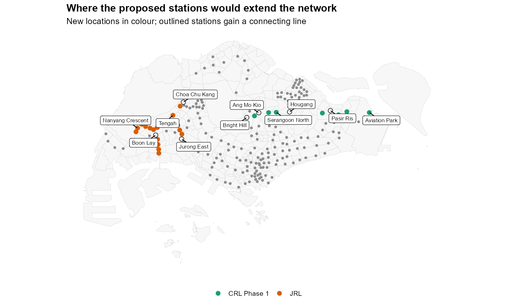

The proposed stations extend into different parts of the island. Interchanges also gain connections, although their physical location stays the same in this comparison.

### Matching homes to the map {#matching-homes-to-the-map}

To measure access from homes, I match HDB property records to building footprints. A matching postal code and a nearby OSM address help identify the street. Where OSM supplies a house number, it must agree with the block number. The two map points must be within 150 metres.

Some footprints use street codes instead of names. I match these where at least 90% of the checked postal addresses agree on the street. For remaining blocks, I look for a shared pattern of block numbers and a confirmed address on the same street within 300 metres. Addresses with competing matches stay out of the sample. Each matched block uses a point inside its largest footprint.

```{r}
#| label: th03-housing-inputs
#| code-fold: true
#| code-summary: "Show the R calculation"
expand_road <- function(x) {
  x <- toupper(x)
  x <- sub("^ST[.]? ", "SAINT ", x)
  abbreviations <- c("RD" = "ROAD", "AVE" = "AVENUE", "ST" = "STREET", "DR" = "DRIVE",
                    "CRES" = "CRESCENT", "TER" = "TERRACE", "NTH" = "NORTH", "STH" = "SOUTH",
                    "BT" = "BUKIT", "UPP" = "UPPER", "CTRL" = "CENTRAL", "JLN" = "JALAN",
                    "LOR" = "LORONG", "TG" = "TANJONG", "KG" = "KAMPONG", "C'WEALTH" = "COMMONWEALTH",
                    "CL" = "CLOSE", "PK" = "PARK", "GDN" = "GARDEN", "GDNS" = "GARDENS",
                    "HTS" = "HEIGHTS", "PL" = "PLACE")
  for (short in names(abbreviations)) x <- gsub(paste0("\\b", short, "\\b"), abbreviations[[short]], x)
  normalise(x)
}
```

The property table identifies residential blocks and their number of homes.

```{r}
#| label: th03-housing-inputs-2
#| code-fold: true
#| code-summary: "Show the R calculation"
properties <- read_csv(file.path(raw_dir, "hdb-properties.csv"), show_col_types = FALSE) %>%
  filter(residential == "Y", total_dwelling_units > 0) %>%
  mutate(address_key = paste(normalise(blk_no), expand_road(street)))
stopifnot(!anyDuplicated(properties$address_key))
building_footprints <- st_read(file.path(raw_dir, "hdb-buildings.geojson"), quiet = TRUE) %>%
  st_make_valid() %>% st_transform(3414)
# Postal addresses must be within 150 m; check the house number when supplied.
```

I look for OSM addresses with postal codes found in the HDB footprints.

```{r}
#| label: th03-housing-inputs-3
#| cache: true
#| cache.extra: !expr digest::digest(list(body(tag), building_footprints$POSTAL_COD, file.info(osm_gpkg)[, c("size", "mtime")]))
#| code-fold: true
#| code-summary: "Show the R calculation"
address_rows <- lapply(c("points", "multipolygons"), function(layer) {
  x <- st_read(osm_gpkg, layer = layer, quiet = TRUE)
  x$road <- tag(x, "addr:street")
  x$postal <- tag(x, "addr:postcode")
  x$block <- tag(x, "addr:housenumber")
  x %>% filter(!is.na(road), postal %in% building_footprints$POSTAL_COD) %>%
    select(road, postal, block) %>% st_make_valid() %>% st_transform(3414) %>% st_point_on_surface()
}) %>% bind_rows()
xy <- st_coordinates(address_rows)
address_rows <- st_drop_geometry(address_rows) %>% mutate(address_x = xy[, 1], address_y = xy[, 2])
saveRDS(address_rows, file.path(out, "hdb-postal-evidence.rds"))
```

```{r}
#| label: th03-housing-matching
#| code-fold: true
#| code-summary: "Show the R calculation"
points <- st_point_on_surface(building_footprints)
xy <- st_coordinates(points)
buildings <- st_drop_geometry(building_footprints) %>%
  mutate(x = xy[, 1], y = xy[, 2], footprint_area = as.numeric(st_area(building_footprints)))
# A postal code locates an HDB block even when OSM omits its house number.
evidence <- inner_join(buildings, address_rows, by = c("POSTAL_COD" = "postal"),
                       relationship = "many-to-many") %>%
  filter(is.na(block) | normalise(block) == normalise(BLK_NO)) %>%
  mutate(separation_m = sqrt((x - address_x)^2 + (y - address_y)^2),
         road = expand_road(road), address_key = paste(normalise(BLK_NO), road)) %>%
  filter(separation_m <= 150, road %in% expand_road(properties$street)) %>%
  distinct(OBJECTID, ST_COD, POSTAL_COD, BLK_NO, road, address_key)
conflicts <- evidence %>% count(OBJECTID) %>% filter(n > 1)
direct <- evidence %>% anti_join(conflicts, by = "OBJECTID") %>%
  filter(address_key %in% properties$address_key) %>%
  select(OBJECTID, address_key) %>% mutate(match_method = "Postal address")
```

A street code is usable when at least 90% of the checked postal addresses agree.

```{r}
#| label: th03-housing-matching-2
#| code-fold: true
#| code-summary: "Show the R calculation"
# Street codes need agreement between independently located postal addresses.
votes <- evidence %>% anti_join(conflicts, by = "OBJECTID") %>%
  distinct(ST_COD, POSTAL_COD, road) %>% count(ST_COD, road) %>%
  group_by(ST_COD) %>% mutate(agreement = n / sum(n)) %>% ungroup()
streets <- votes %>% filter(agreement >= 0.9) %>% select(ST_COD, road)
by_street <- buildings %>% anti_join(direct, by = "OBJECTID") %>%
  anti_join(conflicts, by = "OBJECTID") %>% inner_join(streets, by = "ST_COD") %>%
  mutate(address_key = paste(normalise(BLK_NO), road)) %>%
  filter(address_key %in% properties$address_key) %>%
  select(OBJECTID, address_key) %>% mutate(match_method = "Verified street code")
confirmed <- bind_rows(direct, by_street) %>%
  inner_join(buildings, by = "OBJECTID") %>% arrange(desc(footprint_area)) %>%
  distinct(address_key, .keep_all = TRUE)
```

For the remaining blocks, shared block numbers suggest possible streets. A confirmed address on the same street must be within 300 metres.

```{r}
#| label: th03-housing-matching-3
#| code-fold: true
#| code-summary: "Show the R calculation"
# Block-number patterns propose candidates; a nearby confirmed address on the
# same street must support every additional match. Tied candidates stay out.
pairs <- buildings %>% distinct(ST_COD, BLK_NO) %>%
  inner_join(properties %>% select(blk_no, street), by = c("BLK_NO" = "blk_no"),
             relationship = "many-to-many") %>% count(ST_COD, street, name = "shared_blocks")
seeds <- confirmed %>% inner_join(properties %>% select(address_key, street), by = "address_key")
candidates <- buildings %>% anti_join(confirmed, by = "OBJECTID") %>%
  anti_join(conflicts, by = "OBJECTID") %>%
  inner_join(properties %>% anti_join(confirmed, by = "address_key"),
             by = c("BLK_NO" = "blk_no"), relationship = "many-to-many") %>%
  left_join(pairs, by = c("ST_COD", "street")) %>%
  filter(shared_blocks >= 3) %>%
  mutate(nearest_support_m = map_dbl(seq_len(n()), function(i) {
    support <- seeds[seeds$street == street[i], ]
    if (!nrow(support)) return(Inf)
    min(sqrt((x[i] - support$x)^2 + (y[i] - support$y)^2))
  })) %>% filter(nearest_support_m <= 300)
```

I keep only unique address and postal-code pairings, then use the largest footprint for each matched block.

```{r}
#| label: th03-housing-matching-4
#| code-fold: true
#| code-summary: "Show the R calculation"
unique_pairs <- candidates %>% distinct(address_key, POSTAL_COD) %>%
  add_count(address_key, name = "address_candidates") %>%
  add_count(POSTAL_COD, name = "postal_candidates") %>%
  filter(address_candidates == 1, postal_candidates == 1)
added <- candidates %>% semi_join(unique_pairs, by = c("address_key", "POSTAL_COD")) %>%
  arrange(desc(footprint_area)) %>% distinct(address_key, .keep_all = TRUE) %>%
  mutate(match_method = "Block pattern and nearby verified address")
matches <- bind_rows(confirmed, added) %>% select(OBJECTID, address_key, match_method)
stopifnot(!anyDuplicated(matches$OBJECTID), !anyDuplicated(matches$address_key))
```

The match table records how each block was located. I then attach dwelling counts to the matched map points.

```{r}
#| label: th03-housing-matching-5
#| code-fold: true
#| code-summary: "Show the R calculation"
audit <- matches %>% left_join(buildings %>% select(OBJECTID, ST_COD, BLK_NO, POSTAL_COD), by = "OBJECTID")
write_csv(audit, file.path(out, "hdb-match-audit.csv"))
write_csv(candidates %>% select(OBJECTID, address_key, shared_blocks, nearest_support_m),
           file.path(out, "hdb-match-candidates.csv"))
write_csv(votes, file.path(out, "hdb-address-agreement.csv"))
write_csv(streets %>% rename(street_code = ST_COD), file.path(out, "hdb-street-crosswalk.csv"))
buildings <- points %>% select(OBJECTID) %>% inner_join(matches, by = "OBJECTID") %>%
  inner_join(properties %>% select(address_key, blk_no, street, total_dwelling_units), by = "address_key")
```

```{r}
#| label: th03-housing-joins
unmatched <- anti_join(properties, st_drop_geometry(buildings), by = "address_key")
write_csv(unmatched, file.path(out, "unmatched-hdb-properties.csv"))
hits <- st_intersects(buildings, subzones)
buildings$origin_id <- vapply(hits, function(x) if (length(x)) subzones$origin_id[x[1]] else NA_character_, character(1))
stopifnot(!anyNA(buildings$origin_id), !anyDuplicated(buildings$address_key))
prepared <- list(subzones = subzones, origins = origins, stations = stations,
  interactions = interactions, code_crosswalk = code_crosswalk, pois = pois,
  buildings = buildings, hdb_match = tibble(
    total_blocks = nrow(properties), matched_blocks = nrow(buildings),
    total_dwellings = sum(properties$total_dwelling_units),
    matched_dwellings = sum(buildings$total_dwelling_units)))
```

This locates `r fmt(prepared$hdb_match$matched_blocks)` blocks containing `r fmt(prepared$hdb_match$matched_dwellings)` homes, or `r pct(prepared$hdb_match$matched_dwellings / prepared$hdb_match$total_dwellings)` of the homes in the property table. All housing-access percentages below refer to these mapped homes.

### Where the housing sample is incomplete {#housing-data-quality}

```{r}
#| label: th03-housing-quality
#| code-fold: true
#| code-summary: "Show the R calculation"
housing_quality <- properties %>% group_by(bldg_contract_town) %>%
  summarise(properties = n(), dwellings = sum(total_dwelling_units), .groups = "drop") %>%
  left_join(unmatched %>% group_by(bldg_contract_town) %>%
    summarise(unmatched = sum(total_dwelling_units), .groups = "drop"), by = "bldg_contract_town") %>%
  mutate(unmatched = replace_na(unmatched, 0), matched = dwellings - unmatched,
         share = matched / dwellings) %>% arrange(share)
housing_decades <- properties %>% mutate(decade = 10 * (year_completed %/% 10)) %>% group_by(decade) %>%
  summarise(dwellings = sum(total_dwelling_units), .groups = "drop") %>%
  left_join(unmatched %>% mutate(decade = 10 * (year_completed %/% 10)) %>% group_by(decade) %>%
    summarise(unmatched = sum(total_dwelling_units), .groups = "drop"), by = "decade") %>%
  mutate(unmatched = replace_na(unmatched, 0), matched_share = 1 - unmatched / dwellings)
stopifnot(sum(housing_quality$matched) == prepared$hdb_match$matched_dwellings)
review$housing_quality <- housing_quality
review$housing_decades <- housing_decades
```

```{r}
review$housing_quality %>%
  filter(bldg_contract_town %in% c("TG", "BM")) %>%
  transmute(Town = recode(bldg_contract_town, TG = "Tengah", BM = "Bukit Merah"),
            `All dwellings` = fmt(dwellings), Matched = fmt(matched),
            `Matched share` = pct(share)) %>% knitr::kable()
```

The missing homes are unevenly spread. The sample covers `r pct(review$housing_quality$share[review$housing_quality$bldg_contract_town == "TG"])` of Tengah's homes and `r pct(review$housing_quality$share[review$housing_quality$bldg_contract_town == "BM"])` of Bukit Merah's. Both fall below national coverage. Garden's access gains and Telok Blangah Way's remaining gaps describe their mapped homes; including the missing blocks could change those averages.

```{r}
review$housing_decades %>%
  transmute(`Completion decade` = paste0(decade, "s"), Dwellings = fmt(dwellings),
            `Matched share` = pct(matched_share)) %>% knitr::kable()
```

The ridership model uses these locations too. It spreads each subzone's HDB population across the blocks we could match, keeping the total population unchanged. Where blocks are missing, this gives an approximate picture of where residents live. Residents in other housing types are represented by one point inside their subzone.

### Locating residents and workplaces

I distribute HDB residents over the matched blocks and group nearby locations in 500-metre cells. Residents in other housing types stay at their subzone’s representative point. Each subzone keeps its original population and facility totals.

```{r}
#| label: th03-distributed-demand
#| code-fold: true
#| code-summary: "Show the R calculation"
make_demand_locations <- function(prepared, cell_size = 500) {
  origins <- prepared$origins
  buildings <- prepared$buildings %>%
    left_join(st_drop_geometry(origins) %>% select(origin_id, hdb_residents), by = "origin_id") %>%
    group_by(origin_id) %>%
    mutate(residents = hdb_residents * total_dwelling_units / sum(total_dwelling_units)) %>% ungroup()
  remaining <- st_drop_geometry(origins) %>%
    left_join(st_drop_geometry(buildings) %>% group_by(origin_id) %>%
                summarise(allocated = sum(residents)), by = "origin_id") %>%
    mutate(residents = residents - replace_na(allocated, 0))
  b <- st_coordinates(buildings)
  o <- st_coordinates(origins)
  p <- st_coordinates(prepared$pois)
  locations <- bind_rows(
    tibble(subzone_id = buildings$origin_id, x = b[, 1], y = b[, 2],
           weight = buildings$residents, kind = "residential"),
    tibble(subzone_id = origins$origin_id, x = o[, 1], y = o[, 2],
           weight = remaining$residents, kind = "residential"),
    tibble(subzone_id = prepared$pois$origin_id, x = p[, 1], y = p[, 2],
           weight = 1, kind = "activity")) %>% filter(weight > 0)
  # Group nearby points separately for housing and activity, retaining their totals.
  locations <- locations %>%
    group_by(subzone_id, kind, gx = floor(x / cell_size), gy = floor(y / cell_size)) %>%
    summarise(x = weighted.mean(x, weight), y = weighted.mean(y, weight),
              weight = sum(weight), .groups = "drop") %>%
    mutate(origin_id = sprintf("D%04d", row_number()),
           residents = if_else(kind == "residential", weight, 0),
           activity = if_else(kind == "activity", weight, 0)) %>%
    st_as_sf(coords = c("x", "y"), crs = 3414)
  totals <- st_drop_geometry(locations) %>% group_by(subzone_id) %>%
    summarise(residents = sum(residents), activity = sum(activity))
  expected <- st_drop_geometry(origins) %>% filter(residents > 0 | activity > 0) %>%
    select(subzone_id = origin_id, residents, activity)
  check <- left_join(expected, totals, by = "subzone_id", suffix = c("", "_allocated"))
  stopifnot(!anyNA(check), !anyDuplicated(locations$origin_id),
            max(abs(check$residents - check$residents_allocated)) < 1e-6,
            all(check$activity == check$activity_allocated))
  locations
}
```

Office buildings provide another possible measure of activity. I merge overlapping outlines before measuring their ground area.

```{r}
#| label: th03-office-locations
#| code-fold: true
#| code-summary: "Show the R calculation"
make_office_locations <- function(prepared) {
  buildings <- st_read("data/take-home-03/raw/osm-singapore.gpkg",
    query = "SELECT other_tags, geom FROM multipolygons WHERE building = 'office'", quiet = TRUE) %>%
    st_make_valid() %>% st_transform(3414)
  buildings <- buildings[lengths(st_intersects(buildings, prepared$subzones)) > 0, ]
  coverage <- tibble(office_buildings = nrow(buildings),
    with_levels = sum(grepl('"building:levels"=>"[0-9.]+"', buildings$other_tags)))
  locations <- st_as_sf(st_cast(st_union(buildings), "POLYGON"))
  locations$office_area <- as.numeric(st_area(locations))
  locations <- st_point_on_surface(locations)
  hits <- st_intersects(locations, prepared$subzones)
  stopifnot(all(lengths(hits) > 0))
  locations <- locations %>% mutate(origin_id = sprintf("W%04d", row_number()),
    subzone_id = prepared$subzones$origin_id[vapply(hits, `[`, integer(1), 1)],
    kind = "office", residents = 0, activity = 0)
  locations <- st_sf(st_drop_geometry(locations), geometry = st_geometry(locations))
  list(locations = locations, coverage = coverage)
}
```

```{r}
#| label: th03-workplace-inputs
distributed <- make_demand_locations(prepared)
office <- make_office_locations(prepared)
workplace <- fromJSON(file.path(raw_dir, "workplace-industry-2025.json"), simplifyVector = FALSE)$Data
employment <- map_dfr(workplace$row, function(row) {
  total <- keep(row$columns, ~ .x$key == "Total")[[1]]$value
  tibble(planning_area = toupper(row$rowText), workers = as.numeric(if_else(total == "-", "0", total)))
})
areas <- prepared$subzones %>% group_by(planning_area) %>% summarise(.groups = "drop")
mapped <- employment %>% filter(planning_area %in% areas$planning_area)
unmapped <- employment %>% filter(planning_area != "TOTAL", !planning_area %in% areas$planning_area)
stopifnot(!anyDuplicated(employment$planning_area), !anyNA(employment$workers))

# Workplace counts are observed for planning areas; the allocation within them is estimated.
locations <- bind_rows(mutate(distributed, office_area = 0), office$locations) %>%
  left_join(st_drop_geometry(prepared$origins) %>% select(subzone_id = origin_id, planning_area), by = "subzone_id") %>%
  left_join(mapped, by = "planning_area") %>% mutate(workers = replace_na(workers, 0)) %>%
  group_by(planning_area) %>%
  mutate(employment = if (sum(activity) > 0) first(workers) * activity / sum(activity) else 0) %>% ungroup()
allocation <- st_drop_geometry(locations) %>% group_by(planning_area) %>%
  summarise(workers = first(workers), allocated = sum(employment), .groups = "drop")
stopifnot(max(abs(allocation$workers - allocation$allocated)) < 1e-6,
          !anyDuplicated(locations$origin_id), !anyNA(locations$planning_area))
```

The workplace survey covers employed residents aged 15 and above. I can place `r fmt(sum(mapped$workers))` workers in `r nrow(mapped)` named planning areas. Within each area, cells with more facilities receive more workers. This preserves the published totals, while estimating their locations within each area.

### Direct bus connections

For the later Marine Parade check, I identify regular daytime services that pass near a station and then reach Downtown Core. Each service is counted once per station.

```{r}
#| label: th03-direct-bus-services
#| code-fold: true
#| code-summary: "Show the R calculation"
routes <- readRDS(file.path(raw_dir, "BusRoutes-20261104.rds"))
services <- readRDS(file.path(raw_dir, "BusServices-20261104.rds"))
stops <- readRDS(file.path(raw_dir, "BusStops-20261104.rds")) %>%
  st_as_sf(coords = c("Longitude", "Latitude"), crs = 4326) %>% st_transform(3414)
stopifnot(!anyDuplicated(stops$BusStopCode),
          !anyDuplicated(services[c("ServiceNo", "Direction")]),
          !anyDuplicated(routes[c("ServiceNo", "Direction", "StopSequence")]))
hits <- st_intersects(stops, areas)
stops$planning_area <- vapply(hits, function(i) if (length(i)) areas$planning_area[i[1]] else NA_character_, character(1))
unmatched_stops <- routes %>% distinct(BusStopCode) %>% anti_join(st_drop_geometry(stops), by = "BusStopCode")
stopifnot(nrow(unmatched_stops) == 0)
```

I use the midpoint of each published daytime interval to estimate departures per hour.

```{r}
#| label: th03-direct-bus-services-2
#| code-fold: true
#| code-summary: "Show the R calculation"
# Convert the published daytime headway range to its midpoint, in minutes.
headway <- function(x) vapply(str_extract_all(x, "[0-9]+"), function(v) {
  if (!length(v)) return(NA_real_)
  value <- mean(as.numeric(v))
  if (value > 0) value else NA_real_
}, numeric(1))
services <- services %>% mutate(daytime_headway = headway(AM_Offpeak_Freq),
                                buses_per_hour = 60 / daytime_headway)
routes <- routes %>% left_join(st_drop_geometry(stops) %>% select(BusStopCode, planning_area), by = "BusStopCode")
```

A service offers a direct CBD trip when a Downtown Core stop comes after the boarding stop.

```{r}
#| label: th03-direct-bus-services-3
#| code-fold: true
#| code-summary: "Show the R calculation"
# A route offers a direct CBD trip if a Downtown Core stop follows this boarding stop.
# Keep routes operating in the daytime, and count a service once at each station.
direct_routes <- routes %>% group_by(ServiceNo, Direction) %>%
  mutate(last_cbd_stop = if (any(planning_area == "DOWNTOWN CORE", na.rm = TRUE))
    max(StopSequence[which(planning_area == "DOWNTOWN CORE")]) else 0L,
    cbd_distance_km = vapply(seq_along(StopSequence), function(i) {
      next_stops <- which(planning_area == "DOWNTOWN CORE" & StopSequence > StopSequence[i])
      if (length(next_stops)) min(Distance[next_stops] - Distance[i]) else Inf
    }, numeric(1))) %>% ungroup() %>%
  filter(StopSequence < last_cbd_stop, planning_area != "DOWNTOWN CORE",
         WD_FirstBus != "-", WD_LastBus != "-", grepl("^[0-9]+$", ServiceNo)) %>%
  inner_join(services %>% filter(is.finite(buses_per_hour)), by = c("ServiceNo", "Direction"))
```

Around each station, I count a service once, even when it calls at several nearby stops.

```{r}
#| label: th03-direct-bus-services-4
#| code-fold: true
#| code-summary: "Show the R calculation"
station_bus <- function(destinations, radius = 500) {
  near <- st_is_within_distance(destinations, stops, dist = radius)
  map_dfr(seq_len(nrow(destinations)), function(j) {
    direct_routes %>% filter(BusStopCode %in% stops$BusStopCode[near[[j]]]) %>%
      group_by(ServiceNo) %>% slice_min(cbd_distance_km, n = 1, with_ties = FALSE) %>% ungroup() %>%
      mutate(station_id = destinations$station_id[j], station = destinations$station[j], radius = radius)
  })
}
```

I repeat the count within 400, 500 and 800 metres for the later comparison of buffer sizes.

```{r}
#| label: th03-direct-bus-services-5
#| code-fold: true
#| code-summary: "Show the R calculation"
station_routes <- map_dfr(c(400, 500, 800), ~station_bus(prepared$stations$Both, .x))
bus_totals <- station_routes %>% group_by(station_id, radius) %>%
  summarise(direct_services = n(), direct_buses_hour = sum(buses_per_hour), .groups = "drop")
bus_features <- bus_totals %>% select(station_id, radius, direct_buses_hour) %>%
  pivot_wider(names_from = radius, values_from = direct_buses_hour, names_prefix = "direct_bus_")
destinations <- prepared$stations$Both %>% left_join(bus_features, by = "station_id") %>%
  mutate(across(starts_with("direct_bus_"), ~replace_na(.x, 0)))
stopifnot(nrow(destinations) == nrow(prepared$stations$Both), !anyNA(destinations$direct_bus_500))
context <- list(employment = employment, mapped = mapped, unmapped = unmapped,
                allocation = allocation, origins = locations, destinations = destinations,
                station_routes = station_routes, bus_totals = bus_totals, stops = stops, services = services,
                unmatched_stops = unmatched_stops, workplace_metadata = workplace[setdiff(names(workplace), "row")])
saveRDS(context, "data/take-home-03/derived/context.rds")
write_csv(mapped, "data/take-home-03/derived/workplace-totals-2025.csv")
```

```{r}
#| label: th03-add-bus-features
bus_features <- st_drop_geometry(context$destinations) %>%
  select(station_id, starts_with("direct_bus_"))
prepared$stations <- lapply(prepared$stations, function(x)
  left_join(x, bus_features, by = "station_id"))
stations <- prepared$stations
```

The building outlines are from November 2025, and the HDB property records extend through December 2025. OSM locations and bus routes were downloaded in November 2026. They give a slightly later picture than the September passenger data. Worker counts exclude non-residents and people working from home or without a fixed workplace, as well as the survey’s combined “other areas or outside Singapore” category.

### Assumptions and modelling decisions {#assumptions}

| Decision | Reason and check |
|---|---|
| Count entries throughout the weekday | Includes trips starting near homes and other activities. Check the result against August too. |
| Keep the same number of journeys | Shows how journeys shift between stations. Future development and extra rail trips need separate forecasts. |
| Measure straight-line distances, with a 100 m minimum | Treats current and future stations consistently. Also test minimum distances of 50 m and 250 m. |
| Test how quickly station appeal falls with distance | Compare power and exponential curves, and choices limited to 3, 5 or 8 km. Keep the nearest station available. |
| Group starting points in 500 m cells; count bus stops within 500 m | Keeps local detail manageable. Also count bus stops within 400 m and 800 m; starting-point locations remain approximate. |
| Apply the same station-choice rules everywhere | Allows estimates for unopened stations. Separately test the assumed benefit of gaining a rail line. |
| Test five geographical groups in turn | Fit the model using four groups, then predict the fifth. Repeat with different group boundaries. |
| Choose the lowest prediction error (WAPE) | Prefer the simpler model when its error is within 1% of the best score. WAPE is explained in Section 4. |
| Combine sources from different dates | Population: June 2026; workplaces: 2025; housing: late 2025; boundaries: 2019; OSM and bus routes: November 2026. Together they give an approximate picture of September's surroundings. |

The [run instructions](take-home-03/README.md) list the input files and required R packages. The [package versions](take-home-03/session-info.txt) record the setup used for this report.

## Where passengers enter the network today {#current-boardings}

### Counting a boarding once

With the station records matched, I can compare how busy they are. The origin-destination (OD) data give the start and end stations of each journey. I add up journeys by starting station across all weekday hours, then divide by the number of weekdays excluding public holidays: 22 in September and 20 in August. [MOM's 2026 holiday calendar](https://www.mom.gov.sg/newsroom/press-releases/2025/0616-public-holidays-for-2026)

```{r}
#| label: th03-passenger-import
#| code-fold: true
#| code-summary: "Show the R calculation"
read_entries <- function(month, raw_dir, code_crosswalk) {
  path <- file.path(raw_dir, paste0("origin_destination_train_", month, ".csv"))
  archive <- sub("\\.csv$", ".zip", path)
  if (!file.exists(path) && !file.exists(archive)) return(NULL)
  input <- if (file.exists(path)) path else unz(archive, basename(path), open = "rb")
  if (inherits(input, "connection")) on.exit(close(input))
  trips <- readr::read_csv(input, show_col_types = FALSE,
                          col_types = readr::cols(ORIGIN_PT_CODE = "c", DESTINATION_PT_CODE = "c"))
  required <- c("YEAR_MONTH", "DAY_TYPE", "TIME_PER_HOUR", "ORIGIN_PT_CODE", "DESTINATION_PT_CODE", "TOTAL_TRIPS")
  stopifnot(all(required %in% names(trips)), !anyNA(trips[required]),
            all(gsub("-", "", trips$YEAR_MONTH) == month), all(trips$TOTAL_TRIPS >= 0),
            all(trips$TIME_PER_HOUR %in% 0:23),
            !anyDuplicated(trips[setdiff(required, "TOTAL_TRIPS")]))
  weekdays <- trips %>% filter(DAY_TYPE == "WEEKDAY")
  boarding_codes <- unique(weekdays$ORIGIN_PT_CODE)
  lookup <- lapply(boarding_codes, function(code) {
    pieces <- strsplit(code, "[-/]")[[1]]
    # LTA's 2026 records use CC33/CC34; the station workbook uses CE2/CE1.
    pieces <- dplyr::recode(pieces, CC33 = "CE2", CC34 = "CE1")
    match <- code_crosswalk %>% filter(network == "Existing", .data$code %in% pieces)
    if (!all(pieces %in% match$code) || n_distinct(match$station_id) != 1) {
      stop("Unmatched or ambiguous boarding station code: ", code)
    }
    tibble(ORIGIN_PT_CODE = code, station_id = match$station_id[1])
  }) %>% bind_rows()
  calendar <- seq(as.Date(paste0(substr(month, 1, 4), "-", substr(month, 5, 6), "-01")),
                   by = "day", length.out = 31)
  # MOM: National Day observed on 10 August. No September public holidays.
  n_weekdays <- sum(format(calendar, "%Y%m") == month &
                      as.integer(format(calendar, "%u")) <= 5 & calendar != as.Date("2026-08-10"))
  result <- weekdays %>% left_join(lookup, by = "ORIGIN_PT_CODE") %>%
    group_by(station_id) %>% summarise(monthly_entries = sum(TOTAL_TRIPS), .groups = "drop") %>%
    mutate(entries = monthly_entries / n_weekdays, month = month, weekdays = n_weekdays)
  stopifnot(sum(result$monthly_entries) == sum(weekdays$TOTAL_TRIPS))
  result
}
```

```{r}
#| label: th03-count-entries
entries <- lapply(c("202609", "202608"), read_entries,
  raw_dir = raw_dir, code_crosswalk = prepared$code_crosswalk)
names(entries) <- c("September", "August")
stopifnot(!any(vapply(entries, is.null, logical(1))))
observed_stations <- prepared$stations$Existing %>%
  left_join(entries$September, by = "station_id")
stopifnot(!anyNA(observed_stations$entries))
ridership <- list(observed = observed_stations, entries = entries)
```

Some station codes also need matching. The passenger files call Marina Bay CC33 and Bayfront CC34; the older station workbook calls them CE2 and CE1. After matching these codes, all `r nrow(ridership$observed)` stations have observations in both months, and the journey totals are unchanged. [LTA station listings](https://www.lta.gov.sg/content/ltagov/en/getting_around/public_transport/a_better_public_transport_experience/art_in_public_transport/art_in_transit.html)

```{r}
ridership$entries$September %>%
  select(station_id, monthly_entries, weekdays, entries) %>%
  slice_head(n = 3) %>% knitr::kable(digits = 1)
```

September records `r fmt(sum(ridership$observed$monthly_entries))` weekday journeys, equivalent to `r fmt(sum(ridership$observed$entries))` entries on an average weekday. August's daily average is `r fmt(sum(ridership$entries$August$entries))`. September has more journeys across the whole month because it has two more working days; its daily average is `r pct(1 - sum(ridership$observed$entries) / sum(ridership$entries$August$entries))` lower.

```{r}
#| label: th03-observed-map
observed_map <- ggplot() +
  geom_sf(data = subzones, fill = "grey97", colour = "grey85", linewidth = 0.15) +
  geom_sf(data = ridership$observed, aes(size = entries, colour = entries), alpha = 0.8) +
  scale_colour_viridis_c(labels = scales::label_comma(), breaks = scales::breaks_pretty(n = 3),
                        guide = guide_colourbar(barwidth = grid::unit(6, "cm"))) +
  scale_size_area(max_size = 10, guide = "none") + coord_sf(datum = NA) +
  labs(colour = "Weekday entries", size = "Weekday entries", x = NULL, y = NULL,
       title = "Where passengers enter the network", subtitle = "Average weekday, September 2026")
save_plot(observed_map, "observed-map", height = 6)
```

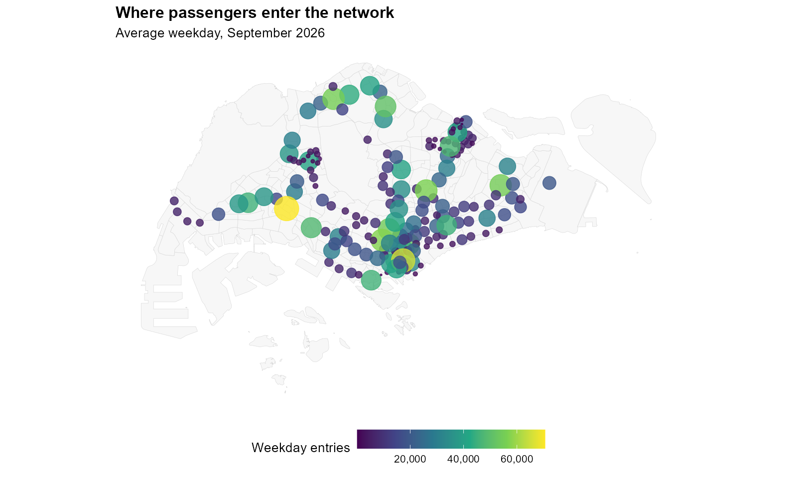

Busy stations appear in both the city centre and the larger residential towns. Since we count the whole day, a station's entries can include people leaving work or shops as well as people setting out from home.

```{r}
#| label: th03-station-ranking
ranking_chart <- ridership$observed %>% st_drop_geometry() %>%
  slice_max(entries, n = 12) %>% ggplot(aes(entries, reorder(station, entries))) +
  geom_col(fill = "#237a83", width = 0.7) + scale_x_continuous(labels = scales::label_comma()) +
  labs(x = "Average weekday entries", y = NULL, title = "The busiest boarding stations")
save_plot(ranking_chart, "station-ranking", height = 6)
```

```{r}
#| echo: false
#| fig-cap: "The twelve stations with the most average weekday entries."
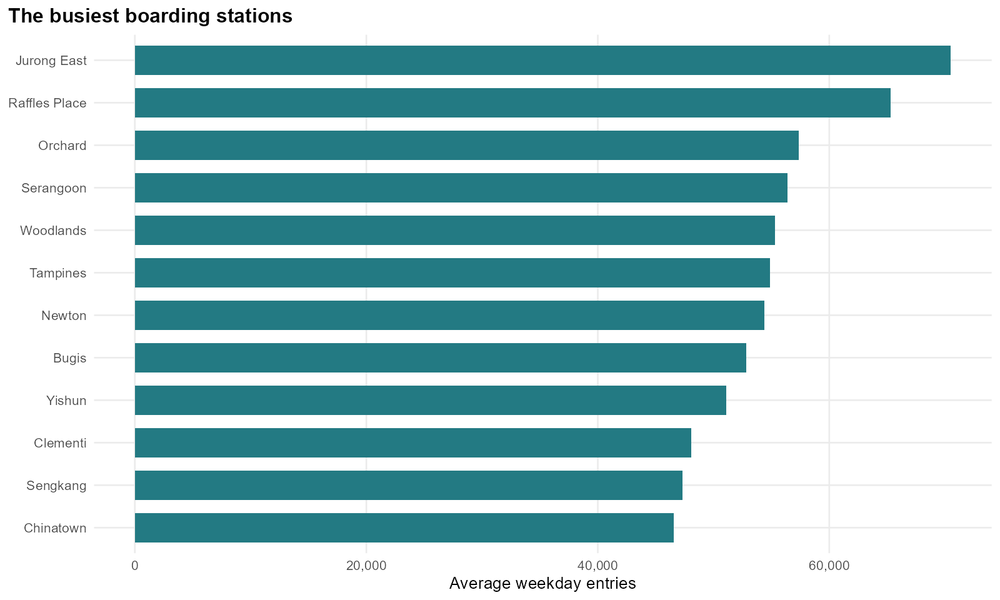
```

Jurong East has the most entries, at `r fmt(ridership$observed$entries[ridership$observed$station_id == "JURONGEAST"])` per weekday, followed by Raffles Place. Yishun is also among the busiest despite having one rail line. This suggests that rail connections alone will not explain the rankings. The next comparison looks at the homes and workplaces around three stations.

### Three different station settings

```{r}
#| label: th03-station-examples
examples <- ridership$observed %>%
  filter(station_id %in% c("YISHUN", "RAFFLESPLACE", "DHOBYGHAUT"))
examples$dwellings_500 <- vapply(st_is_within_distance(examples, prepared$buildings, dist = 500),
  function(i) sum(prepared$buildings$total_dwelling_units[i]), numeric(1))
examples$office_pois_500 <- lengths(st_is_within_distance(
  examples, filter(prepared$pois, category == "Offices"), dist = 500))
examples <- st_drop_geometry(examples) %>%
  select(station, entries, lines, bus_500, dwellings_500, office_pois_500)
details$examples <- examples
```

```{r}
knitr::kable(details$examples %>% mutate(entries = fmt(entries), dwellings_500 = fmt(dwellings_500)),
             col.names = c("Station", "Entries/day", "Lines", "Bus stops", "HDB homes", "Office POIs"),
             caption = "Bus stops, mapped HDB dwellings and office locations within 500 metres.")
```

Yishun has many mapped HDB homes within 500 metres. Raffles Place has many more office locations and no matched HDB blocks within the same distance. Dhoby Ghaut connects three rail lines, yet has fewer entries than either station. I therefore include nearby residents and activities as well as transport connections in the model. The office column counts locations, not workers; the housing column covers the blocks we could match.

```{r}
quality <- tibble(
  Check = c("Station totals in both months", "Population / boundary names", "Activity POIs after deduplication", "Named workplace areas"),
  Result = c(paste(nrow(ridership$observed), "unique station complexes"),
             paste(nrow(prepared$origins), "matched subzones"),
             fmt(nrow(prepared$pois)), paste(nrow(context$mapped), "areas")))
knitr::kable(quality)
```

These checks confirm that matching station codes has not added or lost journeys, and that placing residents and workers on the map has kept each area's total intact. For station locations, I use the LTA building outline when its code matches, otherwise the coordinate registry. Each interchange keeps the same map point in every network comparison.


## Estimating station choice {#estimating-station-choice}

### Distance, connections and surrounding activity

People in the same neighbourhood may use different stations. The Huff model represents this by giving each station a share of the journeys starting from a place. Nearby stations usually get a larger share, while rail connections and nearby bus stops can make a station more attractive. This follows the idea in station-catchment research that passengers have several alternatives to choose from. [Zhu and colleagues, 2021](https://doi.org/10.1155/2021/6374724)

First, I estimate where journeys could start. Residents help describe trips beginning near home; shops, offices, schools and other facilities help describe trips beginning elsewhere. The model learns how much weight to give each distribution. I also test worker counts, since an area with many small outlets may have fewer workers than an area with a few large offices.

```{r}
#| label: th03-origin-demand
origin_weights <- function(origins, residential_share, office_share = 0, employment_share = 0) {
  activity <- origins$activity / sum(origins$activity)
  if (office_share > 0) activity <- (1 - office_share) * activity +
    office_share * origins$office_area / sum(origins$office_area)
  if (employment_share > 0) activity <- (1 - employment_share) * activity +
    employment_share * origins$employment / sum(origins$employment)
  residential_share * origins$residents / sum(origins$residents) +
    (1 - residential_share) * activity
}
```

Hands-on Exercise 8 places each village at one point. I begin that way for each subzone, then test whether more detailed locations improve the predictions. I spread HDB residents across the matched blocks, assigning more residents to blocks with more homes. This assumes the mapped blocks represent the subzone's HDB population. Other residents stay at the subzone point, as do HDB residents where no blocks could be matched. Facilities use their mapped locations.

```{r}
context$origins %>% st_drop_geometry() %>%
  group_by(kind) %>% summarise(locations = n(), residents = sum(residents),
    facilities = sum(activity), allocated_workers = sum(employment), .groups = "drop") %>%
  knitr::kable(digits = 0)
```

To keep the calculation manageable, I group nearby locations of the same type into 500-metre grid cells within each subzone. Each cell is represented by a centre weighted towards its larger counts. This gives `r fmt(sum(context$origins$kind != "office"))` residential and activity starting points, with each subzone's totals unchanged. The office-area model adds a point inside each merged office building. For the catchment maps, I combine the points back into subzones, giving more weight to places with more estimated journeys.

#### From starting locations to station choices

I measure straight-line distances from these starting points to every station. Distances below 100 metres are treated as 100 metres so that a point almost on top of a station does not dominate the calculation. The later housing-access comparison uses individual blocks and their measured distances.

Each station also receives an attraction score based on its rail lines, nearby bus stops and whether it has MRT service. The model learns one common adjustment for MRT stations compared with LRT-only stops, and applies it to new JRL and CRL stations too. It also learns how strongly line and bus-stop counts affect the score. I add one to the bus-stop count so a station with no nearby stops can still be chosen.

```{r}
#| label: th03-distance-pairs
make_interactions <- function(origins, destinations) {
  distances <- units::drop_units(st_distance(origins, destinations)) / 1000
  expand_grid(origin_id = origins$origin_id, station_id = destinations$station_id) %>%
    mutate(distance_km = as.vector(t(distances))) %>%
    left_join(st_drop_geometry(destinations) %>%
                select(station_id, lines, codes, starts_with("bus_")), by = "station_id")
}
```

```{r}
#| label: th03-station-weights
station_features <- function(destinations, bus_radius = 500) {
  mrt <- if (!"codes" %in% names(destinations)) rep(0, nrow(destinations)) else
    as.numeric(grepl("(^|/)(NS|EW|CG|NE|CC|CE|DT|TE|JS|JE|JW|CR)[0-9]", destinations$codes))
  direct <- paste0("direct_bus_", bus_radius)
  competition <- if (direct %in% names(destinations)) -log1p(destinations[[direct]]) else rep(0, nrow(destinations))
  cbind(rail = log(destinations$lines),
        bus = log1p(destinations[[paste0("bus_", bus_radius)]]), mrt = mrt, competition = competition)
}
```

The attraction score combines those station features using the fitted weights.

```{r}
#| label: th03-station-weights-2
station_attraction <- function(parameters, destinations, bus_radius = 500) {
  effects <- c(rail = 0, bus = 0, mrt = 0, competition = 0)
  effects[intersect(names(parameters), names(effects))] <- parameters[intersect(names(parameters), names(effects))]
  exp(as.numeric(station_features(destinations, bus_radius) %*% effects))
}
```

When testing a distance limit, I always keep the nearest station available.

```{r}
#| label: th03-station-weights-3
# A distance limit always retains the nearest station, including remote origins.
station_choices <- function(distances, max_distance = Inf) {
  choices <- distances <= max_distance
  choices[cbind(seq_len(nrow(distances)), max.col(-distances, ties.method = "first"))] <- TRUE
  choices
}
```

For each starting point, I divide each station’s weight by the sum across its available choices.

```{r}
#| label: th03-station-weights-4
choice_probabilities <- function(parameters, distances, destinations,
                                 bus_radius = 500, distance_floor = 0.1,
                                 distance_form = "power", max_distance = Inf) {
  attraction <- log(station_attraction(parameters, destinations, bus_radius))
  distance_term <- pmax(distances, distance_floor)
  if (distance_form == "power") distance_term <- log(distance_term)
  utility <- sweep(-parameters["decay"] * distance_term,
                   2, attraction, "+")
  # The fitted parameter bounds keep these weights finite for the study distances.
  weights <- exp(utility)
  weights[!station_choices(distances, max_distance)] <- 0
  weights / rowSums(weights)
}
```

#### Fitting the station totals

The fitting function compares predicted station totals with observed entries. It keeps the tested stations available as choices, while using only training counts to fit the parameters and set the journey total.

```{r}
#| label: th03-fit-model
#| code-fold: true
#| code-summary: "Show the R calculation"
fit_huff <- function(observed, distances, origins, destinations, model = 3,
                     training = seq_along(observed), bus_radius = 500, distance_floor = 0.1,
                     residential_only = FALSE, distance_form = "power", max_distance = Inf) {
  stopifnot(distance_form %in% c("power", "exponential"), max_distance > 0)
  parameter_names <- c("decay", "residential", "rail", "bus", "mrt")[seq_len(c(1, 2, 4, 5, 4, 5, 5, 5, 5, 5)[model])]
  if (model %in% c(7, 9)) parameter_names <- c(parameter_names, "office")
  if (model %in% c(8, 10)) parameter_names <- c(parameter_names, "employment")
  if (model %in% c(9, 10)) parameter_names <- c(parameter_names, "competition")
  if (residential_only) parameter_names <- setdiff(parameter_names, c("residential", "office", "employment"))
  unpack <- function(x) {
    parameters <- c(decay = 2, residential = 1, rail = 0, bus = 0, mrt = 0, office = 0,
                    employment = 0, competition = 0)
    parameters[parameter_names] <- x
    parameters
  }
  distance_penalty <- pmax(distances, distance_floor)
  if (distance_form == "power") distance_penalty <- log(distance_penalty)
  choices <- station_choices(distances, max_distance)
  features <- station_features(destinations, bus_radius)
  residential <- origins$residents / sum(origins$residents)
  activity <- origins$activity / sum(origins$activity)
  office <- if (model %in% c(7, 9)) origins$office_area / sum(origins$office_area) else rep(0, nrow(origins))
  employment <- if (model %in% c(8, 10)) origins$employment / sum(origins$employment) else rep(0, nrow(origins))
  actual <- observed[training]
  previous <- NULL
  result <- NULL
  # The analytic derivative avoids repeated large-matrix calculations during fitting.
  evaluate <- function(x) {
    if (identical(x, previous)) return(result)
    parameters <- unpack(x)
    weights <- exp(sweep(-parameters["decay"] * distance_penalty, 2,
                         as.numeric(features %*% parameters[c("rail", "bus", "mrt", "competition")]), "+"))
    weights[!choices] <- 0
    probabilities <- weights / rowSums(weights)
    mix <- (1 - parameters["office"] - parameters["employment"]) * activity +
      parameters["office"] * office + parameters["employment"] * employment
    demand <- parameters["residential"] * residential + (1 - parameters["residential"]) * mix
    shares <- as.numeric(crossprod(demand, probabilities))
    # Held-out counts contribute neither to the scale nor to the loss.
    scale <- sum(actual) / sum(shares[training])
    expected <- pmax(scale * shares[training], 1e-12)
    terms <- ifelse(actual > 0, actual * log(pmax(actual, 1e-12) / expected), 0)
    distance_term <- probabilities * distance_penalty
    derivatives <- cbind(
      decay = -colSums(demand * distance_term) +
        as.numeric(crossprod(demand * rowSums(distance_term), probabilities)),
      residential = as.numeric(crossprod(residential - mix, probabilities)),
      features * shares - crossprod(probabilities, demand * (probabilities %*% features)),
      office = as.numeric(crossprod((1 - parameters["residential"]) * (office - activity), probabilities)),
      employment = as.numeric(crossprod((1 - parameters["residential"]) * (employment - activity), probabilities)))
    result <<- list(loss = 2 * sum(terms - actual + expected),
      gradient = as.numeric(2 * crossprod(scale - actual / pmax(shares[training], 1e-12),
                                          derivatives[training, parameter_names, drop = FALSE])),
      predicted = scale * shares)
    previous <<- x
    result
  }
  starts <- expand.grid(decay = c(1, 2, 4), residential = if (model > 1) c(0.25, 0.75) else 1,
                        rail = 0.4, bus = 0.4, mrt = 0.4, office = 0.2, employment = 0.2, competition = 0.2)
  if (model >= 7) {
    starts$rail <- 1.5
    starts$bus <- 0.1
    starts$mrt <- 2.3
  }
  fits <- lapply(seq_len(nrow(starts)), function(i) {
    optim(unlist(starts[i, parameter_names, drop = FALSE]), function(x) evaluate(x)$loss,
          gr = function(x) evaluate(x)$gradient, method = "L-BFGS-B",
          lower = c(decay = 0.25, residential = 0, rail = 0, bus = 0, mrt = 0, office = 0, employment = 0, competition = 0)[parameter_names],
          upper = c(decay = 6, residential = 1, rail = 3, bus = 3, mrt = 4, office = 1, employment = 1, competition = 3)[parameter_names],
          control = list(maxit = 300))
  })
  successful <- which(vapply(fits, function(x) x$convergence == 0 && is.finite(x$value), logical(1)))
  if (!length(successful)) stop("Huff calibration did not converge; inspect the inputs before reporting estimates.")
  best <- fits[[successful[which.min(vapply(fits[successful], `[[`, numeric(1), "value"))]]]
  list(parameters = unpack(best$par), predicted = evaluate(best$par)$predicted, loss = best$value,
       model = model, bus_radius = bus_radius, distance_floor = distance_floor,
       distance_form = distance_form, max_distance = max_distance)
}
```

```{r}
#| label: th03-error-measures
error_measures <- function(observed, predicted) {
  tibble(MAE = mean(abs(observed - predicted)),
         RMSE = sqrt(mean((observed - predicted)^2)),
         WAPE = sum(abs(observed - predicted)) / sum(observed))
}
```

Using the same attraction rule for all stations lets me estimate new ones from their connections. The package's `MCI::huff.fit()` function fits a separate score for each existing station, using a distance effect supplied by the analyst. Those scores would need another model to estimate unopened stations. Its `mci.fit()` function needs observations of which stations people choose from each starting place. Our rail records give boarding and alighting stations, so they do not provide those choices from homes or workplaces. I fit the common rule to station totals and use MCI to calculate choice probabilities. [MCI documentation](https://cran.r-project.org/web/packages/MCI/MCI.pdf)

### Checking the source of the prediction error

A model can fit existing counts closely and still predict other stations poorly. To check this, I start with a simple version using residents and distance, then add activities and connections. I compare their prediction errors using WAPE, explained below. I then test two changes: distinguishing MRT from LRT-only stations and spreading starting locations within each subzone. I test each separately before combining them.

The choice calculation follows Hands-on Exercise 8 and agrees with `MCI::huff.shares()`. To learn the parameters, I compare the model's station totals with recorded entries. The score used for fitting is called Poisson deviance: a smaller score means the predicted counts are closer to the recorded counts. The starting locations behind those journeys remain estimates because the rail data do not identify them.

The model tries different parameter values and keeps the set with the lowest score. Distance must reduce attraction, connections can only increase it or have no effect, and the residential share stays between zero and one.

A tiny positive minimum keeps the fitting calculation valid when a count is zero.

For each check, I divide stations into five geographical groups, or folds. The model learns from four groups and predicts the fifth without using that group's recorded entries. Those stations remain available as choices for passengers. I repeat this until every group has been tested, using the same groups for each model.

I compare the predictions using WAPE: add up the size of every station's error, regardless of whether it is too high or too low, then divide by total recorded entries. Lower is better. I choose the lowest score, keeping the earlier, simpler model if it is within 1% of the best score. Because these checks help choose the model, they are not a separate final test.

```{r}
#| label: th03-fitting-inputs
origins <- prepared$origins
stations <- prepared$stations$Existing %>% left_join(entries$September, by = "station_id")
stopifnot(!anyNA(stations$entries), setequal(stations$station_id, entries$September$station_id))
observed <- stations$entries
distances <- matrix(prepared$interactions$Existing$distance_km, nrow = nrow(origins), byrow = TRUE)
distributed_origins <- make_demand_locations(prepared)
distributed_pairs <- make_interactions(distributed_origins, stations)
distributed_distances <- matrix(distributed_pairs$distance_km, nrow = nrow(distributed_origins), byrow = TRUE)
office_origins <- context$origins
office_distances <- units::drop_units(st_distance(office_origins, stations)) / 1000
office_totals <- st_drop_geometry(office_origins) %>% group_by(subzone_id) %>%
  summarise(office_area = sum(office_area), employment = sum(employment), .groups = "drop")
origins <- origins %>% left_join(office_totals, by = c("origin_id" = "subzone_id")) %>%
  mutate(across(c(office_area, employment), ~replace_na(.x, 0)))
prepared$origins <- origins
```

```{r}
#| label: th03-model-signature
#| include: false
model_signature <- digest::digest(list(
  origins, distributed_origins, office_origins, stations, observed,
  body(origin_weights), body(station_features), body(station_attraction),
  body(station_choices), body(choice_probabilities), body(fit_huff)))
```

```{r}
#| label: th03-spatial-validation
#| code-fold: true
#| code-summary: "Show the R calculation"
#| cache: true
#| cache.extra: !expr model_signature
set.seed(62603)
folds <- kmeans(st_coordinates(stations), centers = 5, nstart = 50)$cluster
validation <- list()
validation_parameters <- list()
for (model in 1:10) {
  current_origins <- if (model >= 7) office_origins else if (model >= 5) distributed_origins else origins
  current_distances <- if (model >= 7) office_distances else if (model >= 5) distributed_distances else distances
  predicted <- rep(NA_real_, nrow(stations))
  for (fold in 1:5) {
    message("Fitting model ", model, ", geographical fold ", fold, "/5")
    fit <- fit_huff(observed, current_distances, current_origins, stations, model, training = which(folds != fold))
    validation_parameters[[paste(model, fold)]] <- as_tibble_row(as.list(fit$parameters)) %>% mutate(model = model, fold = fold)
    predicted[folds == fold] <- fit$predicted[folds == fold]
  }
  validation[[model]] <- tibble(station_id = stations$station_id, model = model, fold = folds,
                               observed = observed, predicted = predicted)
}
validation <- bind_rows(validation)
performance <- validation %>% group_by(model) %>%
  group_modify(~ error_measures(.x$observed, .x$predicted)) %>% ungroup()
performance$description <- c("Residents and distance", "Residents, activities and distance",
  "Add rail and bus connections", "Add MRT/LRT distinction",
  "Distribute demand within subzones", "Distributed demand + MRT/LRT distinction", "Add office footprint area",
  "Use 2025 workplace totals", "Office area + direct CBD buses", "Workplace totals + direct CBD buses")
selected_model <- min(performance$model[performance$WAPE <= min(performance$WAPE) * 1.01])
```

```{r}
#| label: th03-feature-results
ridership$validation <- validation
ridership$performance <- performance
ridership$power_performance <- performance
ridership$validation_parameters <- bind_rows(validation_parameters)
feature_validation <- validation
selected <- performance %>% filter(model == selected_model)
```

```{r}
ridership$power_performance %>%
  transmute(Model = model, Comparison = description, MAE = fmt(MAE),
            RMSE = fmt(RMSE), WAPE = pct(WAPE)) %>% knitr::kable()
```

Distinguishing MRT from LRT and spreading starting locations within subzones brings WAPE to `r pct(ridership$power_performance$WAPE[ridership$power_performance$model == 6])`. Adding office ground area gives `r pct(ridership$power_performance$WAPE[ridership$power_performance$model == 7])`, and using worker counts gives `r pct(ridership$power_performance$WAPE[ridership$power_performance$model == 8])`. These comparisons use the same power curve for distance. I then check whether changing that curve improves the selected model.

The table also reports MAE, the average size of a station's error, and RMSE, which gives larger errors more weight. Both are measured in daily entries per station.

```{r}
#| label: th03-model-diagnosis
diagnosis <- ridership$validation %>% filter(model %in% c(3, selected_model)) %>%
  left_join(st_drop_geometry(ridership$observed) %>% select(station_id, station, codes), by = "station_id") %>%
  mutate(type = if_else(grepl("(^|/)(NS|EW|CG|NE|CC|CE|DT|TE)[0-9]", codes), "MRT", "LRT-only"),
         error = predicted - observed)
type_comparison <- diagnosis %>% group_by(model, type) %>%
  summarise(stations = n(), observed = sum(observed), predicted = sum(predicted),
            WAPE = sum(abs(error)) / sum(observed), .groups = "drop")
station_errors <- diagnosis %>% select(station_id, station, model, observed, predicted) %>%
  mutate(model = if_else(model == 3, "original", "revised")) %>%
  pivot_wider(names_from = model, values_from = predicted)
months <- inner_join(ridership$entries$September, ridership$entries$August,
                     by = "station_id", suffix = c("_sep", "_aug"))
august_share_benchmark <- error_measures(months$entries_sep,
  months$entries_aug / sum(months$entries_aug) * sum(months$entries_sep))

details$type_comparison <- type_comparison
details$station_errors <- station_errors
details$august_share_benchmark <- august_share_benchmark
```

```{r}
details$type_comparison %>%
  mutate(model = if_else(model == 3, "Initial prediction", "Revised prediction")) %>%
  select(Type = type, Observed = observed, model, predicted) %>%
  pivot_wider(names_from = model, values_from = predicted) %>%
  mutate(across(where(is.numeric), fmt)) %>% knitr::kable()
```

The first model predicts roughly three times too many entries at LRT-only stops. The revised total is much closer. Spreading starting locations within a subzone also helps: a station beside the subzone's centre no longer receives most of its estimated journeys just because everyone was placed at that one point.

Could the remaining error mainly reflect a change between months? Giving stations their August shares of September's total produces only `r pct(details$august_share_benchmark$WAPE)` WAPE. The station pattern is quite stable across these two months. The larger Huff error points more towards how the model represents stations and their surroundings. August's shares help check existing stations, but cannot supply estimates for stations that have not opened.

### Does changing the distance rule help? {#distance-assumptions}

The power curve gives even distant stations a small share of journeys. Across thousands of starting locations, those small shares can add up. An exponential curve gives distance a different effect: each additional kilometre reduces the weight by the same proportion. I also test power curves where people can choose only stations within 3, 5 or 8 km. The nearest station always stays available.

I refit each version using the same five geographical groups. This checks whether its predictions improve at stations whose counts were left out.

```{r}
#| label: th03-distance-validation
#| code-fold: true
#| code-summary: "Show the R calculation"
#| cache: true
#| cache.extra: !expr digest::digest(list(model_signature, selected_model, validation, validation_parameters))
# The same station folds isolate the effect of the distance assumption.
choice_origins <- if (selected_model >= 7) office_origins else if (selected_model >= 5) distributed_origins else origins
choice_distances <- if (selected_model >= 7) office_distances else if (selected_model >= 5) distributed_distances else distances
distance_settings <- tribble(~setting, ~distance_form, ~max_distance,
  "Power, all stations", "power", Inf,
  "Exponential, all stations", "exponential", Inf,
  "Power, within 8 km", "power", 8,
  "Power, within 5 km", "power", 5,
  "Power, within 3 km", "power", 3)
distance_validation <- list()
distance_parameters <- list()
for (i in seq_len(nrow(distance_settings))) {
  row <- distance_settings[i, ]
  if (i == 1) {
    distance_validation[[i]] <- validation %>% filter(model == selected_model) %>% mutate(setting = row$setting)
    distance_parameters[[i]] <- bind_rows(validation_parameters) %>% filter(model == selected_model) %>% mutate(setting = row$setting)
    next
  }
  predicted <- rep(NA_real_, nrow(stations))
  for (fold in 1:5) {
    message("Distance check: ", row$setting, ", fold ", fold)
    trial <- fit_huff(observed, choice_distances, choice_origins, stations, selected_model,
      training = which(folds != fold), distance_form = row$distance_form, max_distance = row$max_distance)
    predicted[folds == fold] <- trial$predicted[folds == fold]
    distance_parameters[[paste(i, fold)]] <- as_tibble_row(as.list(trial$parameters)) %>%
      mutate(model = selected_model, fold = fold, setting = row$setting)
  }
  distance_validation[[i]] <- tibble(station_id = stations$station_id, model = selected_model,
    fold = folds, observed = observed, predicted = predicted, setting = row$setting)
}
distance_validation <- bind_rows(distance_validation)
distance_parameters <- bind_rows(distance_parameters)
distance_performance <- distance_validation %>% group_by(setting) %>%
  group_modify(~ error_measures(.x$observed, .x$predicted)) %>% ungroup() %>%
  right_join(distance_settings, by = "setting") %>% arrange(match(setting, distance_settings$setting))
distance_choice <- distance_performance %>% filter(WAPE <= min(WAPE) * 1.01) %>% slice(1)
distance_form <- distance_choice$distance_form
max_distance <- distance_choice$max_distance
power_performance <- performance
performance[performance$model == selected_model, c("MAE", "RMSE", "WAPE")] <- distance_choice[c("MAE", "RMSE", "WAPE")]
validation <- bind_rows(filter(validation, model != selected_model),
  distance_validation %>% filter(setting == distance_choice$setting) %>% select(-setting))
validation_parameters <- bind_rows(bind_rows(validation_parameters) %>% filter(model != selected_model),
  distance_parameters %>% filter(setting == distance_choice$setting) %>% select(-setting))
saveRDS(list(performance = distance_performance, validation = distance_validation,
  parameters = distance_parameters, selected = distance_choice), file.path(out, "distance-validation.rds"))
```

```{r}
#| label: th03-final-fit
#| code-fold: true
#| code-summary: "Show the R calculation"
#| cache: true
#| cache.extra: !expr digest::digest(list(model_signature, selected_model, distance_form, max_distance, prepared$stations))
choice_origins <- if (selected_model >= 7) office_origins else if (selected_model >= 5) distributed_origins else origins
choice_interactions <- if (selected_model >= 5) lapply(prepared$stations, function(x) make_interactions(choice_origins, x)) else prepared$interactions
distances <- matrix(choice_interactions$Existing$distance_km, nrow = nrow(choice_origins), byrow = TRUE)
fit <- fit_huff(observed, distances, choice_origins, stations, selected_model,
                distance_form = distance_form, max_distance = max_distance)
saveRDS(list(fit = fit, performance = performance, validation = validation),
        file.path(out, "calibration.rds"))
```

```{r}
#| label: th03-fitted-results
#| include: false
ridership$fit <- fit
ridership$performance <- performance
ridership$validation <- validation
ridership$validation_parameters <- bind_rows(validation_parameters)
ridership$power_performance <- power_performance
ridership$distance_settings <- distance_settings
ridership$distance_performance <- distance_performance
ridership$distance_validation <- distance_validation
ridership$distance_parameters <- distance_parameters
ridership$choice_origins <- choice_origins
ridership$choice_interactions <- choice_interactions
selected <- performance %>% filter(model == selected_model)
```

```{r}
ridership$distance_performance %>%
  transmute(`Distance assumption` = setting, MAE = fmt(MAE),
            RMSE = fmt(RMSE), WAPE = pct(WAPE)) %>% knitr::kable()
```

The power curve with all stations available has the lowest error, so I keep it. Every alternative also worsens the predictions at Raffles Place and Marine Parade. A different distance rule does not resolve their remaining errors.

```{r}
#| label: th03-validation-inputs
parameters <- ridership$fit$parameters
observed <- ridership$observed
validation <- ridership$validation %>% filter(model == ridership$fit$model)
stopifnot(identical(validation$station_id, observed$station_id))
stations <- observed %>% left_join(select(validation, station_id, fold, predicted), by = "station_id") %>%
  mutate(mrt = station_features(observed)[, "mrt"] == 1,
         error = predicted - entries)
total <- sum(observed$entries)
locations <- ridership$choice_origins
distances <- matrix(ridership$choice_interactions$Existing$distance_km,
                    nrow = nrow(locations), byrow = TRUE)
demand <- origin_weights(locations, parameters["residential"], parameters["office"], parameters["employment"])
```

```{r}
#| label: th03-parameter-ranges
parameter_ranges <- ridership$validation_parameters %>% filter(model == ridership$fit$model) %>%
  pivot_longer(c(decay, rail, bus, mrt, residential, employment), names_to = "parameter") %>%
  group_by(parameter) %>% summarise(low = min(value), high = max(value), .groups = "drop") %>%
  mutate(fitted = unname(parameters[parameter]))
review$parameters <- parameter_ranges
```

### Tables used in the model {#tables-used-in-the-model}

| Table | Contents |
|---|---|
| Existing-network interactions | Starting locations paired with existing stations, with distances, attraction scores and available choices |
| Expanded-network interactions | The same starting locations paired with stations after both lines are added |
| Origins | Starting locations, their subzones, residents, facilities, estimated workers and modelled journeys; office area is kept for comparison |
| Destinations | Stations, recorded entries, rail lines, nearby bus stops, direct CBD buses and attraction scores |

These four tables connect places where journeys could start to the stations passengers could choose. The same `origin_id` and `station_id` fields link them. Attraction is the connection score described above. Future stations have no recorded entries yet. The `r sum(ridership$choice_origins$kind == "office")` office-building points are kept for comparison with the office-area model; they receive no journeys in the selected model, which uses worker counts.

```{r}
#| label: th03-analysis-tables
#| code-fold: true
#| code-summary: "Show the R calculation"
total <- sum(ridership$observed$entries)
parameters <- ridership$fit$parameters
interaction_tables <- lapply(c("Existing", "Both"), function(scenario) {
  pairs <- ridership$choice_interactions[[scenario]]
  destinations <- prepared$stations[[scenario]]
  attraction <- station_attraction(parameters, destinations)
  distances <- matrix(pairs$distance_km, nrow = nrow(ridership$choice_origins), byrow = TRUE)
  eligible <- as.vector(t(station_choices(distances, ridership$fit$max_distance)))
  pairs %>% mutate(attraction = .env$attraction[match(station_id, destinations$station_id)],
                   distance = pmax(distance_km, ridership$fit$distance_floor),
                   eligible = .env$eligible,
                   choice_distance = if (ridership$fit$distance_form == "exponential") exp(distance) else distance)
})
names(interaction_tables) <- c("Existing", "Both")
origin_table <- ridership$choice_origins %>%
  mutate(market_share = origin_weights(ridership$choice_origins, parameters["residential"], parameters["office"], parameters["employment"]),
         market_potential = total * market_share)
destination_table <- prepared$stations$Both %>%
  left_join(st_drop_geometry(ridership$observed) %>%
              select(station_id, observed_entries = entries, existing_lines = lines), by = "station_id") %>%
  mutate(existing_lines = replace_na(existing_lines, 0L),
         mrt = station_features(prepared$stations$Both)[, "mrt"],
         attraction = station_attraction(parameters, prepared$stations$Both))
stopifnot(!anyDuplicated(origin_table$origin_id), !anyDuplicated(destination_table$station_id),
          sum(destination_table$observed_entries, na.rm = TRUE) == total,
          all(is.na(destination_table$observed_entries) == !destination_table$existing),
          abs(sum(origin_table$market_potential) - total) < 1e-6)
saveRDS(interaction_tables$Existing, "data/take-home-03/derived/existing-network-interactions.rds")
saveRDS(interaction_tables$Both, "data/take-home-03/derived/expanded-network-interactions.rds")
saveRDS(origin_table, "data/take-home-03/derived/origins.rds")
saveRDS(destination_table, "data/take-home-03/derived/destinations.rds")
```

```{r}
existing_pairs <- interaction_tables$Existing
existing_pairs %>% select(origin_id, station_id, attraction, distance) %>%
  slice_head(n = 3) %>% knitr::kable(digits = 3, caption = "Existing network: distance in kilometres.")
```

```{r}
expanded_pairs <- interaction_tables$Both
expanded_pairs %>% filter(station_id %in% c("GEKPOH", "SERANGOONNORTH")) %>%
  select(origin_id, station_id, attraction, distance) %>% slice_head(n = 3) %>%
  knitr::kable(digits = 3, caption = "Expanded network: a sample of new-station pairs.")
```

```{r}
origin_table %>% st_drop_geometry() %>%
  select(origin_id, subzone_id, residents, activity, employment, market_potential) %>%
  slice_head(n = 3) %>% knitr::kable(digits = 1, caption = "Origins: modelled weekday demand, not home addresses of observed passengers.")
```

```{r}
destination_table %>% st_drop_geometry() %>%
  filter(station_id %in% c("HOUGANG", "MARINEPARADE", "SERANGOONNORTH")) %>%
  select(station_id, observed_entries, lines, mrt, bus_500, attraction) %>%
  knitr::kable(digits = 1, caption = "Destinations: line counts and attraction with both proposed lines.")
```


```{r}
one_origin <- existing_pairs %>% filter(origin_id == first(origin_id), eligible)
shares <- MCI::huff.shares(
  as.data.frame(one_origin), "origin_id", "station_id", "attraction", "choice_distance",
  gamma = 1, lambda = -ridership$fit$parameters["decay"], check_df = FALSE
)
shares %>% select(station_id, p_ij) %>% slice_max(p_ij, n = 3) %>% knitr::kable(digits = 3)
```

The table shows the three most likely station choices from one starting point. I repeat this for every point, multiply each choice probability by that point's estimated journeys, and add the contributions to each station.


### What the fitted parameters mean {#fitted-parameters}

The parameters are the numbers the model learns from existing stations. “Fitted” uses all stations. The minimum and maximum come from the five [geographical tests](#checking-the-source-of-the-prediction-error), each leaving out a different group. They show how the fitted values change when the model learns from different areas.

```{r}
review$parameters %>%
  mutate(parameter = recode(parameter, decay = "Distance decay", rail = "Rail lines",
    bus = "Bus stops", mrt = "MRT indicator", residential = "Residential weight",
    employment = "Employment weight")) %>%
  select(Parameter = parameter, Fitted = fitted, `Fold minimum` = low, `Fold maximum` = high) %>%
  knitr::kable(digits = 3)
```

Distance has a strong effect. If a station is twice as far away, it keeps only `r pct(2^(-ridership$fit$parameters["decay"]))` of its choice weight, with everything else unchanged. Having two rail lines instead of one multiplies the attraction score by `r round(2^ridership$fit$parameters["rail"], 1)`. An MRT connection gives a multiplier of `r round(exp(ridership$fit$parameters["mrt"]), 1)` compared with LRT-only service. The model then compares these weights across all available stations to calculate each one's share. The multipliers do not translate directly into the same increase in boardings.

Nearby bus stops make a much smaller difference: increasing from 10 to 20 multiplies the attraction score by only `r round((21/11)^ridership$fit$parameters["bus"], 2)`. In one geographical check, the model gives bus stops no extra weight. In another, worker counts receive all the activity weight. These changes show that the fitted relationships depend on which areas the model learns from. The ranges are not confidence intervals, and the relationships do not establish cause and effect.


### Does the model beat simpler estimates? {#reference-models}

The model should also beat simpler guesses. One gives every test station the average entries of the stations used for fitting. Another uses separate averages for MRT and LRT-only stations. A third uses a fixed Huff model with residents only and equal station attraction: a station twice as far away gets one-quarter of the choice weight. In all three, only counts from the fitting groups are used to set the predictions.

```{r}
#| label: th03-reference-models
null_mean <- vapply(seq_len(nrow(stations)), function(i)
  mean(stations$entries[stations$fold != stations$fold[i]]), numeric(1))
null_type <- vapply(seq_len(nrow(stations)), function(i)
  mean(stations$entries[stations$fold != stations$fold[i] & stations$mrt == stations$mrt[i]]), numeric(1))
# A fixed Huff reference uses resident demand, equal attraction and distance power -2.
reference_p <- choice_probabilities(c(decay = 2), distances, observed)
reference_share <- as.numeric(crossprod(origin_weights(locations, 1), reference_p))
reference_prediction <- rep(NA_real_, nrow(stations))
for (fold in 1:5) {
  training <- which(stations$fold != fold)
  scale <- sum(stations$entries[training]) / sum(reference_share[training])
  reference_prediction[-training] <- scale * reference_share[-training]
}
benchmarks <- bind_rows(
  error_measures(stations$entries, null_mean) %>% mutate(model = "Training-station mean"),
  error_measures(stations$entries, null_type) %>% mutate(model = "Training mean within MRT / LRT"),
  error_measures(stations$entries, reference_prediction) %>% mutate(model = "Fixed Huff: residents, equal attraction, decay 2"))
review$benchmarks <- benchmarks
```

```{r}
review$benchmarks %>%
  transmute(Reference = model, MAE = fmt(MAE), RMSE = fmt(RMSE), WAPE = pct(WAPE)) %>%
  knitr::kable()
```

The selected model's error is `r pct(selected$WAPE)`, compared with `r pct(review$benchmarks$WAPE[review$benchmarks$model == "Training mean within MRT / LRT"])` for the separate MRT/LRT averages. The original residents-and-distance model even performs worse than using one overall average. Adding information about stations and their surroundings is therefore useful, although substantial errors remain.


### The errors have a regional pattern {#regional-errors}

```{r}
#| label: th03-station-groups
#| include: false
review$stations <- stations
```

```{r}
#| label: th03-fold-map
fold_map <- ggplot() +
  geom_sf(data = prepared$subzones, fill = "grey97", colour = "grey85", linewidth = 0.15) +
  geom_sf(data = review$stations, aes(colour = factor(fold)), size = 2) +
  scale_colour_brewer(palette = "Dark2") + coord_sf(datum = NA) +
  labs(colour = "Held-out group", x = NULL, y = NULL,
    title = "Five geographical groups for station validation")
save_plot(fold_map, "validation-folds", height = 5.8)
```

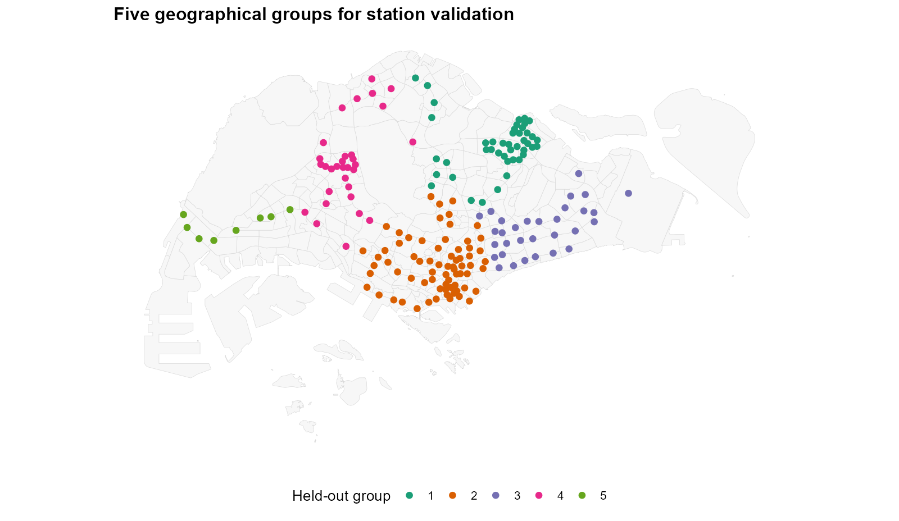

```{r}
#| label: th03-fold-errors
#| code-fold: true
#| code-summary: "Show the R calculation"
fold_errors <- st_drop_geometry(stations) %>% group_by(fold) %>%
  summarise(stations = n(), observed = sum(entries), predicted = sum(predicted),
    WAPE = sum(abs(error)) / sum(entries), bias = sum(error) / sum(entries), .groups = "drop")
rank_correlation <- cor(stations$entries, stations$predicted, method = "spearman")
in_sample <- error_measures(observed$entries, ridership$fit$predicted)
neighbours <- knn2nb(knearneigh(st_coordinates(stations), k = 6))
weights <- nb2listw(neighbours, style = "W")
log_error <- log(stations$predicted / stations$entries)
set.seed(62603)
spatial_error <- moran.mc(log_error, weights, nsim = 9999)
review$folds <- fold_errors
review$stations <- stations
review$rank_correlation <- rank_correlation
review$in_sample <- in_sample
review$residual_moran <- tibble(I = unname(spatial_error$statistic), p = spatial_error$p.value)
```

```{r}
review$folds %>%
  transmute(Group = fold, Stations = stations, WAPE = pct(WAPE), `Net bias` = pct(bias)) %>%
  knitr::kable()
```

The error is also uneven across Singapore. Each group contains a different number of stations, shown in the table. A positive net bias means the model predicts too many entries for that group overall; a negative value means too few. The error map below shows a tendency to underestimate central stations and overestimate parts of the east.

I check whether nearby stations tend to have similar errors using Moran's I. Each station is compared with its six nearest neighbours, using the log of predicted entries divided by recorded entries. Moran's I is `r round(review$residual_moran$I, 2)` (p = `r format(review$residual_moran$p, scientific = FALSE)` from 9,999 random rearrangements). This supports the pattern of neighbouring stations being missed in similar ways. The check describes the errors; the shared fitting data and model-selection process limit what the p-value can tell us about their causes.

### Where the model still misses

```{r}
#| label: th03-validation-chart
validation_values <- ridership$validation %>% filter(model == ridership$fit$model) %>%
  left_join(st_drop_geometry(prepared$stations$Existing) %>% select(station_id, station), by = "station_id")
labelled_errors <- validation_values %>% slice_max(abs(predicted - observed), n = 4)
validation_chart <- ggplot(validation_values, aes(observed, predicted)) +
  geom_abline(slope = 1, intercept = 0, colour = "grey60") +
  geom_point(alpha = 0.65, colour = "#237a83") + coord_equal() +
  geom_text_repel(data = labelled_errors, aes(label = station), seed = 626, size = 3,
    min.segment.length = 0) +
  scale_x_continuous(labels = scales::label_comma()) + scale_y_continuous(labels = scales::label_comma()) +
  labs(x = "Observed entries", y = "Predicted entries", title = "How well does the model predict held-out stations?",
       subtitle = "Each station was predicted without using its own ridership to fit the model")
save_plot(validation_chart, "validation", height = 6)
```

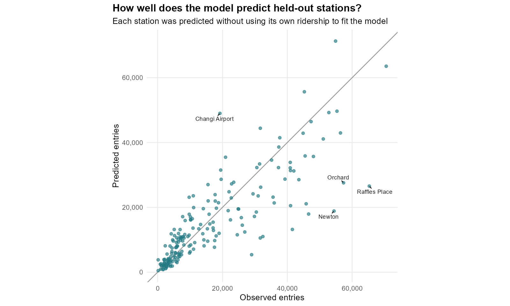

The model misses by an average of `r fmt(selected$MAE)` entries per station. In the chart, points above the diagonal are overestimates and points below it are underestimates. The spread around the line shows why I compare several assumptions when estimating use at new stations.

```{r}
#| label: th03-error-map
errors <- prepared$stations$Existing %>% left_join(ridership$validation %>% filter(model == ridership$fit$model), by = "station_id")
error_limit <- max(abs(errors$predicted - errors$observed))
error_map <- ggplot() + geom_sf(data = subzones, fill = "grey97", colour = "grey85", linewidth = 0.15) +
  geom_sf(data = errors, aes(colour = predicted - observed, size = abs(predicted - observed)), alpha = 0.8) +
  geom_label_repel(data = errors %>% filter(station_id %in% labelled_errors$station_id),
    aes(label = station, geometry = geometry), stat = "sf_coordinates", seed = 626,
    size = 3, min.segment.length = 0) +
  scale_size_area(max_size = 8, guide = "none") +
  scale_colour_gradient2(low = "#2166ac", mid = "white", high = "#b2182b", midpoint = 0,
                         limits = c(-error_limit, error_limit), breaks = c(-40000, -20000, 0, 20000, 40000),
                         labels = scales::label_number(scale = 0.001, suffix = "k"),
                         guide = guide_colourbar(barwidth = grid::unit(6, "cm"))) + coord_sf(datum = NA) +
  labs(x = NULL, y = NULL, colour = "Prediction minus observation", title = "Where the model misses the observed counts")
save_plot(error_map, "errors", height = 6)
```

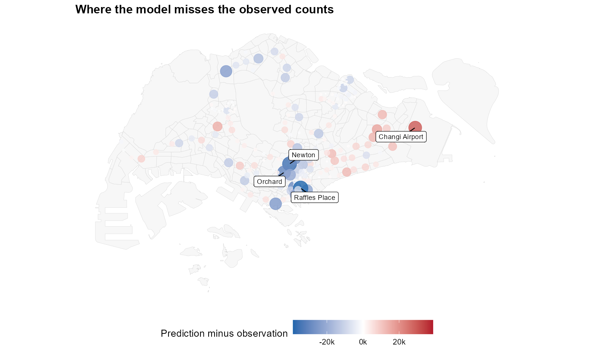

Raffles Place is still predicted too low and Marine Parade too high. Their different daily boarding patterns offer clues about what the model is missing, which I examine in the expandable station discussion below.

```{r}
details$station_errors %>% filter(station %in% c("Outram Park", "Dhoby Ghaut", "Raffles Place", "Marine Parade")) %>%
  transmute(Station = station, Observed = fmt(observed), Initial = fmt(original), Revised = fmt(revised)) %>%
  knitr::kable(caption = "Selected held-out predictions: improvements and remaining misses.")
```

### Recently opened stations are a harder test {#recent-station-check}

```{r}
#| label: th03-recent-stations
#| code-fold: true
#| code-summary: "Show the R calculation"
#| cache: true
#| cache.extra: !expr digest::digest(list(model_signature, ridership$fit, ridership$validation))
# LTA opening dates: TEL4 23 Jun 2024, Hume 28 Feb 2025, CCL6 12 Jul 2026.
stations <- stations %>% mutate(recent_group = case_when(
  grepl("(^|/)TE2[3-9]($|/)", codes) ~ "TEL4 (June 2024)",
  grepl("(^|/)DT4($|/)", codes) ~ "Hume (February 2025)",
  grepl("(^|/)CC3[0-2]($|/)", codes) ~ "CCL6 (July 2026)"))
recent <- which(!is.na(stations$recent_group))
stopifnot(length(recent) == 11)
message("Fitting a separate check with all 11 recent stations excluded from calibration.")
recent_fit <- fit_huff(observed$entries, distances, locations, observed, ridership$fit$model,
                       training = setdiff(seq_len(nrow(observed)), recent),
                       distance_form = ridership$fit$distance_form, max_distance = ridership$fit$max_distance)
recent_stations <- st_drop_geometry(stations[recent, ]) %>%
  mutate(group_prediction = recent_fit$predicted[recent])
recent_groups <- recent_stations %>% group_by(recent_group) %>%
  summarise(stations = n(), observed = sum(entries), spatial_cv = sum(predicted),
    group_holdout = sum(group_prediction), spatial_bias = spatial_cv / observed - 1,
    holdout_bias = group_holdout / observed - 1, .groups = "drop")
```

```{r}
#| label: th03-recent-stations-results
#| include: false
review$stations <- stations
review$recent_stations <- recent_stations
review$recent_groups <- recent_groups
review$recent_fit <- recent_fit
```

```{r}
review$recent_groups %>%
  transmute(Group = recent_group, Stations = stations, Observed = fmt(observed),
    `Spatial CV` = fmt(spatial_cv), `All 11 held out` = fmt(group_holdout)) %>% knitr::kable()
```

Since the aim is to predict new stations, I also check stations that opened recently. “Spatial CV” shows their predictions from the five geographical tests. For “All 11 held out”, I fit the model again without using any of these eleven stations' counts, including when setting the journey total. Passengers can still choose them in the model. Both checks predict too many entries for each group. TEL4 and CCL6 each contain several stations that opened together; Hume is a single-station check. [LTA: TEL4](https://www.lta.gov.sg/content/ltagov/en/newsroom/2024/3/news-releases/TEL4_to_welcome_commuters.html), [Hume](https://www.lta.gov.sg/content/ltagov/en/newsroom/2025/1/news-releases/hume_station_to_open.html), [CCL6](https://www.lta.gov.sg/content/ltagov/en/upcoming_projects/rail_expansion/circle_line_6.html)

These tests use September conditions, rather than recreating what was known before the stations opened. CCL6 had been running for only about two months. Travel habits, connecting journeys and development around the stations may help explain the gaps, but this analysis does not separate those effects. The repeated overestimates are a warning for the JRL and CRL forecasts. They do not give us one reliable percentage by which to reduce every new station's estimate.

::: {.callout-note collapse="true"}
## Station investigation: Raffles Place and Marine Parade

### Raffles Place and Marine Parade serve different daily routines {#raffles-place-and-marine-parade}

```{r}
#| label: th03-focus-stations
origins <- make_demand_locations(prepared)
stations <- ridership$observed
observed <- stations$entries
distances <- units::drop_units(st_distance(origins, stations)) / 1000
validation <- ridership$validation %>% filter(model == 6)
stopifnot(identical(validation$station_id, stations$station_id))
focus <- c("RAFFLESPLACE", "MARINEPARADE")
```

```{r}
#| label: th03-hourly-entries
#| code-fold: true
#| code-summary: "Show the R calculation"
hourly <- lapply(c("202609", "202608"), function(month) {
  file <- paste0("origin_destination_train_", month, ".csv")
  connection <- unz(file.path("data/take-home-03/raw", sub("csv$", "zip", file)), file, open = "rb")
  on.exit(close(connection))
  trips <- read_csv(connection, show_col_types = FALSE,
                    col_types = cols(ORIGIN_PT_CODE = "c", DESTINATION_PT_CODE = "c"))
  trips %>% filter(grepl("(^|[-/])(NS26|EW14|TE26)([-/]|$)", ORIGIN_PT_CODE)) %>%
    mutate(station_id = if_else(grepl("TE26", ORIGIN_PT_CODE), "MARINEPARADE", "RAFFLESPLACE")) %>%
    group_by(station_id, DAY_TYPE, TIME_PER_HOUR) %>%
    summarise(trips = sum(TOTAL_TRIPS), .groups = "drop") %>%
    mutate(month = month, days = case_when(
      month == "202609" & DAY_TYPE == "WEEKDAY" ~ 22,
      month == "202609" ~ 8, DAY_TYPE == "WEEKDAY" ~ 20, TRUE ~ 11),
      entries = trips / days)
}) %>% bind_rows() %>%
  left_join(st_drop_geometry(stations) %>% select(station_id, station), by = "station_id")
profiles <- hourly %>% group_by(month, station_id, station, DAY_TYPE) %>%
  summarise(daily_entries = sum(entries),
            evening_share = sum(entries[TIME_PER_HOUR %in% 17:19]) / sum(entries), .groups = "drop")
reconciliation <- profiles %>% filter(DAY_TYPE == "WEEKDAY") %>%
  inner_join(bind_rows(ridership$entries), by = c("month", "station_id"))
stopifnot(nrow(reconciliation) == 4,
          max(abs(reconciliation$daily_entries - reconciliation$entries)) < 1e-8)
diagnostics <- list(hourly = hourly, profiles = profiles, office_coverage = office$coverage)
raffles_profile <- profiles %>% filter(month == "202609", station_id == "RAFFLESPLACE", DAY_TYPE == "WEEKDAY")
marine_profiles <- profiles %>% filter(month == "202609", station_id == "MARINEPARADE")
```

```{r}
#| label: th03-hourly-chart
hourly_plot <- diagnostics$hourly %>% filter(month == "202609") %>%
  group_by(station, DAY_TYPE) %>%
  mutate(share = entries / sum(entries),
         day = if_else(DAY_TYPE == "WEEKDAY", "Weekday", "Weekend / holiday")) %>% ungroup()
hourly_chart <- ggplot(hourly_plot, aes(TIME_PER_HOUR, share, colour = day)) +
  geom_line(linewidth = 1) + facet_wrap(~station, nrow = 1) +
  scale_colour_brewer(palette = "Dark2") +
  scale_y_continuous(labels = scales::label_percent(accuracy = 1)) +
  scale_x_continuous(breaks = c(6, 9, 12, 15, 18, 21),
                     labels = c("6 am", "9 am", "Noon", "3 pm", "6 pm", "9 pm")) +
  coord_cartesian(xlim = c(5, 23)) +
  labs(x = NULL, y = "Share of that day's entries", colour = NULL,
       title = "Raffles Place has a much sharper weekday evening peak",
       subtitle = "September 2026; each curve sums to 100% across the full day") +
  theme_minimal(base_size = 12) +
  theme(panel.grid.minor = element_blank(), legend.position = "bottom",
        plot.title.position = "plot", plot.title = element_text(face = "bold"))
save_plot(hourly_chart, "station-hours", height = 4.7)
```

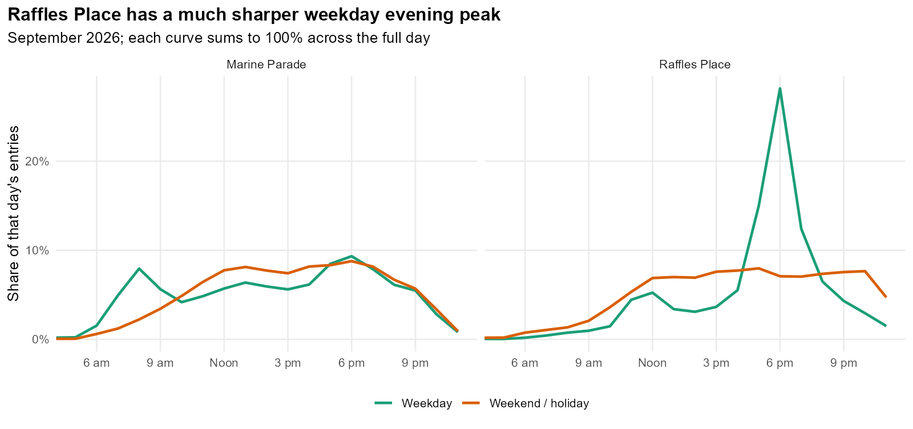

Raffles Place records `r pct(raffles_profile$evening_share)` of its weekday entries between 5 pm and 8 pm. This fits its position in the office district: many passengers enter the railway after work. A count of office locations gives a small business and a large workplace the same weight. [URA's Downtown Core guidance](https://www.ura.gov.sg/guidelines/urban-design/downtown-core/) describes Raffles Place as part of the predominantly commercial core.

Marine Parade has a broader pattern. It averages `r fmt(marine_profiles$daily_entries[marine_profiles$DAY_TYPE != "WEEKDAY"])` entries per weekend or holiday, compared with `r fmt(marine_profiles$daily_entries[marine_profiles$DAY_TYPE == "WEEKDAY"])` on weekdays. Its shops and food outlets support activity throughout the week, but their presence alone tells us little about how many visitors arrive by rail. The station opened with TEL Stage 4 in June 2024. [LTA's opening announcement](https://www.lta.gov.sg/content/ltagov/en/newsroom/2024/3/news-releases/TEL4_to_welcome_commuters.html)

### What drives Marine Parade's overprediction?

To understand the remaining gap, I return to the model with `r pct(ridership$performance$WAPE[ridership$performance$model == 6])` error and split its predictions into journeys assigned to residents and journeys assigned to facilities. Each station's own counts are still left out when fitting its prediction.

```{r}
#| label: th03-station-demand-breakdown
#| code-fold: true
#| code-summary: "Show the R calculation"
#| cache: true
#| cache.extra: !expr digest::digest(list(model_signature, validation))
# Refit the relevant training fold, keeping each focus station's entries out.
contributions <- lapply(focus, function(id) {
  j <- match(id, stations$station_id)
  training <- which(validation$fold != validation$fold[j])
  fit <- fit_huff(observed, distances, origins, stations, model = 6, training = training)
  probabilities <- choice_probabilities(fit$parameters, distances, stations)
  demand <- origin_weights(origins, fit$parameters["residential"])
  shares <- as.numeric(crossprod(demand, probabilities))
  scale <- sum(observed[training]) / sum(shares[training])
  stopifnot(abs(scale * shares[j] - validation$predicted[j]) < 0.01)
  st_drop_geometry(origins) %>%
    mutate(station_id = id, distance_m = distances[, j] * 1000,
           probability = probabilities[, j], entries = scale * demand * probabilities[, j])
}) %>% bind_rows() %>%
  left_join(st_drop_geometry(prepared$origins) %>% select(subzone_id = origin_id, subzone), by = "subzone_id")
nearby_pois <- lapply(focus, function(id) {
  nearby <- lengths(st_is_within_distance(prepared$pois, filter(stations, station_id == id), dist = 800)) > 0
  st_drop_geometry(prepared$pois[nearby, ]) %>% count(category) %>% mutate(station_id = id)
}) %>% bind_rows()
```

```{r}
#| label: th03-station-demand-breakdown-results
#| include: false
diagnostics$contributions <- contributions
diagnostics$nearby_pois <- nearby_pois
marine_demand <- contributions %>% filter(station_id == "MARINEPARADE")
```

```{r}
diagnostics$contributions %>%
  group_by(station_id, kind) %>%
  summarise(entries = sum(entries), .groups = "drop") %>%
  pivot_wider(names_from = kind, values_from = entries) %>%
  left_join(sf::st_drop_geometry(ridership$observed) %>% select(station_id, station), by = "station_id") %>%
  transmute(Station = station,
            Residents = fmt(residential), Activities = fmt(activity)) %>%
  knitr::kable(caption = "Sources of predicted entries before adding office area.")
```

Facilities account for `r pct(sum(marine_demand$entries[marine_demand$kind == "activity"]) / sum(marine_demand$entries))` of Marine Parade's prediction. Just two nearby grid cells containing facilities contribute about `r fmt(sum(head(sort(marine_demand$entries[marine_demand$kind == "activity"], decreasing = TRUE), 2)))` entries per weekday, already more than the station's recorded total. The many mapped shops and outlets cause the model to assign too many journeys here.

The locations of private homes are still approximate. Even so, residents account for only `r fmt(sum(marine_demand$entries[marine_demand$kind == "residential"]))` predicted entries here. The larger share of the overestimate comes from treating facility counts as a guide to how many rail journeys start nearby.

### Office area gives a first improvement

That leads to two possible adjustments. First, I let office locations carry a different weight from other facilities. Second, I use office buildings' ground area, so larger buildings can contribute more journeys. The station-choice calculation and five test groups stay the same, allowing a direct comparison.

The `origin_weights()` function shown earlier combines the distributions of facilities, office area and residents. The model learns their weights from the stations used for fitting. Ground area is only a rough guide to workplace size: a tall office tower can occupy a small plot. Only `r diagnostics$office_coverage$with_levels` of the `r diagnostics$office_coverage$office_buildings` buildings have a recorded floor count, so I use ground area consistently across them.

```{r}
#| label: th03-office-demand-trials
#| code-fold: true
#| code-summary: "Show the R calculation"
xy <- st_coordinates(prepared$pois)
office_counts <- st_drop_geometry(prepared$pois) %>%
  mutate(subzone_id = origin_id, gx = floor(xy[, 1] / 500), gy = floor(xy[, 2] / 500)) %>%
  group_by(subzone_id, gx, gy) %>% summarise(offices = sum(category == "Offices"), .groups = "drop")
locations <- origins %>% left_join(office_counts, by = c("subzone_id", "gx", "gy")) %>%
  mutate(offices = if_else(kind == "activity", replace_na(offices, 0L), 0L))
stopifnot(sum(locations$offices) == sum(prepared$pois$category == "Offices"))
count_inputs <- list(origins = tibble(residents = locations$residents,
                     activity = locations$activity - locations$offices,
                     office_area = locations$offices), distances = distances)

# Read the same office footprints used by the model, with overlaps removed.
office_data <- make_office_locations(prepared)
office_points <- office_data$locations
area <- office_points$office_area
coverage <- office_data$coverage
area_inputs <- list(origins = tibble(residents = c(origins$residents, rep(0, length(area))),
                    activity = c(origins$activity, rep(0, length(area))),
                    office_area = c(rep(0, nrow(origins)), area)),
                    distances = rbind(distances, units::drop_units(st_distance(office_points, stations)) / 1000))
inputs <- list("Separate office counts" = count_inputs, "Add office footprint area" = area_inputs)
```

I test both workplace measures using the same five geographical groups.

```{r}
#| label: th03-office-demand-trials-2
#| code-fold: true
#| code-summary: "Show the R calculation"
#| cache: true
#| cache.extra: !expr digest::digest(list(model_signature, inputs, validation$fold))
trials <- lapply(names(inputs), function(label) {
  input <- inputs[[label]]
  predicted <- rep(NA_real_, nrow(stations))
  parameters <- list()
  for (fold in 1:5) {
    message(label, ": geographical fold ", fold, "/5")
    fit <- fit_huff(observed, input$distances, input$origins, stations, model = 7,
                    training = which(validation$fold != fold))
    predicted[validation$fold == fold] <- fit$predicted[validation$fold == fold]
    parameters[[fold]] <- fit$parameters
  }
  stopifnot(all(is.finite(predicted)), all(predicted >= 0))
  list(predicted = predicted, parameters = parameters, metrics = error_measures(observed, predicted))
})
names(trials) <- names(inputs)
```

I compare their held-out errors and predictions with the preceding model.

```{r}
#| label: th03-office-demand-trials-3
#| code-fold: true
#| code-summary: "Show the R calculation"
comparison <- bind_rows(
  error_measures(observed, validation$predicted) %>% mutate(Adjustment = "Before office adjustment"),
  bind_rows(lapply(trials, `[[`, "metrics"), .id = "Adjustment"))
predictions <- bind_rows(tibble(Adjustment = "Before office adjustment", station_id = stations$station_id,
                               observed = observed, predicted = validation$predicted),
  lapply(names(trials), function(label) tibble(Adjustment = label, station_id = stations$station_id,
                                            observed = observed, predicted = trials[[label]]$predicted)) %>% bind_rows())
focus_error <- validation %>% filter(station_id %in% focus) %>%
  summarise(absolute_error = sum(abs(predicted - observed)),
            WAPE_contribution = absolute_error / sum(validation$observed))
diagnostics <- list(hourly = hourly, profiles = profiles, contributions = contributions,
                    nearby_pois = nearby_pois, office_coverage = coverage, trials = trials,
                    comparison = comparison, predictions = predictions, focus_error = focus_error)
saveRDS(diagnostics, "data/take-home-03/derived/station-diagnostics.rds")
write_csv(comparison, "data/take-home-03/derived/station-activity-trials.csv")
```

```{r}
diagnostics$comparison %>%
  transmute(Adjustment, MAE = fmt(MAE), RMSE = fmt(RMSE), WAPE = pct(WAPE)) %>%
  knitr::kable()
```

Separating office counts raises error to `r pct(diagnostics$comparison$WAPE[diagnostics$comparison$Adjustment == "Separate office counts"])`. Office footprint area lowers it to `r pct(ridership$performance$WAPE[ridership$performance$model == 7])`, with improvement in all five original groups. It gives Raffles Place more weight, but leaves substantial error at both stations.

```{r}
diagnostics$predictions %>% filter(station_id %in% c("RAFFLESPLACE", "MARINEPARADE"),
                                 Adjustment != "Separate office counts") %>%
  left_join(sf::st_drop_geometry(ridership$observed) %>% select(station_id, station), by = "station_id") %>%
  select(Station = station, Observed = observed, Adjustment, predicted) %>%
  pivot_wider(names_from = Adjustment, values_from = predicted) %>%
  mutate(across(where(is.numeric), fmt)) %>% knitr::kable()
```

### What changes when we use workplace counts? {#workplace-counts}

```{r}
#| label: th03-employment-comparison
activity <- context$origins %>% st_drop_geometry() %>% group_by(planning_area) %>%
  summarise(pois = sum(activity), .groups = "drop") %>% mutate(poi_share = pois / sum(pois))
employment_comparison <- context$mapped %>% mutate(worker_share = workers / sum(workers)) %>%
  left_join(activity, by = "planning_area")
shown <- union(head(arrange(employment_comparison, desc(workers))$planning_area, 8), "MARINE PARADE")
marine_context <- employment_comparison %>% filter(planning_area == "MARINE PARADE")
cbd_context <- employment_comparison %>% filter(planning_area == "DOWNTOWN CORE")
```

Building size is still an indirect guide to employment. SingStat's [General Household Survey 2025](https://tablebuilder.singstat.gov.sg/table/CT/C020150) lets us use worker counts instead. Downtown Core has `r fmt(cbd_context$workers)` employed residents working there; Marine Parade has `r fmt(marine_context$workers)`. The chart compares their shares of workers with their shares of mapped facilities.

```{r}
#| label: th03-employment-chart
employment_chart <- employment_comparison %>% filter(planning_area %in% shown) %>%
  mutate(planning_area = factor(str_to_title(planning_area), levels = str_to_title(planning_area[order(workers)]))) %>%
  pivot_longer(c(poi_share, worker_share), names_to = "measure", values_to = "share") %>%
  mutate(measure = recode(measure, poi_share = "Mapped activity POIs", worker_share = "Employed residents at workplaces")) %>%
  ggplot(aes(share, planning_area, fill = measure)) +
  geom_col(position = position_dodge(width = 0.75), width = 0.65) +
  scale_fill_brewer(palette = "Dark2") + scale_x_continuous(labels = scales::label_percent()) +
  labs(x = "Share of the respective mapped total", y = NULL, fill = NULL,
       title = "Facility counts and employment describe different distributions",
       subtitle = "2025 workplace counts for 44 named planning areas; 2026 OSM activity locations")
save_plot(employment_chart, "employment-comparison", height = 6)
```

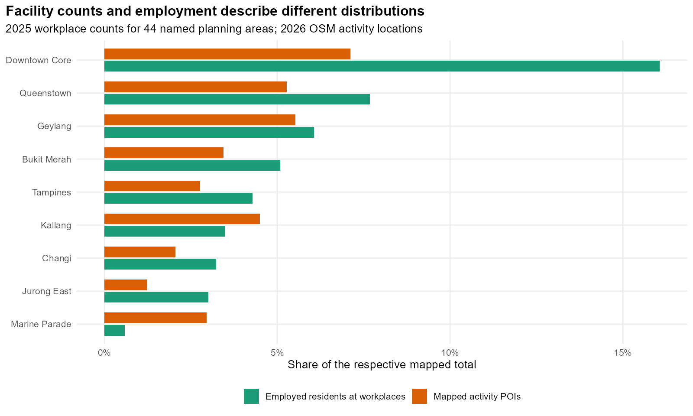

Downtown Core contains `r pct(cbd_context$worker_share)` of the workers in the named planning areas we can map, compared with `r pct(cbd_context$poi_share)` of the facilities. Marine Parade has `r pct(marine_context$poi_share)` of the facilities but only `r pct(marine_context$worker_share)` of these workers. This helps explain the earlier problem: counting every facility equally gives areas with many small outlets a large share of estimated journeys.

The survey gives worker totals for planning areas, not individual buildings. Within each area, I spread workers across the facility locations, giving cells with more facilities more workers. This keeps the published totals unchanged, but still estimates where workers are within an area. Areas without their own reported worker count continue to contribute journeys through residents and general activities.

```{r}
context$allocation %>%
  filter(planning_area %in% c("DOWNTOWN CORE", "MARINE PARADE")) %>%
  knitr::kable(digits = 0, caption = "Published and allocated workplace totals agree.")
```

I replace office area with these worker counts in the model. Residents receive `r pct(ridership$fit$parameters["residential"])` of the weight used to distribute journeys. Of the remaining activity weight, `r pct(ridership$fit$parameters["employment"])` goes to worker counts. These are fitted weights for where journeys start, not measured percentages of home or work trips.

```{r}
feature_validation %>%
  filter(model %in% c(7, 8), station_id %in% c("RAFFLESPLACE", "MARINEPARADE")) %>%
  left_join(sf::st_drop_geometry(ridership$observed) %>% select(station_id, station), by = "station_id") %>%
  mutate(model = if_else(model == 7, "Office area", "Workplace counts")) %>%
  select(Station = station, Observed = observed, model, predicted) %>%
  pivot_wider(names_from = model, values_from = predicted) %>%
  mutate(across(where(is.numeric), fmt)) %>% knitr::kable()
```

Marine Parade's prediction falls considerably, though it is still too high. Raffles Place becomes less accurate. Knowing Downtown Core's worker total helps describe the area, but does not tell us how those workers are spread around its many stations. Within each planning area, the model still relies on facility counts and treats small outlets and large workplaces alike.

### Do direct buses explain Marine Parade's remaining gap? {#marine-parade-buses}

Another possibility at Marine Parade is that some people take a direct bus instead of a train. I identify bus services that stop within 500 metres of each station and later reach Downtown Core. Each regular service is counted once. I use the middle of its published daytime interval range to estimate departures per hour, leaving out peak-only services and shortened route variants.

```{r}
context$station_routes %>%
  filter(station_id == "MARINEPARADE", radius == 500) %>%
  transmute(Service = ServiceNo, `Boarding stop` = BusStopCode,
            `Daytime interval (minutes)` = AM_Offpeak_Freq) %>%
  knitr::kable()
```

```{r}
#| label: th03-marine-bus-count
#| include: false
marine_buses <- context$bus_totals %>% filter(station_id == "MARINEPARADE", radius == 500)
```

Marine Parade has `r marine_buses$direct_services` regular services offering a direct trip into Downtown Core, equivalent to roughly `r fmt(marine_buses$direct_buses_hour)` departures per hour when the frequency midpoints are added. The map follows two of them as far as their first Downtown Core stop. [SBS Transit service 196](https://www.sbstransit.com.sg/Service/BusService?ServiceNo=196) is one example serving Marine Parade station and Parkway Parade.

```{r}
#| label: th03-marine-bus-map
#| code-fold: true
#| code-summary: "Show the R calculation"
routes <- readRDS("data/take-home-03/raw/BusRoutes-20261104.rds") %>%
  left_join(st_drop_geometry(context$stops) %>% select(BusStopCode, planning_area), by = "BusStopCode")
examples <- context$station_routes %>%
  filter(station_id == "MARINEPARADE", radius == 500, ServiceNo %in% c("36", "196"))
paths <- map_dfr(seq_len(nrow(examples)), function(i) {
  route <- routes %>% filter(ServiceNo == examples$ServiceNo[i], Direction == examples$Direction[i],
                             StopSequence >= examples$StopSequence[i]) %>% arrange(StopSequence)
  first_cbd <- min(route$StopSequence[which(route$planning_area == "DOWNTOWN CORE")])
  route %>% filter(StopSequence <= first_cbd)
}) %>% left_join(st_drop_geometry(context$stops) %>%
  mutate(x = st_coordinates(context$stops)[, 1], y = st_coordinates(context$stops)[, 2]) %>%
  select(BusStopCode, x, y), by = "BusStopCode")
rail_examples <- prepared$stations$Existing %>% filter(station_id %in% c("MARINEPARADE", "RAFFLESPLACE"))
cbd <- prepared$subzones %>% filter(planning_area == "DOWNTOWN CORE")
```

```{r}
#| label: th03-bus-map-plot
bus_map <- ggplot() +
  geom_sf(data = prepared$subzones, fill = "grey97", colour = "grey85", linewidth = 0.2) +
  geom_sf(data = cbd, fill = "#f3e6c6", colour = "grey75", linewidth = 0.2) +
  geom_path(data = paths, aes(x, y, colour = ServiceNo, group = ServiceNo), linewidth = 1.1) +
  geom_point(data = paths, aes(x, y, colour = ServiceNo), size = 1.3) +
  geom_sf(data = rail_examples, shape = 23, size = 3, fill = "white") +
  geom_sf_text(data = rail_examples, aes(label = station), nudge_y = -300, size = 3.4) +
  scale_colour_brewer(palette = "Dark2") +
  coord_sf(xlim = range(paths$x) + c(-1000, 1000), ylim = range(c(paths$y, st_coordinates(rail_examples)[, 2])) + c(-800, 800), datum = NA) +
  labs(x = NULL, y = NULL, colour = "Bus service", title = "Two direct bus options from Marine Parade to Downtown Core",
       subtitle = "Lines join successive stops; shaded area is Downtown Core. Route snapshot: 4 November 2026.")
save_plot(bus_map, "marine-bus-routes", height = 5.5)
```

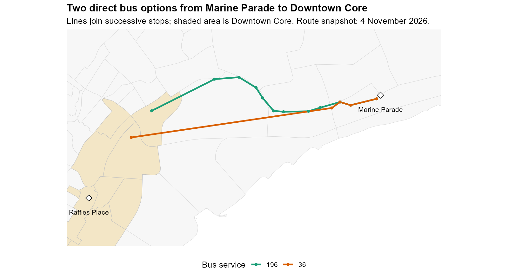

I let the model reduce a station's attraction where direct CBD buses are more frequent, using the same rule across stations. With the power curve, this raises the office-area model's error to `r pct(ridership$power_performance$WAPE[ridership$power_performance$model == 9])`. With worker counts included, the bus-competition effect is zero in all five tests, leaving WAPE at `r pct(ridership$power_performance$WAPE[ridership$power_performance$model == 10])`. I therefore leave this extra adjustment out of the selected model.

Marine Parade clearly has direct bus alternatives, but their frequency alone does not improve these predictions. Passengers also consider where they are going, the time taken by each option and how easily they can reach the stops. A measure of daytime CBD services leaves out much of that choice, especially for trips elsewhere in Singapore.

### Does the employment improvement hold elsewhere?

```{r}
#| label: th03-restore-model-inputs
#| include: false
origins <- prepared$origins
stations <- ridership$observed
observed <- stations$entries
choice_origins <- ridership$choice_origins
choice_interactions <- ridership$choice_interactions
distances <- matrix(choice_interactions$Existing$distance_km,
  nrow = nrow(choice_origins), byrow = TRUE)
fit <- ridership$fit
selected_model <- fit$model
distance_form <- fit$distance_form
max_distance <- fit$max_distance
```

```{r}
#| label: th03-alternative-folds
#| code-fold: true
#| code-summary: "Show the R calculation"
#| cache: true
#| cache.extra: !expr digest::digest(list(model_signature, selected_model, distance_form, max_distance))
# Check whether the improvement depends on one geographical split.
alternative_folds <- cutree(hclust(dist(st_coordinates(stations)), method = "ward.D2"), k = 5)
fold_sensitivity <- lapply(union(6:7, selected_model), function(model) {
  current_origins <- if (model >= 7) office_origins else distributed_origins
  current_distances <- if (model >= 7) office_distances else distributed_distances
  predicted <- rep(NA_real_, nrow(stations))
  for (fold in 1:5) {
    message("Alternative partition: model ", model, ", fold ", fold)
    check <- fit_huff(observed, current_distances, current_origins, stations, model,
                      training = which(alternative_folds != fold),
                      distance_form = if (model == selected_model) distance_form else "power",
                      max_distance = if (model == selected_model) max_distance else Inf)
    predicted[alternative_folds == fold] <- check$predicted[alternative_folds == fold]
  }
  tibble(model = model, station_id = stations$station_id, fold = alternative_folds,
         observed = observed, predicted = predicted)
}) %>% bind_rows()
```

```{r}
#| label: th03-august-check
august <- stations %>% select(station_id) %>% left_join(entries$August, by = "station_id")
stopifnot(!anyNA(august$entries))
temporal <- error_measures(august$entries, fit$predicted)
ridership$fold_sensitivity <- fold_sensitivity
ridership$temporal <- temporal
office_check <- fold_sensitivity %>% group_by(model) %>%
  summarise(WAPE = sum(abs(predicted - observed)) / sum(observed), .groups = "drop")
```

I also regroup nearby stations using Ward clustering. With these different test groups, the selected model's error is `r pct(office_check$WAPE[office_check$model == ridership$fit$model])`, compared with `r pct(office_check$WAPE[office_check$model == 7])` for the office-area version. Both sets of groups help assess the model. Against August counts at the same stations, error is `r pct(ridership$temporal$WAPE)`. Its September error on the data used for fitting is `r pct(review$in_sample$WAPE)`.

The predictions also tend to put busier and quieter stations in the right order. Their Spearman rank correlation with recorded entries is `r round(review$rank_correlation, 2)`, where one would mean exactly the same ranking. That makes the model useful for comparing station roles, while the sizeable count errors remain important when reading individual forecasts. Distance from homes to stations can be checked separately, without the ridership model.

:::

## What changes with JRL and CRL {#expanded-network}

### Compare the four networks

I now use the fitted model to compare four networks: today's stations, JRL added, CRL Phase 1 added, and both lines added. Each version has the same number of journeys. New stations give passengers more choices, while an extra line changes the attraction of an existing interchange. All changes below compare the modelled existing network with the modelled expansion.

```{r}
#| label: th03-expansion-inputs
#| include: false
origins <- prepared$origins
stations <- ridership$observed
observed <- stations$entries
choice_origins <- ridership$choice_origins
choice_interactions <- ridership$choice_interactions
distances <- matrix(choice_interactions$Existing$distance_km,
  nrow = nrow(choice_origins), byrow = TRUE)
fit <- ridership$fit
selected_model <- fit$model
distance_form <- fit$distance_form
max_distance <- fit$max_distance
```

```{r}
#| label: th03-mci-probabilities
#| code-fold: true
#| code-summary: "Show the R calculation"
# The matrix calculation above is used in optimisation; verify its output against MCI.
mci_probabilities <- function(fit, interactions, origins, destinations) {
  parameters <- fit$parameters
  attraction <- station_attraction(parameters, destinations, fit$bus_radius)
  pairs <- interactions %>%
    mutate(attraction = .env$attraction[match(station_id, destinations$station_id)],
           distance = pmax(distance_km, fit$distance_floor))
  pairs <- as.data.frame(pairs)
  # MCI repeatedly grows an internal table. Separate origins give identical
  # probabilities while keeping that table small for the finer demand locations.
  by_origin <- split(pairs, factor(pairs$origin_id, levels = origins$origin_id))
  do.call(rbind, lapply(by_origin, function(x) {
    if (!is.null(fit$max_distance) && is.finite(fit$max_distance)) {
      keep <- x$distance_km <= fit$max_distance
      keep[which.min(x$distance_km)] <- TRUE
      x <- x[keep, ]
    }
    # exp(distance)^(-decay) gives exponential decay within the same Huff shares.
    if (identical(fit$distance_form, "exponential")) x$distance <- exp(x$distance)
    shares <- MCI::huff.shares(x, "origin_id", "station_id", "attraction", "distance",
                              gamma = 1, lambda = -unname(parameters["decay"]), check_df = FALSE)
    p <- shares$p_ij[match(destinations$station_id, shares$station_id)]
    replace(p, is.na(p), 0)
  }))
}
```

```{r}
#| label: th03-subzone-probabilities
#| code-fold: true
#| code-summary: "Show the R calculation"
subzone_probabilities <- function(probabilities, locations, subzones, residential_share,
                                  fallback, office_share = 0, employment_share = 0) {
  demand <- origin_weights(locations, residential_share, office_share, employment_share)
  totals <- rowsum(probabilities * demand, locations$subzone_id, reorder = FALSE)
  weights <- rowsum(matrix(demand), locations$subzone_id, reorder = FALSE)[, 1]
  active <- weights > 0
  index <- match(rownames(totals)[active], subzones$origin_id)
  fallback[index, ] <- totals[active, , drop = FALSE] / weights[active]
  stopifnot(max(abs(rowSums(fallback) - 1)) < 1e-10)
  fallback
}
```

```{r}
#| label: th03-expanded-network
#| code-fold: true
#| code-summary: "Show the R calculation"
scenario_predictions <- list()
probabilities <- list()
for (scenario in names(prepared$stations)) {
  message("Predicting network: ", scenario)
  destinations <- prepared$stations[[scenario]]
  pairs <- choice_interactions[[scenario]]
  p <- mci_probabilities(fit, pairs, choice_origins, destinations)
  fast_p <- choice_probabilities(fit$parameters, matrix(pairs$distance_km, nrow = nrow(choice_origins), byrow = TRUE),
                                 destinations, fit$bus_radius, fit$distance_floor, distance_form, max_distance)
  stopifnot(max(abs(p - fast_p)) < 1e-10, all(is.finite(p)), all(p >= 0), max(abs(rowSums(p) - 1)) < 1e-10)
  predicted <- sum(observed) * as.numeric(crossprod(origin_weights(choice_origins, fit$parameters["residential"], fit$parameters["office"], fit$parameters["employment"]), p))
  stopifnot(abs(sum(predicted) - sum(observed)) < 1e-6)
  scenario_predictions[[scenario]] <- st_drop_geometry(destinations) %>%
    mutate(scenario = scenario, predicted = predicted)
  if (selected_model >= 5) {
    fallback <- choice_probabilities(fit$parameters,
      matrix(prepared$interactions[[scenario]]$distance_km, nrow = nrow(origins), byrow = TRUE), destinations,
      distance_form = distance_form, max_distance = max_distance)
    probabilities[[scenario]] <- subzone_probabilities(p, choice_origins, origins,
      fit$parameters["residential"], fallback, fit$parameters["office"], fit$parameters["employment"])
    reconstructed <- sum(observed) * as.numeric(crossprod(origin_weights(origins, fit$parameters["residential"], fit$parameters["office"], fit$parameters["employment"]), probabilities[[scenario]]))
    stopifnot(max(abs(reconstructed - predicted)) < 1e-6)
  } else probabilities[[scenario]] <- p
}
```

I compare each expansion prediction with the modelled existing network.

```{r}
#| label: th03-expanded-network-2
#| code-fold: true
#| code-summary: "Show the R calculation"
predictions <- bind_rows(scenario_predictions)
baseline <- predictions %>% filter(scenario == "Existing") %>% select(station_id, baseline = predicted)
predictions <- predictions %>% left_join(baseline, by = "station_id") %>%
  mutate(change = predicted - baseline, percent_change = change / baseline)
stopifnot(max(abs(predictions$change[predictions$scenario == "Existing"])) < 1e-10)
```

The station with the largest probability becomes the leading choice for each subzone.

```{r}
#| label: th03-expanded-network-3
#| code-fold: true
#| code-summary: "Show the R calculation"
catchments <- lapply(names(probabilities), function(scenario) {
  p <- probabilities[[scenario]]
  destinations <- prepared$stations[[scenario]]
  largest <- max.col(p, ties.method = "first")
  tibble(origin_id = origins$origin_id, scenario = scenario,
         station_id = destinations$station_id[largest],
         station = destinations$station[largest],
         probability = p[cbind(seq_len(nrow(p)), largest)])
}) %>% bind_rows()
```

```{r}
#| label: th03-store-scenarios
ridership$predictions <- predictions
ridership$probabilities <- probabilities
ridership$catchments <- catchments
total <- sum(observed)
demand_share <- origin_weights(origins, fit$parameters["residential"],
  fit$parameters["office"], fit$parameters["employment"])
```

```{r}
#| label: th03-scenario-comparison
catchments <- ridership$catchments %>%
  left_join(tibble(origin_id = origins$origin_id, demand_share = demand_share), by = "origin_id")
baseline_choices <- catchments %>% filter(scenario == "Existing") %>%
  select(origin_id, baseline_station = station_id)
catchments <- catchments %>% left_join(baseline_choices, by = "origin_id") %>%
  mutate(changed = station_id != baseline_station, active = demand_share > 0)
scenario_summary <- ridership$predictions %>% group_by(scenario) %>%
  summarise(new_locations = sum(!existing), new_entries = sum(predicted[!existing]),
            new_share = new_entries / sum(predicted), total_entries = sum(predicted), .groups = "drop") %>%
  left_join(catchments %>% group_by(scenario) %>%
              summarise(changed_origins = sum(changed & active), active_origins = sum(active), .groups = "drop"),
            by = "scenario")
details$scenarios <- scenario_summary
details$catchments <- catchments
combined <- scenario_summary %>% filter(scenario == "Both")
```

```{r}
details$scenarios %>%
  mutate(scenario = factor(scenario, levels = c("Existing", "JRL", "CRL", "Both"))) %>%
  arrange(scenario) %>%
  transmute(Network = scenario, `New locations` = new_locations,
            `Entries at new locations` = estimate(new_entries),
            `Share of entries` = pct(new_share), `Changed catchments` = changed_origins) %>%
  knitr::kable()
```

With both lines, the new station locations receive about `r estimate(combined$new_entries)` daily entries, or `r pct(combined$new_share)` of the unchanged total. Adding both lines gives a slightly smaller new-station total than adding their separate estimates together. That is because passengers choose among all the stations in the combined network.

```{r}
#| label: th03-scenario-explorer
#| code-fold: true
#| code-summary: "Show the R calculation"
scenario_map <- leaflet(options = leafletOptions(minZoom = 10)) %>%
  addPolygons(data = st_transform(subzones, 4326), weight = 0.5, color = "#b8c2c4",
              fillColor = "#f5f5f0", fillOpacity = 1,
              label = ~paste(str_to_title(subzone), str_to_title(planning_area), sep = ", ")) %>%
  addControl("Boundaries: URA", position = "bottomleft") %>%
  setView(lng = 103.83, lat = 1.35, zoom = 11)
palette <- colorFactor("Dark2", c("Existing", "New"))
probability_palette <- colorNumeric("Blues", domain = c(0, 1), na.color = "#eeeeee")
for (scenario in names(prepared$stations)) {
  points <- st_transform(prepared$stations[[scenario]], 4326) %>%
    mutate(status = if_else(existing, "Existing", "New"),
           label = paste0(station, "<br>", codes, "<br>", lines, " connecting line(s)"))
  if (!is.null(ridership)) {
    values <- ridership$predictions %>% filter(.data$scenario == .env$scenario) %>% select(station_id, predicted)
    points <- points %>% left_join(values, by = "station_id") %>%
      mutate(label = paste0(label, "<br>Estimated weekday entries: ", scales::comma(round(predicted, -2))))
    areas <- subzones %>% st_simplify(dTolerance = 20) %>% st_transform(4326) %>%
      left_join(details$catchments %>% filter(.data$scenario == .env$scenario), by = "origin_id") %>%
      mutate(label = if_else(active,
        paste0(str_to_title(subzone), "<br>Most likely station: ", station,
               "<br>Probability: ", scales::percent(probability, accuracy = 0.1)),
        paste0(str_to_title(subzone), "<br>No population or activity demand in the model")))
    scenario_map <- scenario_map %>% addPolygons(data = areas, group = scenario,
      color = "#aab4b6", weight = 0.4, fillOpacity = 0.65,
      fillColor = ~probability_palette(if_else(active, probability, NA_real_)), popup = ~label)
  }
  scenario_map <- scenario_map %>% addCircleMarkers(data = points, group = scenario,
    radius = 4, color = ~palette(status), weight = 1, fillOpacity = 0.85, popup = ~label)
}
scenario_map <- scenario_map %>%
  addLayersControl(baseGroups = names(prepared$stations), options = layersControlOptions(collapsed = FALSE)) %>%
  hideGroup(c("JRL", "CRL", "Both")) %>%
  addLegend(position = "bottomright", pal = palette, values = c("Existing", "New"), title = "Station location")
if (!is.null(ridership)) scenario_map <- scenario_map %>%
  addLegend(position = "bottomleft", pal = probability_palette, values = c(0, 1), title = "Highest choice probability")
saveWidget(scenario_map, "take-home-03/network-explorer.html", selfcontained = FALSE)
```

<iframe src="take-home-03/network-explorer.html" title="Compare existing stations, JRL, CRL Phase 1 and both proposed lines" style="width:100%;height:560px;border:1px solid #dce3e4;border-radius:8px;" loading="lazy"></iframe>

Choose a network in the upper-right corner. Select a station to see its estimated entries, or a subzone to see its most likely station. Darker shading means the leading station receives a larger share of that subzone's estimated journeys. Grey areas have no modelled journeys from residents or activities.

### New stations and nearby alternatives

Before plotting the estimates, I repeat the calculation with different bus-stop buffers and minimum distances. I also compare a version where residents alone determine where journeys start.

```{r}
#| label: th03-expansion-sensitivity
#| code-fold: true
#| code-summary: "Show the R calculation"
#| cache: true
#| cache.extra: !expr digest::digest(list(model_signature, fit, choice_interactions))
settings <- tribble(~check, ~radius, ~floor, ~model,
                    "Main model", 500, 0.1, selected_model,
                    "400 m bus buffer", 400, 0.1, selected_model,
                    "800 m bus buffer", 800, 0.1, selected_model,
                    "50 m distance floor", 500, 0.05, selected_model,
                    "250 m distance floor", 500, 0.25, selected_model,
                    "Residential demand only", 500, 0.1, selected_model) %>%
  mutate(residential_only = check == "Residential demand only")
sensitivity <- lapply(seq_len(nrow(settings)), function(i) {
  row <- settings[i, ]
  message("Sensitivity check: ", row$check)
  alt <- if (row$check == "Main model") fit else
    fit_huff(observed, distances, choice_origins, stations, row$model,
             bus_radius = row$radius, distance_floor = row$floor, residential_only = row$residential_only,
             distance_form = distance_form, max_distance = max_distance)
  do.call(bind_rows, lapply(c("Existing", "Both"), function(scenario) {
    destinations <- prepared$stations[[scenario]]
    pairs <- choice_interactions[[scenario]]
    p <- choice_probabilities(alt$parameters, matrix(pairs$distance_km, nrow = nrow(choice_origins), byrow = TRUE),
                              destinations, row$radius, row$floor, distance_form, max_distance)
    tibble(check = row$check, scenario = scenario, station_id = destinations$station_id,
           predicted = sum(observed) * as.numeric(crossprod(origin_weights(choice_origins, alt$parameters["residential"], alt$parameters["office"], alt$parameters["employment"]), p)))
  }))
}) %>% bind_rows()
```

```{r}
#| label: th03-expansion-sensitivity-results
#| include: false
ridership$sensitivity <- sensitivity
```

```{r}
#| label: th03-leading-stations
#| include: false
new_top <- predictions %>% filter(scenario == "Both", !existing) %>%
  slice_max(predicted, n = 1, with_ties = FALSE)
leading_jrl <- predictions %>% filter(scenario == "Both", !existing, startsWith(codes, "J")) %>%
  slice_max(predicted, n = 1, with_ties = FALSE)
quiet_stations <- predictions %>% filter(scenario == "Both", !existing) %>%
  arrange(predicted) %>% slice_head(n = 6)
campus <- predictions %>% filter(scenario == "Both", station_id == "NANYANGCRESCENT")
campus_residential <- sensitivity %>% filter(scenario == "Both",
  station_id == "NANYANGCRESCENT", check == "Residential demand only")
```

```{r}
#| label: th03-new-station-estimates
ranges <- ridership$sensitivity %>% filter(scenario == "Both", check != "Residential demand only") %>% group_by(station_id) %>%
  summarise(low = min(predicted), high = max(predicted), .groups = "drop")
residential <- ridership$sensitivity %>% filter(scenario == "Both", check == "Residential demand only") %>%
  select(station_id, residential = predicted)
new_chart <- ridership$predictions %>% filter(scenario == "Both", !existing) %>%
  left_join(ranges, by = "station_id") %>%
  left_join(residential, by = "station_id") %>%
  mutate(line = if_else(startsWith(codes, "J"), "JRL", "CRL Phase 1")) %>%
  ggplot(aes(predicted, reorder(station, predicted))) +
  geom_errorbar(aes(xmin = low, xmax = high), orientation = "y", width = 0.25, colour = "grey60") +
  geom_point(aes(colour = line), size = 2) +
  geom_point(aes(x = residential, colour = line), shape = 1, size = 2) +
  scale_colour_brewer(palette = "Dark2", name = NULL) +
  scale_x_continuous(labels = scales::label_comma()) +
  labs(x = "Estimated average weekday entries", y = NULL, title = "Potential boardings at new stations",
       subtitle = "Filled: selected model. Hollow: residents only. Bars: buffer and distance-floor checks.")
save_plot(new_chart, "new-stations", height = 9)
```

```{r}
#| echo: false
#| fig-cap: "Estimated entries at all 29 new physical stations with both lines added."
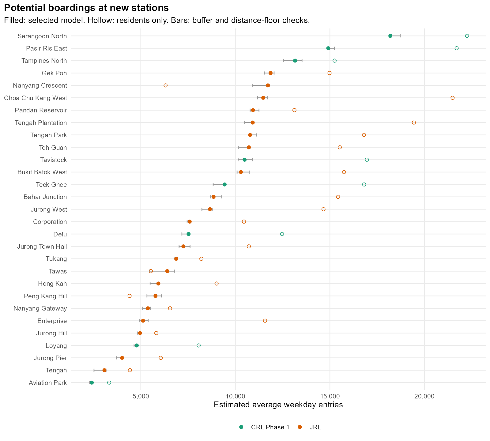
```

`r new_top$station` has the highest estimate among the new locations, at about `r estimate(new_top$predicted)` weekday entries. Pasir Ris East also ranks highly, while `r leading_jrl$station` leads the JRL locations. Filled dots show the selected model. The narrow bars show what changes when I vary the distance used to count bus stops or the minimum distance in the model. Hollow dots show a larger change: distributing journeys using residents alone.

Nanyang Crescent falls from about `r estimate(campus$predicted)` to `r estimate(campus_residential$predicted)` entries when only residents determine where journeys start. Much of its main estimate therefore comes from activity around the campus. Serangoon North stays first in both versions. The chart shows how the estimates change under different assumptions; its bars are not confidence intervals.

### Which stations have the lowest estimates? {#low-entry-estimates}

```{r}
quiet_stations %>%
  transmute(Station = station, `Estimated entries/day` = estimate(predicted)) %>% knitr::kable()
```

`r quiet_stations$station[1]`, `r quiet_stations$station[2]` and `r quiet_stations$station[3]` have the lowest estimates. For comparison, half of existing MRT stations record fewer than `r fmt(median(review$stations$entries[review$stations$mrt]))` weekday entries, and the quietest tenth record about `r fmt(quantile(review$stations$entries[review$stations$mrt], 0.1))` or fewer. These figures give context; they are not rules for deciding when a station should open.

These locations need closer study. Resident worker counts give only part of the picture around industrial and airport areas. Tengah's housing matches are incomplete, and the forecasts keep development at its current level. Alongside the errors at recently opened stations, these gaps mean a low estimate is a reason to gather better local evidence before making an opening decision.

### Existing stations gain connections and competition

```{r}
#| label: th03-existing-station-changes
changes_chart <- ridership$predictions %>% filter(scenario == "Both", existing) %>%
  slice_max(abs(change), n = 12) %>% ggplot(aes(change, reorder(station, change), fill = change > 0)) +
  geom_col(width = 0.7) + geom_vline(xintercept = 0, colour = "grey50") +
  scale_fill_brewer(palette = "Set2", guide = "none") + scale_x_continuous(labels = scales::label_comma()) +
  labs(x = "Change in estimated weekday entries", y = NULL, title = "Where existing stations could gain or lose boardings")
save_plot(changes_chart, "station-changes", height = 6)
```

```{r}
#| echo: false
#| fig-cap: "The twelve largest absolute changes among existing stations."
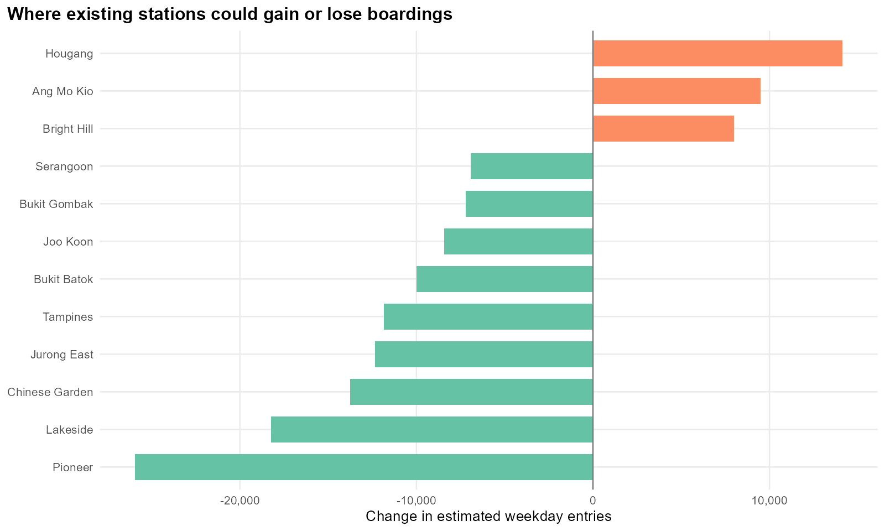
```

```{r}
ridership$predictions %>% filter(scenario == "Both", existing) %>%
  slice_max(abs(change), n = 5, with_ties = FALSE) %>%
  transmute(Station = station, `Baseline estimate` = estimate(predicted - change),
            `With both lines` = estimate(predicted), Change = estimate(change),
            `Change (%)` = pct(percent_change)) %>% knitr::kable()
```

```{r}
#| label: th03-largest-changes
#| include: false
largest_change <- ridership$predictions %>% filter(scenario == "Both", existing) %>%
  slice_max(abs(change), n = 1, with_ties = FALSE)
largest_gain <- ridership$predictions %>% filter(scenario == "Both", existing) %>%
  slice_max(change, n = 1, with_ties = FALSE)
```

The largest shift is at `r largest_change$station`, with about `r estimate(abs(largest_change$change))` fewer predicted daily entries (`r pct(abs(largest_change$percent_change))`). The largest gain is at `r largest_gain$station`, with about `r estimate(largest_gain$change)` more (`r pct(largest_gain$percent_change)`). New stations give passengers alternatives to Pioneer. Hougang gains an extra rail line, which raises its attraction score in the model. I check how much that assumption matters next.

Both sides of this comparison use model predictions: the existing network and the expanded network. This keeps the original prediction error out of the calculation of change. The counts cover people entering the railway, so passengers transferring between lines inside a station are excluded. Assessing platform crowding would need those transfers too.

### Does Hougang's gain depend on the extra line? {#interchange-sensitivity}

I run the expansion again with the same 29 new locations, but give existing stations no extra attraction for gaining a line. Their line counts stay at today's values in the calculation. Everything else stays the same. This separates the effect of new nearby stations from the extra weight given to upgraded interchanges.

```{r}
#| label: th03-interchange-check
#| code-fold: true
#| code-summary: "Show the R calculation"
parameters <- ridership$fit$parameters
locations <- ridership$choice_origins
demand <- origin_weights(locations, parameters["residential"], parameters["office"], parameters["employment"])
both <- prepared$stations$Both
baseline_lines <- prepared$stations$Existing$lines[match(both$station_id, prepared$stations$Existing$station_id)]
fixed_lines <- both %>% mutate(lines = coalesce(baseline_lines, lines))
expanded_distances <- matrix(ridership$choice_interactions$Both$distance_km,
                             nrow = nrow(locations), byrow = TRUE)
fixed_p <- choice_probabilities(parameters, expanded_distances, fixed_lines,
  distance_form = ridership$fit$distance_form, max_distance = ridership$fit$max_distance)
fixed_prediction <- total * as.numeric(crossprod(demand, fixed_p))
interchange_check <- ridership$predictions %>% filter(scenario == "Both") %>%
  mutate(fixed_lines = fixed_prediction[match(station_id, both$station_id)],
    fixed_change = fixed_lines - baseline, upgrade_difference = predicted - fixed_lines) %>%
  filter(existing, lines > baseline_lines[match(station_id, both$station_id)])
stopifnot(abs(sum(fixed_prediction) - total) < 1e-6,
          all(fixed_prediction[both$existing] <= ridership$predictions$predicted[ridership$predictions$scenario == "Existing"] + 1e-6))
review$interchanges <- interchange_check
review$fixed_lines <- tibble(station_id = both$station_id, predicted = fixed_prediction)
hougang_check <- interchange_check %>% filter(station_id == "HOUGANG")
```

```{r}
review$interchanges %>%
  transmute(Station = station, `Full expansion: change` = estimate(change),
    `Without line-count uplift: change` = estimate(fixed_change)) %>% knitr::kable()
```

Hougang changes from a gain of `r estimate(hougang_check$change)` entries to a loss of `r estimate(abs(hougang_check$fixed_change))`. Its predicted gain relies heavily on the model assuming that an extra line draws more people to enter there. That rule comes from comparing today's stations. Existing interchanges also differ in their surroundings and position in the network, so their boarding counts cannot tell us exactly what an extra line alone will do.

The two versions show how much the result depends on this assumption. Actual entries could fall outside either estimate, depending on how passengers use the new connections. Transfers within the railway remain outside these entry counts.

### A closer look at Yunnan and Pioneer

```{r}
#| label: th03-local-competition
#| code-fold: true
#| code-summary: "Show the R calculation"
origins <- prepared$origins
change_station <- ridership$predictions %>% filter(scenario == "Both", existing) %>%
  slice_max(abs(change), n = 1, with_ties = FALSE)
before_index <- match(change_station$station_id, prepared$stations$Existing$station_id)
after_index <- match(change_station$station_id, prepared$stations$Both$station_id)
contributions <- total * demand_share *
  (ridership$probabilities$Both[, after_index] - ridership$probabilities$Existing[, before_index])
origin_index <- which.max(abs(contributions))
local_origin <- st_drop_geometry(origins[origin_index, ])
local_choices <- lapply(c("Existing", "Both"), function(scenario) {
  stations <- prepared$stations[[scenario]]
  probabilities <- ridership$probabilities[[scenario]][origin_index, ]
  tibble(station_id = stations$station_id, station = stations$station, scenario = scenario,
         probability = probabilities,
         lines = stations$lines, bus_500 = stations$bus_500,
         distance_m = as.numeric(st_distance(origins[origin_index, ], stations)))
}) %>% bind_rows()
shown <- local_choices %>% group_by(scenario) %>% slice_max(probability, n = 3, with_ties = FALSE) %>%
  pull(station_id) %>% union(change_station$station_id)
local_choices <- local_choices %>% filter(station_id %in% shown)
details$change_station <- change_station
details$local_origin <- local_origin
details$local_choices <- local_choices
details$local_contribution <- contributions[origin_index]
local_name <- paste0(str_to_title(local_origin$subzone), " (", str_to_title(local_origin$planning_area), ")")
pioneer <- local_choices %>% filter(station_id == change_station$station_id)
local_leader <- local_choices %>% filter(scenario == "Both") %>%
  slice_max(probability, n = 1, with_ties = FALSE)
```

```{r}
#| label: th03-catchment-changes
choices <- details$catchments %>% select(origin_id, scenario, station_id, active) %>%
  pivot_wider(names_from = scenario, values_from = station_id) %>%
  mutate(changed = case_when(!active ~ "No modelled origin demand",
                            Existing == Both ~ "Same most likely station",
                            TRUE ~ "Different most likely station"))
catchment_map <- subzones %>% left_join(choices, by = "origin_id") %>% ggplot() +
  geom_sf(aes(fill = changed), colour = "white", linewidth = 0.15) +
  geom_sf(data = new_stations, size = 0.8) +
  scale_fill_manual(values = c("Different most likely station" = "#1b9e77",
    "Same most likely station" = "#e6eee9", "No modelled origin demand" = "grey85")) + coord_sf(datum = NA) +
  labs(x = NULL, y = NULL, fill = NULL, title = "Where the most likely station changes",
       subtitle = "Subzone-level Huff probabilities; both proposed lines added")
save_plot(catchment_map, "catchment-changes", height = 6)
```

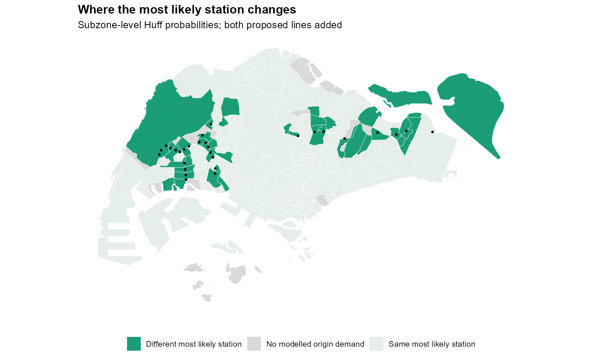

These station changes also affect which areas each station serves. The most likely choice changes in `r combined$changed_origins` of `r combined$active_origins` subzones with estimated journeys. Each subzone combines choices from its different starting locations. Even where the leading station stays the same, other stations can still gain part of the neighbourhood's journeys.

`r local_name` contributes most to the predicted change at `r largest_change$station`. Looking at the choices within this subzone helps explain the loss: different parts of the neighbourhood can favour different nearby stations once the new line opens.

```{r}
#| label: th03-local-choice-chart
local_probabilities <- details$local_choices %>% select(station, scenario, probability) %>%
  complete(station, scenario, fill = list(probability = 0)) %>%
  mutate(scenario = factor(scenario, levels = c("Existing", "Both"),
                           labels = c("Existing network", "With both lines")))
local_choice_chart <- ggplot(local_probabilities, aes(probability, reorder(station, probability), colour = scenario)) +
  geom_line(aes(group = station), colour = "grey75") + geom_point(size = 3) +
  scale_colour_brewer(palette = "Dark2") + scale_x_continuous(labels = scales::label_percent()) +
  labs(x = "Modelled station-choice probability", y = NULL, colour = NULL,
       title = paste("How station choices change in", str_to_title(details$local_origin$subzone)),
       subtitle = "Selected alternatives; unopened stations have zero probability in the baseline")
save_plot(local_choice_chart, "local-choices", height = 6)
```

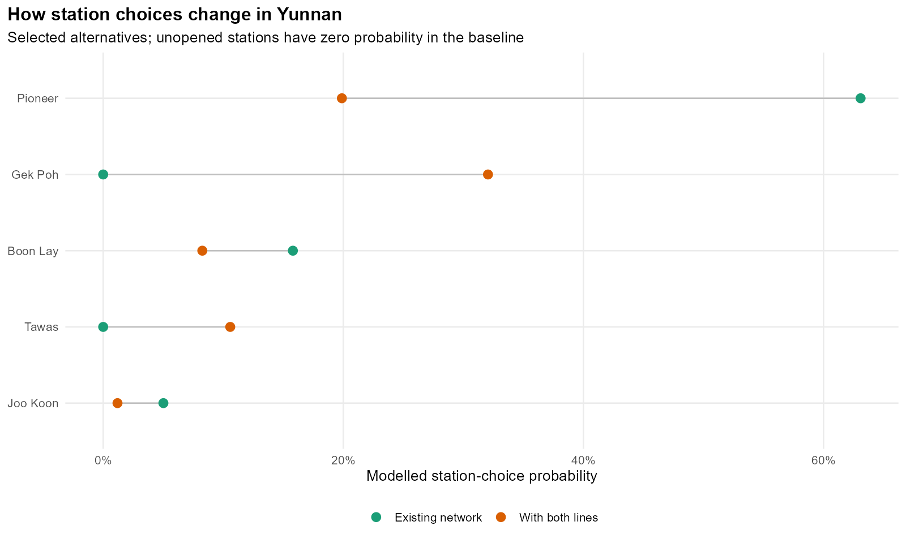

`r largest_change$station`'s share of this subzone's estimated journeys falls from `r pct(pioneer$probability[pioneer$scenario == "Existing"])` to `r pct(pioneer$probability[pioneer$scenario == "Both"])`. `r local_leader$station` becomes the leading choice. The passenger's final destination could change that choice, however. Someone heading to the CBD may prefer an EWL station to a closer JRL station that requires a transfer. The model leaves out this part of the journey, so Pioneer's predicted loss needs checking against actual travel routes.

```{r}
#| label: th03-pioneer-surface
#| code-fold: true
#| code-summary: "Show the R calculation"
probabilities <- map_dfr(c("Existing", "Both"), function(network) {
  stations <- prepared$stations[[network]]
  tibble(origin_id = prepared$origins$origin_id, scenario = network,
    probability = ridership$probabilities[[network]][, match("PIONEER", stations$station_id)])
})
active <- details$catchments %>% filter(scenario == "Both") %>% select(origin_id, active)
pioneer <- prepared$stations$Existing %>% filter(station_id == "PIONEER")
areas <- prepared$subzones[st_intersects(prepared$subzones, st_buffer(pioneer, 5000), sparse = FALSE)[, 1], ] %>%
  left_join(probabilities, by = "origin_id", relationship = "many-to-many") %>%
  left_join(active, by = "origin_id") %>%
  mutate(probability = if_else(active, probability, NA_real_),
    scenario = factor(scenario, c("Existing", "Both"), c("Existing network", "With both lines")))
points <- map_dfr(c("Existing", "Both"), function(network)
  prepared$stations[[network]] %>% filter(station_id %in% c("PIONEER", "BOONLAY", "GEKPOH", "TAWAS")) %>%
    mutate(scenario = factor(network, c("Existing", "Both"), c("Existing network", "With both lines"))))
extent <- st_bbox(st_buffer(pioneer, 4500))
pioneer_map <- ggplot(areas) +
  geom_sf(aes(fill = probability), colour = "white", linewidth = 0.2) +
  geom_sf(data = points, size = 2) +
  geom_label_repel(data = points, aes(label = station, geometry = geometry), stat = "sf_coordinates",
    size = 3, seed = 626, min.segment.length = 0) +
  scale_fill_distiller(palette = "Blues", direction = 1, limits = c(0, 1),
    breaks = c(0, 0.5, 1), labels = scales::label_percent(), na.value = "grey85",
    guide = guide_colourbar(barwidth = grid::unit(6, "cm"))) +
  facet_wrap(~scenario) +
  coord_sf(xlim = extent[c("xmin", "xmax")], ylim = extent[c("ymin", "ymax")], datum = NA) +
  labs(fill = "Pioneer choice probability", x = NULL, y = NULL,
    title = "How Pioneer's catchment changes",
    subtitle = "Demand-weighted subzone probabilities; grey areas have no modelled demand")
save_plot(pioneer_map, "pioneer-catchment", height = 5.8)
```

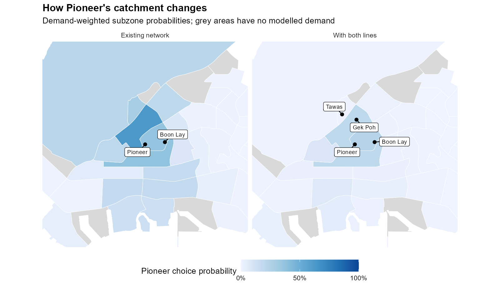

The paired maps show the same change across nearby subzones. A lighter shade means a smaller share of journeys is assigned to Pioneer. This reveals changes that a map of the leading station alone would hide: Pioneer can stay first in a subzone while sharing more of its journeys with new alternatives.

## Which neighbourhoods gain closer access {#neighbourhood-access}

The ridership model tells us where journeys might shift. A separate question is easier to measure directly: how much closer would homes be to a station? This value-added analysis compares that distance across neighbourhoods, including those with more older HDB residents. It can identify benefits even at stations with modest boarding estimates.

### From the home to the nearest station

I measure the straight-line distance from each mapped residential block to its nearest MRT or LRT station. A block with more homes counts more in the average, so the result represents the average distance per mapped home. This measures how close the station is on a map. Actual walking routes also depend on entrances, crossings and barriers, while the onward train journey needs a separate calculation.

```{r}
#| label: th03-access-distances
#| code-fold: true
#| code-summary: "Show the R calculation"
stations <- prepared$stations
buildings <- prepared$buildings
subzones <- prepared$subzones
access <- lapply(names(stations), function(scenario) {
  destinations <- stations[[scenario]]
  nearest <- st_nearest_feature(buildings, destinations)
  tibble(address_key = buildings$address_key, origin_id = buildings$origin_id,
         dwellings = buildings$total_dwelling_units, scenario = scenario,
         nearest_station = destinations$station[nearest],
         distance_m = as.numeric(st_distance(buildings, destinations[nearest, ], by_element = TRUE)))
}) %>% bind_rows()
baseline <- access %>% filter(scenario == "Existing") %>% select(address_key, baseline_m = distance_m)
access <- access %>% left_join(baseline, by = "address_key") %>% mutate(gain_m = baseline_m - distance_m)
stopifnot(all(access$gain_m >= -1e-7), all(access$gain_m[access$scenario == "Existing"] == 0))
```

I group subzones by their older-resident share and calculate dwelling-weighted coverage and distance.

```{r}
#| label: th03-access-distances-2
#| code-fold: true
#| code-summary: "Show the R calculation"
age_groups <- subzones %>% st_drop_geometry() %>% filter(hdb_residents > 0) %>%
  mutate(age_group = factor(ntile(older_share, 4), levels = 1:4,
                            labels = c("Lowest older share", "Second quarter", "Third quarter", "Highest older share"))) %>%
  select(origin_id, older_share, age_group)
access <- left_join(access, age_groups, by = "origin_id")
coverage <- access %>% crossing(threshold = c(400, 800, 1200)) %>% group_by(scenario, threshold) %>%
  summarise(share = weighted.mean(distance_m <= threshold, dwellings), .groups = "drop")
equity <- access %>% filter(!is.na(age_group)) %>% group_by(scenario, age_group) %>%
  summarise(mean_distance = weighted.mean(distance_m, dwellings),
            mean_gain = weighted.mean(gain_m, dwellings),
            share_800 = weighted.mean(distance_m <= 800, dwellings), dwellings = sum(dwellings), .groups = "drop")
```

I also calculate the average distance saved in each subzone.

```{r}
#| label: th03-access-distances-3
#| code-fold: true
#| code-summary: "Show the R calculation"
local_access <- access %>% filter(scenario == "Both") %>% group_by(origin_id) %>%
  summarise(gain_m = weighted.mean(gain_m, dwellings),
            after_m = weighted.mean(distance_m, dwellings), dwellings = sum(dwellings), .groups = "drop") %>%
  left_join(st_drop_geometry(subzones) %>% select(origin_id, subzone, older_share), by = "origin_id")
```

These results supply the maps and comparisons below.

```{r}
#| label: th03-access-distances-4
#| code-fold: true
#| code-summary: "Show the R calculation"
prepared$access <- access
prepared$coverage <- coverage
prepared$equity <- equity
prepared$local_access <- local_access
before <- coverage$share[coverage$scenario == "Existing" & coverage$threshold == 800]
after <- coverage$share[coverage$scenario == "Both" & coverage$threshold == 800]
older <- equity %>% filter(scenario == "Both", age_group == "Highest older share")
younger <- equity %>% filter(scenario == "Both", age_group == "Lowest older share")
```

I repeat this for the four networks using the same homes each time. Adding stations can only leave the nearest distance unchanged or make it shorter, which provides a useful check on the calculation.

```{r}
#| label: th03-access-map
local_access <- subzones %>% left_join(prepared$local_access %>% select(origin_id, gain_m), by = "origin_id")
access_map <- ggplot(local_access) +
  geom_sf(aes(fill = gain_m), colour = "white", linewidth = 0.15) +
  geom_sf(data = new_stations, size = 0.8, colour = "grey20") +
  scale_fill_viridis_c(option = "C", na.value = "grey90", breaks = scales::breaks_pretty(n = 3),
                       labels = scales::label_number(suffix = " m", big.mark = ","),
                       guide = guide_colourbar(barwidth = grid::unit(6, "cm"))) +
  coord_sf(datum = NA) + labs(fill = "Mean distance saved", x = NULL, y = NULL,
    title = "How much closer would the nearest station be?",
    subtitle = "JRL and CRL Phase 1 combined; averages weighted by mapped HDB dwellings")
save_plot(access_map, "access-map", height = 6)
```

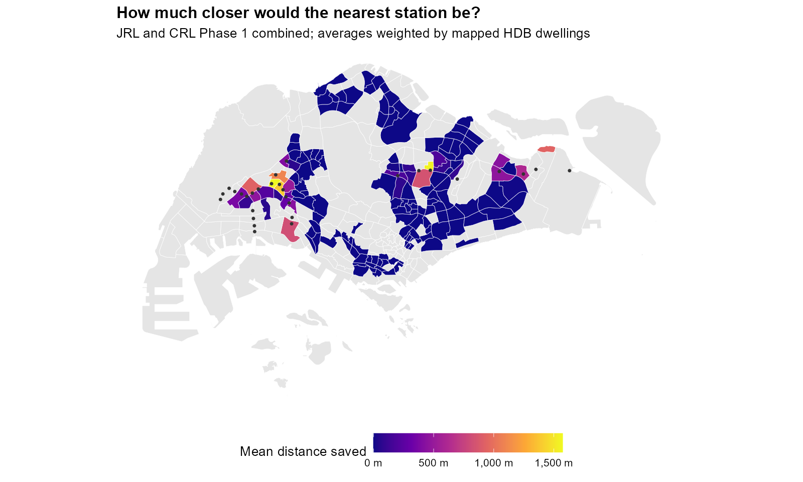

With both lines, the share of mapped HDB dwellings within 800 metres rises from `r pct(before)` to `r pct(after)`, a gain of `r round(100 * (after - before), 1)` percentage points. Grey subzones have no matched residential blocks in this sample.

```{r}
#| label: th03-access-coverage
coverage <- prepared$coverage %>%
  mutate(scenario = factor(scenario, levels = c("Existing", "JRL", "CRL", "Both")),
         threshold = factor(threshold, levels = c(400, 800, 1200), labels = c("400 metres", "800 metres", "1,200 metres")))
coverage_chart <- ggplot(coverage, aes(scenario, share, fill = threshold)) +
  geom_col(position = position_dodge(width = 0.8), width = 0.7) +
  geom_text(aes(label = scales::percent(share, accuracy = 0.1)),
            position = position_dodge(width = 0.8), vjust = -0.5, size = 3) +
  scale_fill_brewer(palette = "Blues", direction = -1) +
  scale_y_continuous(labels = scales::label_percent(), limits = c(0, 1.08), breaks = seq(0, 1, 0.2)) +
  labs(x = NULL, y = "Share of mapped HDB dwellings", fill = "Distance to nearest station",
       title = "More homes within reach of a station",
       subtitle = "Straight-line distances to station locations")
save_plot(coverage_chart, "coverage", height = 6)
```

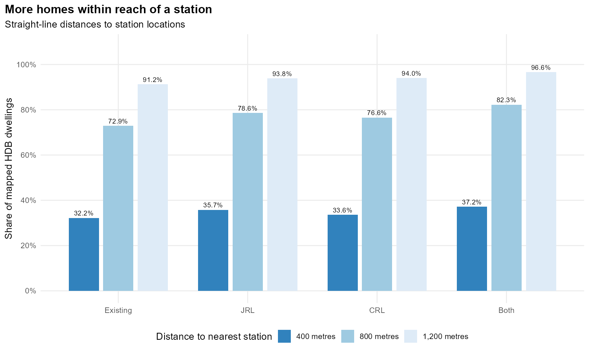

The 400, 800 and 1,200-metre comparisons show how the gain changes with our definition of “close”. A home already beside an LRT station may gain little in this distance measure, even if a new MRT line makes the rest of its journey easier.

```{r}
#| label: th03-local-housing-access
top_access <- prepared$local_access %>% slice_max(gain_m, n = 1, with_ties = FALSE) %>%
  left_join(st_drop_geometry(prepared$subzones) %>% select(origin_id, planning_area), by = "origin_id")
local_housing <- prepared$access %>% filter(origin_id == top_access$origin_id) %>%
  group_by(scenario, nearest_station) %>% summarise(dwellings = sum(dwellings), .groups = "drop") %>%
  group_by(scenario) %>% mutate(share = dwellings / sum(dwellings)) %>% ungroup()
older_gaps <- prepared$access %>% filter(scenario == "Both", age_group == "Highest older share") %>%
  group_by(origin_id) %>% summarise(beyond_800 = sum(dwellings[distance_m > 800]),
    mean_distance = weighted.mean(distance_m, dwellings), dwellings = sum(dwellings),
    .groups = "drop") %>%
  left_join(st_drop_geometry(prepared$subzones) %>% select(origin_id, subzone, planning_area, older_share), by = "origin_id") %>%
  arrange(desc(beyond_800))
details$top_access <- top_access
details$local_housing <- local_housing
details$older_gaps <- older_gaps
top_place <- paste0(str_to_title(top_access$subzone), " (", str_to_title(top_access$planning_area), ")")
```

### Places with the largest improvements

```{r}
#| label: th03-local-gains
local_chart <- prepared$local_access %>% slice_max(gain_m, n = 8, with_ties = FALSE) %>%
  left_join(st_drop_geometry(subzones) %>% select(origin_id, planning_area), by = "origin_id") %>%
  mutate(place = paste0(str_to_title(subzone), " (", str_to_title(planning_area), ")")) %>%
  ggplot(aes(gain_m, reorder(place, gain_m))) +
  geom_col(fill = "#237a83", width = 0.65) +
  geom_text(aes(label = paste0(round(gain_m), " m")), hjust = -0.15, size = 3.5) +
  scale_x_continuous(expand = expansion(mult = c(0, 0.18))) +
  labs(x = "Mean distance saved per mapped dwelling (metres)", y = NULL,
       title = "The largest improvements in neighbourhood access",
       subtitle = "Both proposed lines added to the existing network")
save_plot(local_chart, "local-gains", height = 6)
```

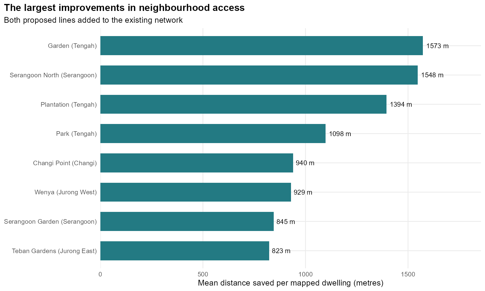

The largest improvement is in `r top_place`. Across its `r fmt(top_access$dwellings)` mapped homes, the nearest station becomes an average of `r fmt(top_access$gain_m)` metres closer. The remaining average distance is `r fmt(top_access$after_m)` metres.

```{r}
#| label: th03-local-housing-map
local_blocks <- prepared$buildings %>% filter(origin_id == details$top_access$origin_id) %>%
  left_join(prepared$access %>% filter(scenario == "Both") %>% select(address_key, gain_m), by = "address_key")
local_stations <- prepared$stations$Both %>% filter(station %in% details$local_housing$nearest_station) %>%
  mutate(status = if_else(existing, "Existing", "New"))
extent <- st_bbox(st_buffer(st_union(c(st_geometry(local_blocks), st_geometry(local_stations))), 500))
local_housing_map <- ggplot() +
  geom_sf(data = subzones, fill = "grey96", colour = "grey80", linewidth = 0.3) +
  geom_sf(data = local_blocks, aes(colour = gain_m), size = 2) +
  geom_sf(data = local_stations, aes(shape = status), size = 3, colour = "grey20") +
  geom_sf_text(data = local_stations, aes(label = station), nudge_y = -220, size = 3.2) +
  scale_colour_viridis_c(option = "C", breaks = scales::breaks_pretty(n = 3),
                        labels = scales::label_number(suffix = " m", big.mark = ","),
                        guide = guide_colourbar(barwidth = grid::unit(6, "cm"))) +
  coord_sf(xlim = extent[c("xmin", "xmax")], ylim = extent[c("ymin", "ymax")], datum = NA) +
  labs(x = NULL, y = NULL, colour = "Distance saved", shape = "Station",
       title = paste("Closer stations for", str_to_title(details$top_access$subzone),
                     paste0("(", str_to_title(details$top_access$planning_area), ")")),
       subtitle = "Matched residential blocks and their nearest stations before and after expansion")
save_plot(local_housing_map, "local-housing", height = 6)
```

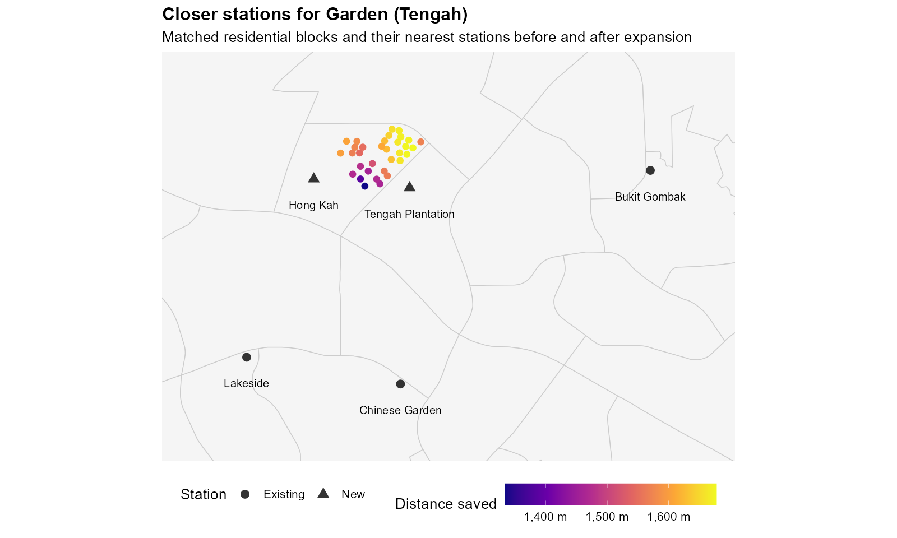

These homes are currently closest to Bukit Gombak, Chinese Garden or Lakeside. With JRL, Hong Kah and Tengah Plantation become their nearest stations. The map explains the large gain: the new stations sit much closer to this group of homes. The next practical step is to check the routes to their entrances, including crossings and sheltered links.

### Neighbourhoods with more older residents

Do neighbourhoods with more older residents gain as much? I sort subzones by the share of HDB residents aged 65 and above, then divide them into four groups. Each group has roughly the same number of subzones, but different numbers of homes. I calculate the average distance per mapped home within each group. This describes access in those neighbourhoods, rather than how individual older residents travel.

```{r}
#| label: th03-age-comparison
equity_chart <- prepared$equity %>% filter(scenario %in% c("Existing", "Both")) %>%
  mutate(scenario = factor(scenario, levels = c("Existing", "Both"), labels = c("Existing network", "With both lines"))) %>%
  ggplot(aes(age_group, mean_distance, colour = scenario, group = age_group)) +
  geom_line(colour = "grey70", linewidth = 1) + geom_point(size = 3) +
  scale_colour_brewer(palette = "Dark2") +
  coord_flip() + labs(x = "Subzones grouped by the share of HDB residents aged 65+",
                      y = "Mean distance to nearest station (metres)", colour = NULL,
                      title = "Do older neighbourhoods receive similar improvements?")
save_plot(equity_chart, "equity", height = 6)
```

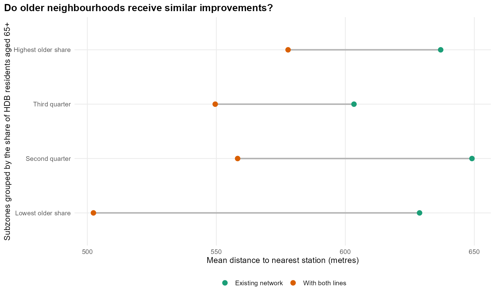

In the group with the largest share of older residents, stations become an average of `r fmt(older$mean_gain)` metres closer per mapped home. The group with the smallest older-resident share gains `r fmt(younger$mean_gain)` metres. Their remaining average distances are `r fmt(older$mean_distance)` and `r fmt(younger$mean_distance)` metres respectively. Of these two groups, the one with more older residents gains less and remains farther from stations on average.

```{r}
#| label: th03-age-coverage
age_coverage <- prepared$access %>% filter(scenario %in% c("Existing", "Both")) %>%
  group_by(age_group, scenario) %>% summarise(subzones = n_distinct(origin_id),
    share = weighted.mean(distance_m <= 800, dwellings), dwellings = sum(dwellings), .groups = "drop")


review$age_coverage <- age_coverage
age_coverage <- age_coverage %>% filter(!is.na(age_group)) %>%
  pivot_wider(names_from = scenario, values_from = share) %>% mutate(gain = Both - Existing)
age_gap_before <- age_coverage$Existing[age_coverage$age_group == "Lowest older share"] -
  age_coverage$Existing[age_coverage$age_group == "Highest older share"]
age_gap_after <- age_coverage$Both[age_coverage$age_group == "Lowest older share"] -
  age_coverage$Both[age_coverage$age_group == "Highest older share"]
```

```{r}
age_coverage %>%
  transmute(Group = age_group, Subzones = subzones, Dwellings = fmt(dwellings),
    `Within 800 m: existing` = pct(Existing), `With both lines` = pct(Both),
    `Gain (percentage points)` = round(100 * gain, 1)) %>% knitr::kable()
```

The share of homes within 800 metres improves in every group. It improves more in the group with the smallest older-resident share, so its lead over the group with the largest share grows from `r round(100 * age_gap_before, 1)` to `r round(100 * age_gap_after, 1)` percentage points. The two middle groups do not follow a steady age pattern, and the groups contain quite different numbers of homes. The clearest difference is between the two ends.

```{r}
details$older_gaps %>% slice_head(n = 5) %>%
  transmute(Subzone = str_to_title(subzone), `Mapped homes` = fmt(dwellings),
            `Homes beyond 800 m` = fmt(beyond_800), `Mean distance (m)` = fmt(mean_distance)) %>%
  knitr::kable(caption = "Remaining gaps in the highest older-resident-share group, with both lines.")
```

Within the group with the largest share of older residents, Bedok South has the most mapped homes still beyond 800 metres. In Clementi West and Telok Blangah Way, every matched home remains beyond that distance. The new lines therefore leave specific gaps where feeder buses and easier walks to stops could still help.

## Which assumptions change the estimates? {#sensitivity}

The comparisons above depend on choices about where journeys start and how people choose stations. I vary those choices here to see which ones change the results most.

### How distance rules affect the forecast {#distance-expansion}

A distance rule affects how widely new stations compete for journeys. I use each fitted version to compare its own existing and expanded networks, keeping the journey total fixed.

```{r}
#| label: th03-distance-check-inputs
#| include: false
origins <- prepared$origins
stations <- ridership$observed
observed <- stations$entries
choice_origins <- ridership$choice_origins
choice_interactions <- ridership$choice_interactions
distances <- matrix(choice_interactions$Existing$distance_km,
  nrow = nrow(choice_origins), byrow = TRUE)
fit <- ridership$fit
selected_model <- fit$model
distance_form <- fit$distance_form
max_distance <- fit$max_distance
```

```{r}
#| label: th03-distance-scenarios
#| code-fold: true
#| code-summary: "Show the R calculation"
#| cache: true
#| cache.extra: !expr digest::digest(list(model_signature, fit, choice_interactions, distance_settings))
distance_scenarios <- lapply(seq_len(nrow(distance_settings)), function(i) {
  row <- distance_settings[i, ]
  message("Expansion distance check: ", row$setting)
  alt <- if (row$setting == distance_choice$setting) fit else
    fit_huff(observed, distances, choice_origins, stations, selected_model,
      distance_form = row$distance_form, max_distance = row$max_distance)
  bind_rows(lapply(c("Existing", "Both"), function(scenario) {
    dest <- prepared$stations[[scenario]]
    dd <- matrix(choice_interactions[[scenario]]$distance_km, nrow = nrow(choice_origins), byrow = TRUE)
    pp <- choice_probabilities(alt$parameters, dd, dest,
      distance_form = row$distance_form, max_distance = row$max_distance)
    ww <- origin_weights(choice_origins, alt$parameters["residential"], alt$parameters["office"], alt$parameters["employment"])
    tibble(setting = row$setting, scenario = scenario, station_id = dest$station_id,
      predicted = sum(observed) * as.numeric(crossprod(ww, pp)),
      share_beyond_5km = sum(ww * rowSums(pp * (dd > 5))))
  }))
}) %>% bind_rows()
```

```{r}
#| label: th03-distance-scenarios-results
#| include: false
ridership$distance_scenarios <- distance_scenarios
```

```{r}
#| label: th03-distance-summary
new_ids <- prepared$stations$Both$station_id[!prepared$stations$Both$existing]
distance_summary <- ridership$distance_scenarios %>% group_by(setting, scenario) %>%
  summarise(new_entries = sum(predicted[station_id %in% new_ids]),
    new_share = new_entries / sum(predicted),
    share_beyond_5km = first(share_beyond_5km), .groups = "drop")
new_locations <- prepared$stations$Both %>% filter(!existing)
nearest_new <- apply(units::drop_units(st_distance(prepared$stations$Existing, new_locations)), 1, min)
far_ids <- prepared$stations$Existing$station_id[nearest_new > 5000]
distance_changes <- ridership$distance_scenarios %>% filter(station_id %in% far_ids) %>%
  select(setting, scenario, station_id, predicted) %>%
  pivot_wider(names_from = scenario, values_from = predicted) %>%
  mutate(change = Both - Existing, percent_change = change / Existing)
stopifnot(all(is.finite(distance_changes$percent_change)),
  all(abs(ridership$distance_scenarios %>% group_by(setting, scenario) %>%
    summarise(total = sum(predicted), .groups = "drop") %>% pull(total) - total) < 1e-6))
details$distance_summary <- distance_summary
details$distance_changes <- distance_changes
distance_expansion <- distance_summary %>% filter(scenario == "Both")
distance_remote <- distance_changes %>% group_by(setting) %>%
  summarise(stations = n(), median_change = median(percent_change), .groups = "drop")
```

```{r}
distance_expansion %>%
  arrange(match(setting, ridership$distance_settings$setting)) %>%
  transmute(`Distance assumption` = setting,
    `Entries at new stations` = fmt(new_entries), `Share at new stations` = pct(new_share),
    `All modelled journeys beyond 5 km` = pct(share_beyond_5km)) %>% knitr::kable()
```

The five versions assign `r pct(min(distance_expansion$new_share))`–`r pct(max(distance_expansion$new_share))` of journeys to new stations. They differ more in where the losses occur. Among `r distance_remote$stations[distance_remote$setting == "Power, all stations"]` existing stations more than 5 km from any new station, the median decline is `r pct(abs(distance_remote$median_change[distance_remote$setting == "Power, all stations"]))` without a distance limit, compared with `r pct(abs(distance_remote$median_change[distance_remote$setting == "Power, within 5 km"]))` under the 5 km limit. Small predicted losses far from the proposed stations therefore depend heavily on this assumption.

Some journeys still exceed 5 km under that limit because an origin always keeps its nearest station, even when it is farther away.

### How much does the demand mix change the estimates?

I fit the model again after changing the distance used to count nearby bus stops to 400 or 800 metres, and the minimum station distance to 50 or 250 metres. I also try placing all journeys according to where residents live. That last version keeps the station-connection rules but leaves activities out of the starting locations.

```{r}
#| label: th03-sensitivity-summary
sensitivity_summary <- ridership$sensitivity %>%
  left_join(st_drop_geometry(prepared$stations$Both) %>% select(station_id, station, existing), by = "station_id") %>%
  filter(scenario == "Both", !existing) %>% group_by(check) %>%
  summarise(new_entries = sum(predicted), new_share = new_entries / total,
            leading_station = station[which.max(predicted)], .groups = "drop")
details$sensitivity <- sensitivity_summary
main_sensitivity <- sensitivity_summary %>% filter(check != "Residential demand only")
residential_sensitivity <- sensitivity_summary %>% filter(check == "Residential demand only")
```

```{r}
details$sensitivity %>%
  transmute(Check = check, `Entries at new stations` = estimate(new_entries),
            `Share of entries` = pct(new_share), `Leading new station` = leading_station) %>%
  knitr::kable()
```

Changing the bus-stop radius or minimum distance makes little difference: the new stations receive between `r pct(min(main_sensitivity$new_share))` and `r pct(max(main_sensitivity$new_share))` of journeys. Using residents alone raises their share to `r pct(residential_sensitivity$new_share)`. The bigger uncertainty is where journeys start throughout the day. Better information on those locations would help judge which estimate is more realistic.

### A separate month and different access thresholds

Using the September model and journey total to predict August gives `r pct(ridership$temporal$WAPE)` WAPE. This checks another month at the same stations. The earlier `r pct(selected$WAPE)` score is a harder check in a different sense: the model had to predict stations whose counts were left out of fitting.

August and September have similar station shares. Doing reasonably well across these months therefore tells us more about stability over time than about predicting unopened stations. The geographical tests and recent-station checks are more relevant to that question.

The housing result comes directly from distances, so it does not rely on the ridership model. The share of homes within 400 metres rises from `r pct(prepared$coverage$share[prepared$coverage$scenario == "Existing" & prepared$coverage$threshold == 400])` to `r pct(prepared$coverage$share[prepared$coverage$scenario == "Both" & prepared$coverage$threshold == 400])`. Within 1,200 metres, it rises from `r pct(prepared$coverage$share[prepared$coverage$scenario == "Existing" & prepared$coverage$threshold == 1200])` to `r pct(prepared$coverage$share[prepared$coverage$scenario == "Both" & prepared$coverage$threshold == 1200])`. All three distance cut-offs show an improvement, though the size of the gain changes.

### Different groups of stations give different estimates {#parameter-sensitivity}

```{r}
#| label: th03-fold-scenarios
#| code-fold: true
#| code-summary: "Show the R calculation"
# Reuse each training-fold fit at one fixed national demand total.
fold_parameters <- ridership$validation_parameters %>% filter(model == ridership$fit$model)
fold_predictions <- map_dfr(seq_len(nrow(fold_parameters)), function(i) {
  values <- unlist(fold_parameters[i, names(parameters)])
  p <- choice_probabilities(values, expanded_distances, both,
    distance_form = ridership$fit$distance_form, max_distance = ridership$fit$max_distance)
  w <- origin_weights(locations, values["residential"], values["office"], values["employment"])
  tibble(fold = fold_parameters$fold[i], station_id = both$station_id, existing = both$existing,
         predicted = total * as.numeric(crossprod(w, p)))
})
fold_scenarios <- fold_predictions %>% group_by(fold) %>%
  summarise(total = sum(predicted), new_share = sum(predicted[!existing]) / total, .groups = "drop")
stopifnot(all(abs(fold_scenarios$total - total) < 1e-6))
review$fold_predictions <- fold_predictions
review$fold_scenarios <- fold_scenarios
```

```{r}
review$fold_scenarios %>%
  transmute(`Training fit` = fold, `Share at new stations` = pct(new_share)) %>% knitr::kable()
```

Each geographical test produced a slightly different set of model parameters. I use each set to predict the expanded network, keeping the total journeys unchanged. The new stations' share ranges from `r pct(min(review$fold_scenarios$new_share))` to `r pct(max(review$fold_scenarios$new_share))`. That is a wider spread than changing the bus-stop radius or minimum distance. Which areas the model learns from matters too. Because the five versions use overlapping data, this range is not a confidence interval.

```{r}
#| label: th03-month-summary
month_summary <- bind_rows(ridership$entries) %>% group_by(month) %>%
  summarise(stations = n(), weekdays = first(weekdays), monthly_entries = sum(monthly_entries),
            daily_entries = sum(entries), .groups = "drop")
details$months <- month_summary
```

```{r}
#| label: th03-save-results
#| include: false
stopifnot(all(abs(details$scenarios$total_entries - total) < 1e-6),
  !anyDuplicated(details$catchments[c("origin_id", "scenario")]),
  all(details$local_choices$probability >= 0 & details$local_choices$probability <= 1))
analysis <- list(prepared = prepared, ridership = ridership, missing = character(), details = details)
saveRDS(prepared, file.path(out, "prepared.rds"))
saveRDS(analysis, file.path(out, "analysis.rds"))
review$baseline_sha256 <- digest::digest(file = file.path(out, "analysis.rds"), algo = "sha256")
saveRDS(review, file.path(out, "review.rds"))
saveRDS(diagnostics, file.path(out, "station-diagnostics.rds"))
saveRDS(employment_comparison, file.path(out, "employment-comparison.rds"))
write_csv(st_drop_geometry(prepared$origins), file.path(out, "origins.csv"))
write_csv(prepared$local_access, file.path(out, "neighbourhood-access.csv"))
write_csv(prepared$coverage, file.path(out, "access-coverage.csv"))
write_csv(ridership$predictions, file.path(out, "station-predictions.csv"))
write_csv(ridership$performance, file.path(out, "model-validation.csv"))
write_csv(ridership$catchments, file.path(out, "station-catchments.csv"))
write_csv(details$scenarios, file.path(out, "scenario-comparison.csv"))
write_csv(details$older_gaps, file.path(out, "older-neighbourhood-gaps.csv"))
write_csv(details$local_choices, file.path(out, "local-station-choices.csv"))
write_csv(details$months, file.path(out, "passenger-months.csv"))
writeLines(trimws(capture.output(sessionInfo()), which = "right"), "take-home-03/session-info.txt")
```

### Limitations {#limitations}

- The model divides a fixed number of rail journeys among stations. It does not estimate extra journeys from future housing, or people switching from bus or car to rail.
- Adding a station keeps the relative odds between unchanged stations the same at each starting point. This is the Huff model's independence-of-irrelevant-alternatives assumption. It leaves out shared routes, final destinations and the inconvenience of transfers.
- The model learns the apparent benefit of MRT service and extra lines from existing stations. Hougang shows how strongly a forecast can depend on carrying that relationship over to an upgrade.
- Distances are straight lines. Entrances, crossings and barriers can make the actual walk longer; 800 metres here is a map distance.
- The population and worker data leave out non-residents. Facilities are an approximate guide to activities, workplaces within each planning area are estimated, and some homes are missing from the map. We have not measured the separate effect of each gap on the errors.
- Both sets of geographical tests helped choose the model. Its broad station rankings are useful, but recent stations are still overestimated and nearby stations often have similar errors.

```{r}
#| label: th03-summary-figures
#| include: false
save_plot(network_map + labs(title = NULL, subtitle = NULL) +
  theme(text = element_text(size = 17)), "network-summary", width = 7, height = 5)
summary_coverage <- prepared$coverage %>% filter(threshold == 800) %>%
  mutate(scenario = factor(scenario, levels = c("Existing", "JRL", "CRL", "Both"))) %>%
  ggplot(aes(scenario, share)) + geom_col(fill = "#237a83", width = 0.65) +
  geom_text(aes(label = scales::percent(share, accuracy = 0.1)), vjust = -0.5, size = 5) +
  scale_y_continuous(labels = scales::label_percent(), limits = c(0, 1)) +
  labs(x = NULL, y = "Dwellings within 800 metres") + theme(text = element_text(size = 17))
save_plot(summary_coverage, "coverage-summary", width = 7, height = 5)
save_plot(equity_chart + labs(title = NULL, x = NULL, y = "Mean distance (metres)") +
  theme(text = element_text(size = 17), legend.text = element_text(size = 13)),
  "equity-summary", width = 7, height = 5)
top_ten <- ridership$predictions %>% filter(scenario == "Both", !existing) %>%
  slice_max(predicted, n = 10, with_ties = FALSE) %>% pull(station)
save_plot(new_chart + filter(new_chart$data, station %in% top_ten) +
  labs(title = NULL, subtitle = NULL) + theme(text = element_text(size = 17)),
  "new-stations-summary", width = 7, height = 5)
save_plot(observed_map + labs(title = NULL, subtitle = NULL) + theme(text = element_text(size = 17)),
  "observed-summary", width = 7, height = 5)
save_plot(validation_chart + labs(title = NULL, subtitle = NULL) + theme(text = element_text(size = 17)),
  "validation-summary", width = 7, height = 5)
save_plot(changes_chart + labs(title = NULL, subtitle = NULL) + theme(text = element_text(size = 17)),
  "station-changes-summary", width = 7, height = 5)
save_plot(local_choice_chart + labs(title = NULL, subtitle = NULL) + theme(text = element_text(size = 17)),
  "local-choices-summary", width = 7, height = 5)
```

## Findings and recommendations {#findings-and-recommendations}

### What the comparisons suggest

The model improves when it distinguishes MRT from LRT-only stops, spreads starting locations within neighbourhoods and uses worker counts. Together, these changes reduce prediction error from `r pct(ridership$performance$WAPE[ridership$performance$model == 3])` to `r pct(selected$WAPE)`. Worker counts help particularly at Marine Parade. Raffles Place remains poorly predicted, and its workplaces are still only approximately located within Downtown Core. Direct CBD buses offer another possible explanation at Marine Parade, but adding their frequency does not improve the worker-count model.

Changing to an exponential curve or limiting station choices increases validation error. More precise workplace locations and information about where journeys begin are worth testing next.

With both lines added, new stations receive `r pct(combined$new_share)` of the fixed journey total. `r new_top$station` has the highest estimate among new locations. Around Yunnan, several stations could share journeys that currently favour Pioneer. Hougang's predicted gain turns into a loss when the extra weight for gaining a line is removed. These are useful places for closer study, while the overestimates at recently opened stations show that capacity planning needs better evidence on likely passenger numbers.

The access comparison covers `r pct(prepared$hdb_match$matched_dwellings / prepared$hdb_match$total_dwellings)` of HDB homes in the property table. The share within 800 metres rises from `r pct(before)` to `r pct(after)`. Garden gains substantially, while neighbourhoods with the largest share of older residents gain less. Their gap with the lowest-share group widens. Tengah and Bukit Merah still have more missing housing records than the national average.

### Planning priorities {#where-to-follow-up}

- Check the walks from Garden's mapped homes to Hong Kah and Tengah Plantation. Identify crossings, entrances and gaps in sheltered paths that could make the shorter map distance difficult to use.
- Check bus travel times and the walk to bus stops in Clementi West and Telok Blangah Way. All matched homes remain more than 800 metres from a station even with both lines.
- Study journeys from Yunnan to Pioneer, Gek Poh and Tawas before changing feeder routes. Include passengers' final destinations and transfers to see which station actually offers the easier trip.
- Locate workplaces more precisely around Raffles Place and compare bus and rail journeys from Marine Parade. Both stations remain poorly predicted.
- Gather better information on where trips start around Serangoon North and Pasir Ris East before planning capacity from these estimates. At interchanges such as Hougang, count passengers transferring inside the station separately from those entering from outside.

## Sources {#sources}

- [ISSS626 Take-home Exercise 3 handout](https://isss626-ay2026-27aug.netlify.app/take-home_ex03)
- [LTA: The next phase of rail development, March 2026](https://www.lta.gov.sg/content/ltagov/en/newsroom/2026/3/news-releases/next-phase-of-rail-development.html)
- [LTA: Circle Line 6](https://www.lta.gov.sg/content/ltagov/en/upcoming_projects/rail_expansion/circle_line_6.html)
- [LTA: Hume station opening, February 2025](https://www.lta.gov.sg/content/ltagov/en/newsroom/2025/1/news-releases/hume_station_to_open.html)
- [LTA DataMall: Static datasets](https://datamall.lta.gov.sg/content/datamall/en/static-data.html)
- [LTA DataMall: Dynamic datasets](https://datamall.lta.gov.sg/content/datamall/en/dynamic-data.html)
- [LTA DataMall API documentation](https://datamall.lta.gov.sg/content/dam/datamall/datasets/LTA_DataMall_API_User_Guide.pdf)
- [LTA: Station names and current codes](https://www.lta.gov.sg/content/ltagov/en/getting_around/public_transport/a_better_public_transport_experience/art_in_public_transport/art_in_transit.html)
- [Singapore train station coordinates](https://github.com/elliotwutingfeng/singapore_train_station_coordinates)
- [SingStat: Geographic distribution](https://www.singstat.gov.sg/find-data/explore-data-themes/population/geographic-distribution/latest-news-data)
- [URA: Master Plan 2019 subzone boundaries](https://data.gov.sg/datasets/d_8594ae9ff96d0c708bc2af633048edfb/view)
- [HDB: Existing buildings](https://data.gov.sg/datasets/d_16b157c52ed637edd6ba1232e026258d/view)
- [HDB: Property Information](https://data.gov.sg/datasets/d_17f5382f26140b1fdae0ba2ef6239d2f/view)
- [OpenStreetMap contributors](https://www.openstreetmap.org/copyright), [Geofabrik extract](https://download.geofabrik.de/asia/malaysia-singapore-brunei.html)
- [OpenStreetMap: Office buildings](https://wiki.openstreetmap.org/wiki/Tag:building%3Doffice)
- [URA: Downtown Core urban design guidance](https://www.ura.gov.sg/guidelines/urban-design/downtown-core/)
- [LTA: TEL Stage 4 opening announcement, March 2024](https://www.lta.gov.sg/content/ltagov/en/newsroom/2024/3/news-releases/TEL4_to_welcome_commuters.html)
- [SingStat: Employed residents by planning area of workplace and industry, GHS 2025](https://tablebuilder.singstat.gov.sg/table/CT/C020150)
- [SingStat: General Household Survey 2025](https://www.singstat.gov.sg/publication-resources/general-household-survey-2025)
- [SBS Transit: Bus service 196](https://www.sbstransit.com.sg/Service/BusService?ServiceNo=196)
- [MOM: Public holidays for 2026](https://www.mom.gov.sg/newsroom/press-releases/2025/0616-public-holidays-for-2026)
- [Zhu et al. (2021): Improved Huff model for estimating urban rail transit station catchment areas considering station choices](https://doi.org/10.1155/2021/6374724)
- [Hands-on Exercise 8](hands-on-exercise-08.qmd) and [Hands-on Exercise 7](hands-on-exercise-07.qmd)
- [MCI package: Huff probabilities and calibration](https://cran.r-project.org/web/packages/MCI/MCI.pdf)
