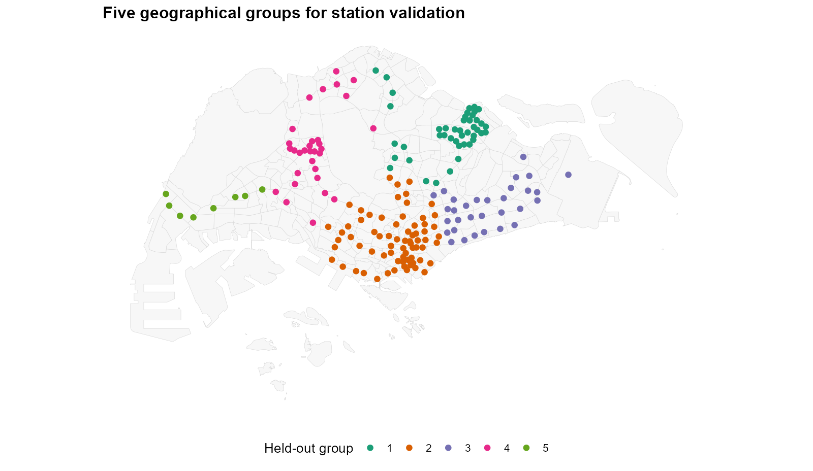
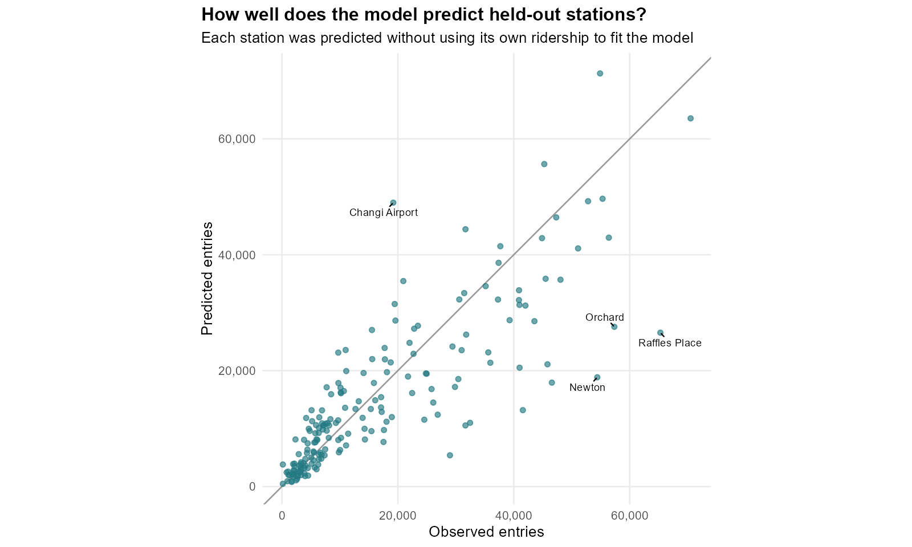
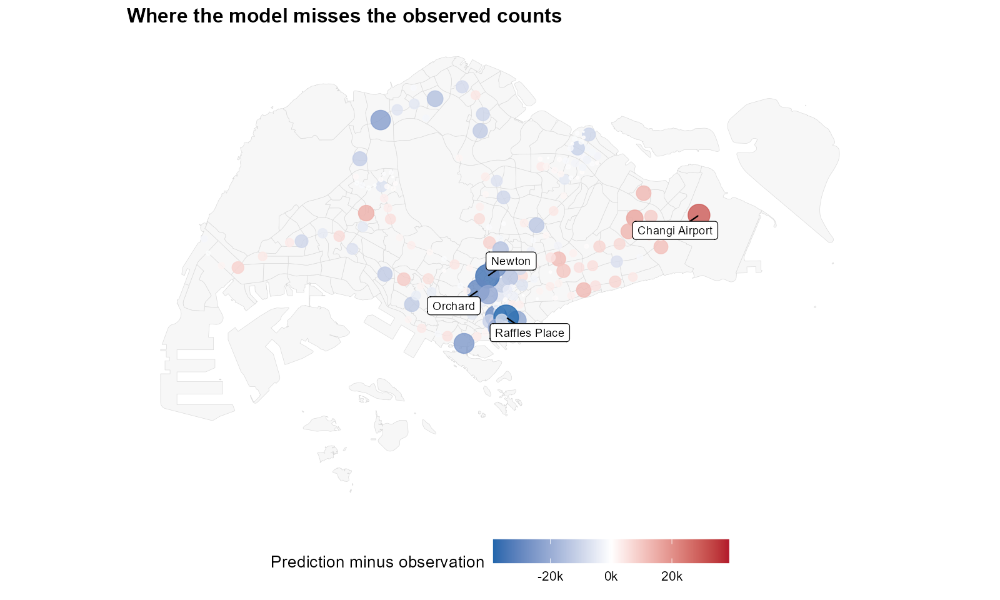
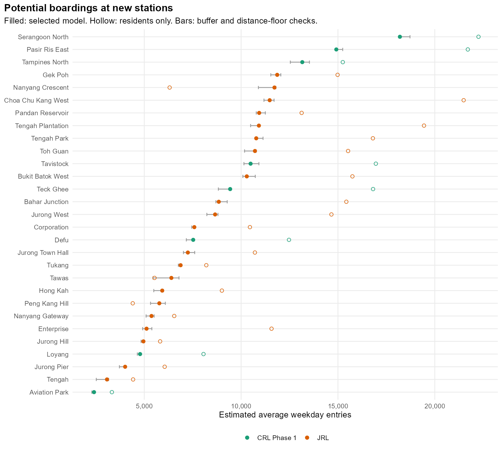
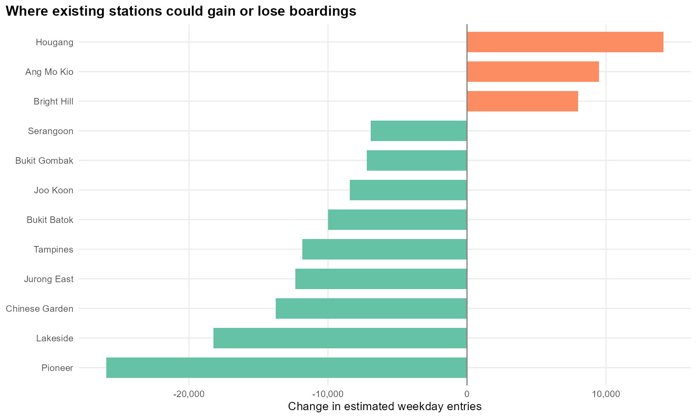
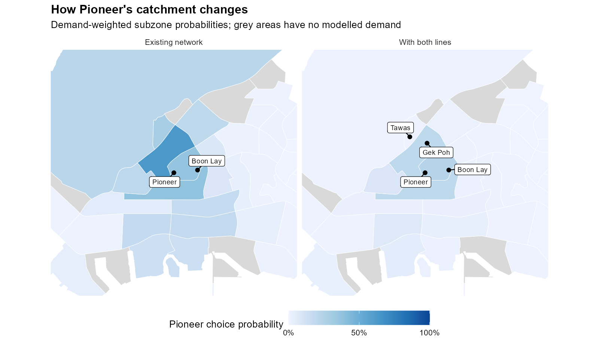
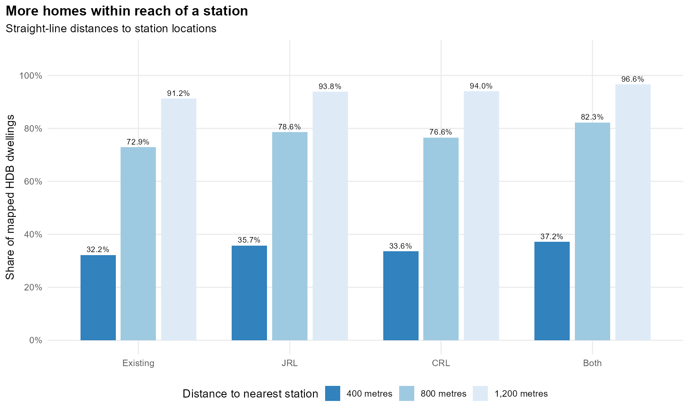
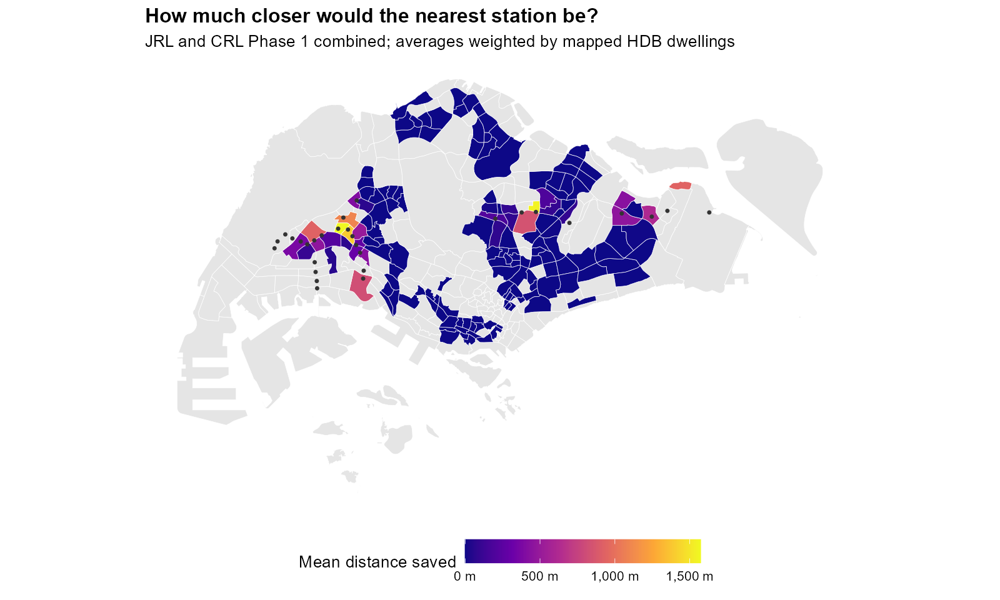

```{r}
#| label: numbers-for-text
#| include: false
# Values quoted in the text. They come from the same saved results loaded under "Getting started".
library(tidyverse)
library(sf)
derived <- "data/take-home-03/derived"
analysis <- read_rds(file.path(derived, "analysis.rds"))
review <- read_rds(file.path(derived, "review.rds"))
prepared <- analysis$prepared
ridership <- analysis$ridership
details <- analysis$details

fmt <- function(x) scales::comma(round(x))
hundreds <- function(x) scales::comma(round(x, -2))
pct <- function(x) scales::percent(x, accuracy = 0.1)
dec <- function(x, digits = 2) format(round(x, digits), nsmall = digits)

p <- ridership$fit$parameters
wape <- setNames(ridership$performance$WAPE, ridership$performance$model)
bench <- setNames(review$benchmarks$WAPE, review$benchmarks$model)
selected <- ridership$performance %>% filter(model == ridership$fit$model)

observed <- st_drop_geometry(ridership$observed)
mrt_entries <- observed$entries[grepl("(^|/)(NS|EW|CG|NE|CC|CE|DT|TE)[0-9]", observed$codes)]
hume <- observed %>% filter(station_id == "HUME")

both <- ridership$predictions %>% filter(scenario == "Both")
new_stations <- both %>% filter(!existing) %>% arrange(desc(predicted))
existing_changes <- both %>% filter(existing) %>% arrange(change)
combined <- details$scenarios %>% filter(scenario == "Both")
jrl <- details$scenarios %>% filter(scenario == "JRL")
crl <- details$scenarios %>% filter(scenario == "CRL")

residential_only <- ridership$sensitivity %>%
  filter(scenario == "Both", check == "Residential demand only")
campus <- new_stations %>% filter(station_id == "NANYANGCRESCENT")
campus_residents <- residential_only %>% filter(station_id == "NANYANGCRESCENT")
leading_jrl <- new_stations %>% filter(startsWith(codes, "J")) %>% slice(1)
demand_points <- sum(ridership$choice_origins$kind != "office")
office_points <- sum(ridership$choice_origins$kind == "office")
n_pois <- nrow(prepared$pois)
recent_ratio <- range(review$recent_groups$spatial_cv / review$recent_groups$observed)

recent <- review$recent_groups
hougang <- review$interchanges %>% filter(station_id == "HOUGANG")

coverage <- prepared$coverage %>% filter(threshold == 800)
before_800 <- coverage$share[coverage$scenario == "Existing"]
after_800 <- coverage$share[coverage$scenario == "Both"]
age <- review$age_coverage
age_share <- function(group, network) age$share[age$age_group == group & age$scenario == network]
gap_before <- age_share("Lowest older share", "Existing") - age_share("Highest older share", "Existing")
gap_after <- age_share("Lowest older share", "Both") - age_share("Highest older share", "Both")
garden <- details$top_access
hdb_match <- prepared$hdb_match$matched_dwellings / prepared$hdb_match$total_dwellings
```

::: {.exercise-lead}
Which of the new Jurong Region Line and Cross Island Line stations are likely to be busy, which may be quiet, and which existing stations would lose passengers to them?
:::

[Executive summary](take-home-exercise-03-summary.qmd) · [Full R workflow](take-home-exercise-03-workflow.qmd) · [GitHub repository](https://github.com/chinh02/isss626-chinh-le)

## Overview {#sec-overview}

### Why station ridership matters

Singapore often builds a station's structure years before trains stop there. Building it early avoids digging up the area again later, but opening it means paying to staff and run it every day. Hume station's shell was finished in 2015, yet it only opened on 28 February 2025, because few people were expected to use it. Buangkok and Woodleigh stayed closed when the North East Line opened in 2003 for the same reason.

Two new lines are now under construction: the **Jurong Region Line (JRL)** and the first phase of the **Cross Island Line (CRL)**. Before they open, planners need two answers. How many people will start their journeys at each new station? And which existing stations will lose passengers to them?

### What this exercise does

I use a **Huff model**, the same probabilistic spatial interaction model as in [Hands-on Exercise 8](hands-on-exercise-08.qmd). There, shoppers in each village chose between stores. Here, people at each place in Singapore choose which station to start their rail journey from. The model learns from today's 184 stations how distance and station features affect that choice, then applies what it learned to the new stations.

| Handout objective | Where it is answered |
|---|---|
| Calibrate a probabilistic spatial interaction model for station ridership | @sec-model |
| Predict ridership at the proposed JRL and CRL stations | @sec-new-stations and @sec-quiet-stations |
| Evaluate the effect on existing stations' ridership and catchments | @sec-existing-stations and @sec-catchments |

@sec-access adds a related question: which neighbourhoods end up closer to a station?

::: {.callout-tip}
## Key results

- The calibrated model's error on stations it has not seen is **`r pct(selected$WAPE)`**, against **`r pct(bench[["Training-station mean"]])`** for simply using the average station.
- The 29 new station locations would take about **`r hundreds(combined$new_entries)`** of today's weekday entries (`r pct(combined$new_share)`). **`r new_stations$station[1]`** has the highest estimate, at about `r hundreds(new_stations$predicted[1])` a day. **`r new_stations$station[29]`** and **`r new_stations$station[28]`** have the lowest.
- **`r existing_changes$station[1]`**, **`r existing_changes$station[2]`** and **`r existing_changes$station[3]`** lose more than half of their modelled entries to nearby JRL stations.
- The share of mapped HDB homes within 800 metres of a station rises from **`r pct(before_800)`** to **`r pct(after_800)`**.
- The model **over-predicts recently opened stations**, so the new-station estimates are a starting point for planning, not a forecast to build capacity on.
:::

### Getting started

These packages read the spatial data (`sf`), wrangle and plot it (`tidyverse`), calculate Huff probabilities (`MCI`) and format the tables (`knitr`, `scales`).

```{r}
#| label: packages
pacman::p_load(sf, tidyverse, MCI, knitr, scales)
```

The heavy work (cleaning about 900,000 passenger records, matching 10,817 HDB blocks to the map and fitting the model ten different ways) is in the [full R workflow](take-home-exercise-03-workflow.qmd). That page runs from the raw downloads and saves its results, which this report reads.

```{r}
#| label: load-results
derived <- "data/take-home-03/derived"

analysis <- read_rds(file.path(derived, "analysis.rds"))
review <- read_rds(file.path(derived, "review.rds"))

prepared <- analysis$prepared    # cleaned stations, subzones, homes and facilities
ridership <- analysis$ridership  # observed entries, fitted model and predictions
```

## Singapore's rail network {#sec-mrt}

### From five stations to six lines

The Mass Rapid Transit (MRT) opened on 7 November 1987 with a 6-kilometre stretch of five stations, Yio Chu Kang to Toa Payoh. It now has 146 stations on six lines and about 246.6 kilometres of track, and carried an average of 3.49 million passengers a day in 2025 (Wikipedia, 2026). Three Light Rail Transit (LRT) systems in Bukit Panjang, Sengkang and Punggol act as feeders, carrying residents from their estates to an MRT station.

| Line | Station code | First section opened | Stations (September 2026) |
|---|---|---|---|
| North–South Line | NS | November 1987 | 27 |
| East–West Line, with the Changi Airport branch | EW, CG | December 1987 | 35 |
| North East Line | NE | June 2003 | 17 |
| Circle Line, with its extension | CC, CE | May 2009 | 33 |
| Downtown Line | DT | December 2013 | 35 |
| Thomson–East Coast Line | TE | January 2020 | 27 |
| LRT: Bukit Panjang, Sengkang and Punggol | BP, SE/SW, PE/PW | 1999–2005 | 42 |

Interchange stations appear once for each line, so the counts add up to more than the number of buildings. Counted as physical stations, the September 2026 network has **184**: 146 with MRT service and 38 served only by the LRT. The newest are Hume (February 2025) and the three Circle Line 6 stations, Keppel, Cantonment and Prince Edward Road (July 2026).

### Two new lines

**The Jurong Region Line** has 24 stations in western Singapore. It links Choa Chu Kang, the new Tengah town, Jurong West, Nanyang Technological University and the Jurong industrial area. It is planned to open in three stages between 2028 and 2029 (Wikipedia, 2026).

**The Cross Island Line, Phase 1** has 12 stations. It runs from Aviation Park near Changi through Loyang, Pasir Ris, Tampines North, Hougang, Serangoon North and Ang Mo Kio to Bright Hill (LTA, 2026). It is due in 2030; later phases continue west to Jurong Lake District. The handout's "12 Cross Island Line stations" are these Phase 1 stations, codes CR2 to CR13.

Seven of the 36 new platforms are at existing stations: Choa Chu Kang, Boon Lay and Jurong East on the JRL, and Pasir Ris, Hougang, Ang Mo Kio and Bright Hill on the CRL. The two lines therefore add **29 new station locations**, and seven existing stations become interchanges.

```{r}
#| label: network-map
#| code-fold: true
#| code-summary: "Code for the map"
#| fig-height: 4.5
#| layout-ncol: 1
#| fig-cap: "Today's 184 stations (grey) and the new stations. White circles are existing stations that gain a platform."
#| fig-subcap:
#|   - "Both lines across Singapore"
#|   - "Jurong Region Line"
#|   - "Cross Island Line Phase 1"
stations_both <- read_rds(file.path(derived, "destinations.rds"))
line_colours <- c("Jurong Region Line" = "#0099aa", "Cross Island Line Phase 1" = "#86b817")

new_locations <- stations_both %>%
  filter(!existing) %>%
  mutate(line = if_else(startsWith(codes, "J"), "Jurong Region Line", "Cross Island Line Phase 1"))

new_interchanges <- stations_both %>%
  filter(existing, lines > existing_lines) %>%
  mutate(line = if_else(grepl("(^|/)J", codes), "Jurong Region Line", "Cross Island Line Phase 1"))

# Base map: subzones, today's stations, new stations and new interchanges
network_map <- function(zoom = NULL, labels = FALSE) {
  map <- ggplot() +
    geom_sf(data = prepared$subzones, fill = "grey97", colour = "grey88", linewidth = 0.1) +
    geom_sf(data = filter(stations_both, existing), colour = "grey60", size = 0.8) +
    geom_sf(data = new_locations, aes(colour = line), size = 2.2) +
    geom_sf(data = new_interchanges, shape = 21, fill = "white", size = 2.6, stroke = 0.9) +
    scale_colour_manual(values = line_colours, name = NULL) +
    theme_void() +
    theme(legend.position = "bottom")

  if (labels) {
    map <- map +
      ggrepel::geom_text_repel(
        data = bind_rows(new_locations, new_interchanges) %>% filter(line == zoom),
        aes(label = station, geometry = geometry), stat = "sf_coordinates",
        size = 3, min.segment.length = 0, max.overlaps = Inf, seed = 626
      )
  }

  if (is.null(zoom)) return(map + coord_sf(datum = NA))

  # Zoom to one line's stations, with a 1.5 km margin
  box <- st_bbox(st_buffer(filter(new_locations, line == zoom), 1500))
  map +
    coord_sf(xlim = box[c("xmin", "xmax")], ylim = box[c("ymin", "ymax")], datum = NA) +
    theme(legend.position = "none")
}

network_map()
network_map("Jurong Region Line", labels = TRUE)
network_map("Cross Island Line Phase 1", labels = TRUE)
```

The JRL fills in the west, where Tengah and western Jurong West are far from today's stations. The CRL runs across the north-east, crossing four existing lines.

### Where people board today {#sec-current-boardings}

LTA's *Passenger Volume by Origin Destination Train Stations* counts trips between every pair of stations, by hour, for a month. Each row is one origin station, one destination station and one hour, with the number of trips.

```{r}
#| label: read-passenger-data
od_september <- read_csv(
  unz("data/take-home-03/raw/origin_destination_train_202609.zip",
      "origin_destination_train_202609.csv"),
  col_types = cols(ORIGIN_PT_CODE = "c", DESTINATION_PT_CODE = "c")
)

glimpse(od_september)
```

A journey enters the railway only once, at its origin station; changing lines inside the network is not a new entry. To get each station's ridership, I add up all weekday trips by origin station and divide by the 22 weekdays in September 2026.

```{r}
#| label: weekday-entries
weekday_entries <- od_september %>%
  filter(DAY_TYPE == "WEEKDAY") %>%
  group_by(ORIGIN_PT_CODE) %>%
  summarise(entries = sum(TOTAL_TRIPS) / 22) %>%
  arrange(desc(entries))

head(weekday_entries, 5)
```

An interchange has a combined code, such as `EW24/NS1` for Jurong East. The workflow maps every code to one of the 184 physical stations. Together they record **`r fmt(sum(observed$entries))` entries on an average weekday**.

```{r}
#| label: ridership-map
#| code-fold: true
#| code-summary: "Code for the map"
#| fig-height: 6
#| fig-cap: "Average weekday entries at each station, September 2026. The eight busiest are labelled."
busiest <- ridership$observed %>%
  slice_max(entries, n = 8)

ggplot() +
  geom_sf(data = prepared$subzones, fill = "grey97", colour = "grey88", linewidth = 0.1) +
  geom_sf(data = arrange(ridership$observed, entries),
          aes(size = entries, colour = entries), alpha = 0.85) +
  ggrepel::geom_label_repel(
    data = busiest, aes(label = station, geometry = geometry),
    stat = "sf_coordinates", size = 2.8, min.segment.length = 0, seed = 626
  ) +
  scale_size_area(max_size = 7, guide = "none") +
  scale_colour_viridis_c(labels = label_comma(), name = "Weekday entries") +
  coord_sf(datum = NA) +
  theme_void() +
  theme(legend.position = "bottom", legend.key.width = unit(1.5, "cm"))
```

Ridership is high in two kinds of places. The first is the city centre, where people start their journeys home from work: Raffles Place, Orchard and Newton. The second is the large housing towns, where people start their journeys to work and school: Jurong East, Woodlands, Tampines and Yishun. A good model therefore needs to know both where people live and where they work. Half of the MRT stations record fewer than `r fmt(median(mrt_entries))` entries a day; Hume records `r fmt(hume$entries)`.

## Data {#sec-data}

### Datasets used {#sec-datasets}

| Dataset | Source | Used for |
|---|---|---|
| Passenger volume by origin–destination train station, August and September 2026 | [LTA DataMall](https://datamall.lta.gov.sg/content/datamall/en/dynamic-data.html) | Observed weekday entries at each station |
| Train station footprints (September 2026) and station codes | [LTA DataMall](https://datamall.lta.gov.sg/content/datamall/en/static-data.html) | Locations of existing stations |
| Future station coordinates | [GitHub: singapore_train_station_coordinates](https://github.com/elliotwutingfeng/singapore_train_station_coordinates) | Locations of the JRL and CRL stations |
| Bus stop locations (September 2026) | [LTA DataMall](https://datamall.lta.gov.sg/content/datamall/en/static-data.html) | Bus stops within 500 m of each station |
| Population by subzone, age and dwelling type, June 2026 | [SingStat](https://www.singstat.gov.sg/find-data/explore-data-themes/population/geographic-distribution/latest-news-data) | Where residents live |
| HDB Existing Building and HDB Property Information | [data.gov.sg](https://data.gov.sg/datasets/d_16b157c52ed637edd6ba1232e026258d/view) | Locations of HDB blocks and their flat counts |
| Points of interest from OpenStreetMap | [Geofabrik](https://download.geofabrik.de/asia/malaysia-singapore-brunei.html) | Shops, offices, schools, clinics, food and leisure places |
| Employed residents by planning area of workplace, 2025 | [SingStat GHS 2025](https://tablebuilder.singstat.gov.sg/table/CT/C020150) | How many people work in each area |
| Master Plan 2019 subzone boundaries | [data.gov.sg](https://data.gov.sg/datasets/d_8594ae9ff96d0c708bc2af633048edfb/view) | Subzone maps |

All distances are measured in Singapore's SVY21 projection (EPSG:3414), which uses metres.

### Problems found in the data

The handout warns that data are "full of land mines". These are the ones that would have changed the results if left alone.

| Problem | Why it matters | What I did |
|---|---|---|
| The passenger data call Marina Bay and Bayfront `CC33` and `CC34`; the station table calls them `CE2` and `CE1` | Two stations' trips would be lost | Recoded them, checked against LTA's station list |
| The station-code table predates Circle Line 6 (opened July 2026) | Three working stations would be missing | Added Keppel, Cantonment and Prince Edward Road |
| One interchange has several codes, e.g. `NS24/NE6/CC1` for Dhoby Ghaut | The same building would be counted as three stations | Merged codes into one physical station, keeping its line count |
| National Day was observed on Monday 10 August | Dividing by 21 weekdays would understate August | Used 20 weekdays for August and 22 for September |
| The 2026 population uses newer subzone names than the 2019 boundary map | Residents could be placed in the wrong subzone | Checked all 332 names; every one matches |
| The HDB property table has flat counts but no coordinates | Residents cannot be placed at their blocks | Matched blocks to building footprints by postal code, block number and street: `r pct(hdb_match)` of flats matched |
| Population and workplace counts cover residents only | Foreign workers and international students are left out | Kept as a stated limitation; it helps explain errors in the city centre (@sec-validation) |

The HDB match is weakest in Bukit Timah, Bukit Merah, Woodlands and Tengah, where 13–26% of flats are unmatched, and in blocks completed in the 2020s (12% unmatched, against 4% overall). A subzone's residents are spread over its matched blocks, so the subzone totals stay correct. Unmatched blocks are, however, missing from the access figures in @sec-access.

## Estimating station choice {#sec-model}

### The three tables the model needs {#sec-tables}

The handout asks for three tables, the same structure as Hands-on Exercise 8:

- **Origins**: places where weekday journeys start, with their *local market potential*, i.e. how many journeys start there.
- **Destinations**: stations, with their observed entries and the features that make them attractive.
- **Spatial interactions**: every origin–station pair, with the distance between them and the station's attraction, made once for the existing network and once with both new lines.

```{r}
#| label: model-tables
origins <- read_rds(file.path(derived, "origins.rds"))
destinations <- read_rds(file.path(derived, "destinations.rds"))
existing_si <- read_rds(file.path(derived, "existing-network-interactions.rds"))
expanded_si <- read_rds(file.path(derived, "expanded-network-interactions.rds"))
```

**Origins.** Hands-on Exercise 8 used one point per village. A Singapore subzone can be large, though, and a single centre point would put a whole town's residents in one spot, perhaps closer to the wrong station. So I place journeys where people actually are: residents at their HDB blocks (other residents at the subzone centre), and activities at the `r fmt(n_pois)` shops, offices, schools, clinics and food places in OpenStreetMap. Workers are counted by planning area, so each area's workers are shared among its activity places. Points of the same type are grouped within 500-metre squares, giving `r fmt(demand_points)` origins. Each origin's journeys combine its residents, activities and workers, in proportions the model learns (@sec-parameters). The tables also keep `r office_points` office-building points from an earlier trial; they carry no journeys in the final model.

```{r}
#| label: origins-table
origins %>%
  st_drop_geometry() %>%
  select(origin_id, subzone_id, kind, residents, activity, employment, market_potential) %>%
  slice_head(n = 4)
```

The `market_potential` column is the local market potential: modelled weekday journeys starting at that origin. It adds up to the observed `r fmt(sum(observed$entries))` entries.

```{r}
#| label: demand-map
#| code-fold: true
#| code-summary: "Code for the map"
#| fig-height: 6
#| fig-cap: "Where weekday rail journeys start, according to the model. Each circle is one origin, sized by its journeys."
journey_points <- origins %>%
  filter(market_potential > 0) %>%
  mutate(kind = recode(kind, residential = "Homes", activity = "Activity places")) %>%
  arrange(desc(market_potential))

ggplot() +
  geom_sf(data = prepared$subzones, fill = "grey97", colour = "grey88", linewidth = 0.1) +
  geom_sf(data = journey_points, aes(size = market_potential, colour = kind), alpha = 0.45) +
  scale_size_area(max_size = 6, labels = label_comma(), name = "Journeys per weekday") +
  scale_colour_manual(values = c("Homes" = "#d95f02", "Activity places" = "#1b9e77"), name = NULL) +
  coord_sf(datum = NA) +
  theme_void() +
  theme(legend.position = "bottom", legend.box = "vertical")
```

Journeys from homes (orange) come from the HDB towns. Journeys from activity places (green) cluster in the city centre and at town centres, and the largest are where many people work. This matches the boarding pattern in @sec-current-boardings.

**Destinations.** Each station has three features that could make it more attractive than a station at the same distance: the number of rail lines it serves, whether it has MRT service (rather than LRT only), and the number of bus stops within 500 metres. New stations have no observed entries yet.

```{r}
#| label: destinations-table
destinations %>%
  st_drop_geometry() %>%
  filter(station_id %in% c("JURONGEAST", "PIONEER", "GEKPOH", "SERANGOONNORTH")) %>%
  select(station, existing, observed_entries, lines, mrt, bus_500, attraction)
```

**Spatial interactions.** Every origin is paired with every station: `r fmt(nrow(existing_si))` pairs for today's 184 stations and `r fmt(nrow(expanded_si))` with both lines (213 stations). Distances are straight lines in kilometres, with a minimum of 100 metres so that an origin right next to a station does not get an infinite weight.

```{r}
#| label: interaction-table
expanded_si %>%
  filter(origin_id == first(origin_id)) %>%
  select(origin_id, station_id, distance, attraction) %>%
  slice_min(distance, n = 4)
```

These are the four closest stations to the first origin, a group of shops in Ang Mo Kio. The interchange at Ang Mo Kio has a higher attraction score because it gains the CRL in this network.

### How the Huff model works {#sec-huff}

The Huff model (Huff, 1963) gives the probability that someone at origin *i* chooses station *j*:

$$
P_{ij} = \frac{A_j \, d_{ij}^{-\lambda}}{\sum_{k} A_k \, d_{ik}^{-\lambda}}
$$

*A* is a station's attraction and *d* its distance. The exponent λ controls how quickly a station's pull fades with distance. Each station's predicted entries are the sum, over all origins, of journeys starting there × the probability of choosing that station.

This is the calculation `MCI::huff.shares()` performed for stores in Hands-on Exercise 8 (Wieland, 2017). There, store size was the attraction and λ was left at the default of 2. Here the attraction is built from the station's features, and both the attraction weights and λ are estimated from the data (@sec-calibration).

As an example, I take the largest group of HDB blocks in Yunnan, Jurong West, and compare its station choices before and after the JRL opens.

```{r}
#| label: huff-example
yunnan <- origins %>%
  filter(subzone_id == "JWSZ08", kind == "residential") %>%
  slice_max(residents, n = 1) %>%
  pull(origin_id)

station_names <- st_drop_geometry(destinations) %>%
  select(station_id, station)

top_choices <- function(interactions) {
  interactions %>%
    filter(origin_id == yunnan) %>%
    as.data.frame() %>%
    # check_df = FALSE: MCI's input check cannot see a data frame passed through a pipe
    huff.shares("origin_id", "station_id", "attraction", "distance",
                gamma = 1, lambda = -ridership$fit$parameters[["decay"]],
                check_df = FALSE) %>%
    left_join(station_names, by = "station_id") %>%
    slice_max(p_ij, n = 4) %>%
    transmute(station,
              distance_km = round(distance, 2),
              probability = percent(p_ij, accuracy = 0.1))
}

top_choices(existing_si)
top_choices(expanded_si)
```

Today, about two-thirds of journeys from these blocks start at Pioneer, 800 metres away. Once the JRL opens, Gek Poh is less than 500 metres away and takes the largest share, while Pioneer drops to about one in eight. Bahar Junction and Tawas, both new, take similar shares to Pioneer. Repeating this for every origin and adding up the journeys gives every station's predicted entries.

### Calibrating the model {#sec-calibration}

In Hands-on Exercise 8, λ and the attraction were fixed in advance. Here they are unknown, so I **calibrate** the model: I search for the values that make the predicted entries at today's 184 stations as close as possible to the observed entries. The search uses R's `optim()` and measures closeness with Poisson deviance, a standard measure for counts. The model estimates six numbers:

- λ, the distance decay;
- the effect of each extra rail line;
- the effect of MRT service compared with LRT only;
- the effect of nearby bus stops;
- how journeys are split between homes and activity places; and
- within activities, how much weight goes to worker counts rather than to the number of places.

`MCI::huff.fit()` was not suitable for this. It estimates a separate attraction value for each existing station, and a station that has not opened has no value to estimate from. Building attraction from station features (lines, MRT service, bus stops) lets the same rule be applied to the JRL and CRL stations.

**Testing on unseen stations.** A model can fit the stations it learned from and still predict new ones poorly. To test this, I split the stations into five geographical groups. I fit the model five times, each time leaving one group out, and predict the stations that were left out. I report the error on these held-out stations as the **WAPE**: total prediction error divided by total observed entries.



I tried ten versions of the model, adding one idea at a time, and kept the version with the lowest held-out error. The table shows the main steps, together with three simple reference predictions that use no Huff calibration.

| Approach | Held-out error (WAPE) |
|---|---|
| *Reference:* every station gets the average entries of the training stations | `r pct(bench[["Training-station mean"]])` |
| *Reference:* separate averages for MRT and LRT-only stations | `r pct(bench[["Training mean within MRT / LRT"]])` |
| *Reference:* Huff as in Hands-on Exercise 8: residents only, equal attraction, λ = 2 | `r pct(bench[["Fixed Huff: residents, equal attraction, decay 2"]])` |
| Calibrated Huff: residents and distance | `r pct(wape[["1"]])` |
| \+ activity places, rail lines and bus stops | `r pct(wape[["3"]])` |
| \+ MRT vs LRT, and journeys placed at blocks and activity places | `r pct(wape[["6"]])` |
| **\+ worker counts by planning area (selected model)** | **`r pct(wape[["8"]])`** |

Using residents and distance alone is no better than guessing the average. The model improves once it knows where activities are, separates MRT from LRT, and places journeys at the blocks and activity places rather than subzone centres. Worker counts then separate busy workplaces from areas with many small shops. The remaining trials (office floor area, competing bus routes, different distance rules) did not help; they are in the [workflow](take-home-exercise-03-workflow.qmd#checking-the-source-of-the-prediction-error).

### What the model learned {#sec-parameters}

| Estimated parameter | Value | What it means |
|---|---|---|
| Distance decay, λ | `r dec(p[["decay"]])` | A station twice as far away keeps only `r pct(2^-p[["decay"]])` of its pull. People strongly prefer the nearest station. |
| Each extra rail line | `r dec(p[["rail"]])` | A two-line interchange is `r dec(2^p[["rail"]], 1)` times as attractive as a one-line station at the same distance. |
| MRT service | `r dec(p[["mrt"]])` | An MRT station is `r dec(exp(p[["mrt"]]), 0)` times as attractive as an LRT-only stop, so LRT stops draw few journeys from beyond their immediate area. |
| Bus stops within 500 m | `r dec(p[["bus"]])` | Close to no effect: going from 10 to 20 nearby stops raises attraction by only `r pct((21 / 11)^p[["bus"]] - 1)`. |
| Share of journeys starting at homes | `r pct(p[["residential"]])` | About a third of weekday entries start near home; the rest start near workplaces, shops and schools (often the trip home). |
| Weight on worker counts within activities | `r pct(p[["employment"]])` | Places with many workers start more journeys than places with many small shops. |

The five held-out fits give very similar values: λ stays between `r dec(review$parameters$low[review$parameters$parameter == "decay"])` and `r dec(review$parameters$high[review$parameters$parameter == "decay"])`. These show how strongly each feature is *associated* with ridership at today's stations. They do not show that adding a line would cause the same increase at a new interchange; @sec-interchanges shows why that matters.

### How well does it predict? {#sec-validation}



The model ranks stations well: the rank correlation between predicted and observed entries is `r dec(review$rank_correlation)`. A typical station is still missed by about `r fmt(selected$MAE)` entries a day.



The misses are not random. The model **under-predicts the city centre** (Raffles Place, Orchard, Newton) and **over-predicts parts of the east**, including Changi Airport. Neighbouring stations tend to have similar errors (Moran's I = `r dec(review$residual_moran$I)`). One likely reason is that the population and workplace data cover residents only, while many people who work in the city centre are not residents. At Changi Airport, many travellers and workers may use taxis, buses or shuttles instead of the train.

**Recently opened stations are the hardest test.** They are the closest thing in the data to a station that has not opened yet.

```{r}
#| label: recent-stations
#| echo: false
recent %>%
  transmute(
    `Opened` = recent_group,
    Stations = stations,
    `Observed entries/day` = comma(observed, accuracy = 1),
    `Predicted entries/day` = comma(spatial_cv, accuracy = 1),
    `Over-prediction` = percent(spatial_bias, accuracy = 1)
  ) %>%
  kable()
```

The model predicts `r dec(recent_ratio[1], 1)` to `r dec(recent_ratio[2], 1)` times the observed entries for these stations. New stations can take years to build up ridership, CCL6 had been open only two months, and people may keep their old travel habits for a while. These figures cannot be turned into a single correction factor. They are a warning that a new station's estimate may be too high, especially where it is already low.

## What changes with JRL and CRL {#sec-expansion}

I run the calibrated model on four networks: today's, JRL added, CRL Phase 1 added, and both added. In every network the total number of journeys stays at today's `r fmt(sum(observed$entries))`. The comparison shows how today's journeys would **redistribute** between stations. It does not estimate new journeys from people switching from bus or car, or from future housing.

| Network | New station locations | Entries at new stations | Share of all entries |
|---|---|---|---|
| JRL added | `r jrl$new_locations` | `r hundreds(jrl$new_entries)` | `r pct(jrl$new_share)` |
| CRL Phase 1 added | `r crl$new_locations` | `r hundreds(crl$new_entries)` | `r pct(crl$new_share)` |
| Both added | `r combined$new_locations` | `r hundreds(combined$new_entries)` | `r pct(combined$new_share)` |

### Ridership at the new stations {#sec-new-stations}



`r new_stations$station[1]` (CRL) has the highest estimate, about `r hundreds(new_stations$predicted[1])` entries a day, followed by `r new_stations$station[2]` and `r new_stations$station[3]`. All three sit next to large HDB estates that are some distance from a station today. `r leading_jrl$station` is the busiest JRL location. Nanyang Crescent's estimate (about `r hundreds(campus$predicted)`) relies on activity at the university campus: with residents alone it falls to about `r hundreds(campus_residents$predicted)`.

The bars are narrow, so bus-stop and distance settings barely matter. Who starts the journeys matters much more: the hollow dots, using residents alone, move many stations up or down.

### Which new stations could be quiet? {#sec-quiet-stations}

```{r}
#| label: quiet-stations
#| echo: false
new_stations %>%
  slice_min(predicted, n = 5) %>%
  transmute(
    Station = station,
    Line = if_else(startsWith(codes, "J"), "JRL", "CRL"),
    `Estimated entries/day` = comma(predicted, accuracy = 100)
  ) %>%
  kable()
```

For comparison, Hume records `r fmt(hume$entries)` entries a day, and the quietest tenth of MRT stations record fewer than `r fmt(quantile(mrt_entries, 0.1))`. The lowest estimates fall in this range. These are the stations at most risk of becoming "ghost stations", and they are also the hardest to estimate:

- Aviation Park, Loyang, Jurong Pier and Jurong Hill serve airport and industrial areas, where many workers are not residents and so are missing from the data.
- Tengah station sits in a town that is still being built.
- @sec-validation showed that recently opened stations are over-predicted.

A low estimate here is a reason to collect better local evidence before deciding when to open, not a verdict.

### Effects on existing stations {#sec-existing-stations}



The biggest losers are on the western East–West Line: **`r existing_changes$station[1]`** (`r pct(existing_changes$percent_change[1])`), **`r existing_changes$station[2]`** (`r pct(existing_changes$percent_change[2])`) and **`r existing_changes$station[3]`** (`r pct(existing_changes$percent_change[3])`). JRL stations will be closer to many of the homes these stations serve today, as the Yunnan example showed. The real loss may be smaller. The model does not know where passengers are going, and someone heading to the city may still prefer a direct East–West Line train to a JRL ride with a change at Boon Lay.

#### Does Hougang really gain? {#sec-interchanges}

Stations that gain a CRL platform show the largest gains, led by **Hougang (+`r hundreds(hougang$change)`)**. This comes from the rail-lines effect in @sec-parameters: in the model, a second line makes a station `r dec(2^p[["rail"]], 1)` times as attractive. That relationship was learned from today's interchanges, most of which are in busy central locations, so it may not carry over to an upgrade. To check, I rerun the expansion and keep existing stations at their current number of lines:

```{r}
#| label: interchange-check
#| echo: false
review$interchanges %>%
  transmute(
    Station = station,
    `Change with the line effect` = comma(change, accuracy = 100),
    `Change without it` = comma(fixed_change, accuracy = 100)
  ) %>%
  kable()
```

Without the line effect, every interchange loses entries, including Hougang (`r hundreds(hougang$fixed_change)`). The truth probably lies between the two. Interchange counts also exclude people changing lines inside the station, so crowding at Hougang needs transfer counts as well.

### How catchments change {#sec-catchments}

A station's catchment is the area it draws passengers from. In the Huff model, catchments overlap: one neighbourhood can send passengers to several stations.



Today, Pioneer draws heavily from Jurong West. With the JRL, Gek Poh and Tawas take over most of that area, and Pioneer keeps a smaller core around the station. Across Singapore, the most likely station changes in `r combined$changed_origins` of `r combined$active_origins` subzones with modelled journeys.

The map below can be used to explore any station or subzone. Choose a network in the top-right corner, click a station to see its estimated entries, or click a subzone to see its most likely station.

<iframe src="take-home-03/network-explorer.html" title="Compare station estimates and catchments for the four networks" style="width:100%;height:560px;border:1px solid #dce3e4;border-radius:8px;" loading="lazy"></iframe>

## Who gets closer to a station {#sec-access}

Ridership is one measure of a new station's value; another is how many people it brings within walking distance. A station with modest ridership can still save a neighbourhood a long trip. This part does not use the Huff model. For each matched HDB block, I measure the straight-line distance to the nearest station, before and after the new lines, weighting blocks by their number of flats.



With both lines, the share of HDB flats within 800 metres of a station rises from **`r pct(before_800)` to `r pct(after_800)`**. LTA aims for most households to be within a 10-minute walk of a station. Walking routes are longer than straight lines, so 800 metres on the map usually means about a kilometre on foot, or a 12-to-13-minute walk.



The biggest gain is in **Garden, Tengah**: its `r fmt(garden$dwellings)` mapped flats are on average `r fmt(garden$gain_m)` metres closer to a station, and now `r fmt(garden$after_m)` metres away. Most subzones see no change; the gains are concentrated along the new lines, in Tengah, Jurong West and the north-east.

**Neighbourhoods with more older residents gain less.** I split the subzones with HDB residents into four groups of about 40 each, by the share of HDB residents aged 65 and over:

```{r}
#| label: older-residents
#| echo: false
age %>%
  mutate(scenario = if_else(scenario == "Existing", "Today", "With both lines")) %>%
  select(age_group, scenario, share) %>%
  pivot_wider(names_from = scenario, values_from = share) %>%
  mutate(across(c(Today, `With both lines`), ~ percent(.x, accuracy = 0.1))) %>%
  select(`Older-resident group` = age_group, Today, `With both lines`) %>%
  kable(caption = "Share of mapped HDB flats within 800 m of a station.")
```

The gap between the groups with the lowest and highest share of older residents widens from `r dec(100 * gap_before, 1)` to `r dec(100 * gap_after, 1)` percentage points. The new lines mainly serve newer, younger towns such as Tengah and Jurong West, while older estates like Bedok South, Clementi West and Telok Blangah Way keep many flats beyond 800 metres. For older residents, a long walk to the station is a bigger barrier, so feeder buses and covered walkways matter more there.

## Limitations {#sec-limitations}

- **Fixed total journeys.** The model only moves today's journeys between stations. It cannot estimate new riders from Tengah's future housing or from people switching from bus or car.
- **Proportional competition.** In the Huff model, a new station takes passengers from every nearby station in proportion to their current share. It ignores where people are going and the effort of changing lines.
- **Straight-line distances.** Real walking routes are longer, and expressways, rivers and fences can make a nearby station hard to reach.
- **Residents only.** Population and worker counts leave out foreign workers and international students, which helps explain the errors in the city centre and the uncertainty at industrial stations.
- **Associations, not causes.** The model learns how station features relate to ridership today. Applying them to new stations and upgraded interchanges assumes the same relationships hold.
- **Recent stations are over-predicted**, so treat the new-station estimates as a starting point rather than a forecast.

## Conclusions and recommendations {#sec-conclusions}

A calibrated Huff model explains today's station entries far better than simple averages, and ranks stations well. Its main finding is that **the JRL and CRL would mostly redistribute today's journeys**: about `r pct(combined$new_share)` of entries move to the new stations, mainly from nearby stations on the East–West Line. The new lines also bring many more HDB homes within reach of a station, especially in Tengah.

For planners, this suggests four next steps:

1. **Check the quiet stations first.** Aviation Park, Tengah, Jurong Pier and Loyang have the lowest estimates, all below 5,000 entries a day. Gather local evidence on workers and future housing before deciding opening dates and service levels.
2. **Plan feeder buses around Pioneer, Lakeside and Chinese Garden.** Their catchments shrink, and feeder routes may need to point towards the new JRL stations instead.
3. **Count transfers at the new interchanges.** Hougang's change in entries depends on an assumption; crowding there will depend on people changing lines, which entry counts do not show.
4. **Look at walking routes for older estates.** Bedok South, Clementi West and Telok Blangah Way stay far from a station even after both lines open.

## References {#sec-references}

**Methods**

- Bahrami, M. et al. (2022). Using gravity model to make store closing decisions: A data driven approach. *Expert Systems with Applications*, 205, 117703.
- Bai, L. et al. (2023). Delineating hierarchical obstetric hospital service areas using the Huff model based on medical records. *Applied Geography*, 153, 102903.
- Huff, D. L. (1963). A probabilistic analysis of shopping center trade areas. *Land Economics*, 39(1), 81–90.
- Lin, T. (Grace) et al. (2016). Enhanced Huff model for estimating Park and Ride (PnR) catchment areas in Perth, WA. *Journal of Transport Geography*, 54, 336–348.
- Wieland, T. (2017). Market area analysis for retail and service locations with MCI. *The R Journal*, 9(1), 298–323.
- Zhu, Z. et al. (2021). [Improved Huff model for estimating urban rail transit station catchment areas considering station choices](https://doi.org/10.1155/2021/6374724). *Journal of Advanced Transportation*, 2021.

**Singapore's rail network**

- Land Transport Authority (2026). [The next phase of rail development](https://www.lta.gov.sg/content/ltagov/en/newsroom/2026/3/news-releases/next-phase-of-rail-development.html).
- Land Transport Authority (2025). [Hume station to open](https://www.lta.gov.sg/content/ltagov/en/newsroom/2025/1/news-releases/hume_station_to_open.html).
- Land Transport Authority. [Circle Line 6](https://www.lta.gov.sg/content/ltagov/en/upcoming_projects/rail_expansion/circle_line_6.html).
- Wikipedia (2026). [Mass Rapid Transit (Singapore)](https://en.wikipedia.org/wiki/Mass_Rapid_Transit_(Singapore)) and [Light Rail Transit (Singapore)](https://en.wikipedia.org/wiki/Light_Rail_Transit_(Singapore)).

**Course material and software**

- [ISSS626 Take-home Exercise 3 handout](https://isss626-ay2026-27aug.netlify.app/take-home_ex03) and [Hands-on Exercise 8](hands-on-exercise-08.qmd).
- [MCI package documentation](https://cran.r-project.org/web/packages/MCI/MCI.pdf).
